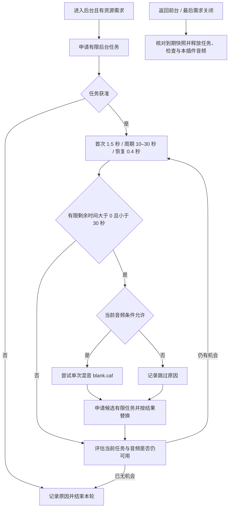

# 后台运行逻辑梳理与审查（2.6-5）

日期：2026-11-16。源码与构建位置：`WeChatImprove` 当前 checkout。用户设备的既有注入环境为 **Rootless**；本轮提供 Rootless 主安装包及 Rootful / 重签附件。产物、构建命令与核验见 [2.6-5 发布记录](../../../packages/2.6-5-background-recovery/README.md)。

## 行为目标与实际边界

插件主动让出的音频条件是微信进程自身接管音频会话；返回前台或关闭最后一个后台需求时清理全部保活资源。其他 App 播放音乐、播客、视频，以及电话、Siri 引起的系统中断，都不再建立长期播放阻断。

系统中断已经发生时，iOS 会停用当前音频会话。插件释放失效播放器，保留仍有效的有限后台任务与原周期检查，在实际获得执行机会时继续尝试混音播放。系统拒绝激活、有限任务到期、音频服务不可用、系统挂起或结束进程，仍可能使本轮停止；此实现不能保证连续运行，也不能自行唤醒已挂起或退出的微信。

“微信自身音频”在代码中的依据是 **微信进程内、非本插件发起的公开 AVAudioSession 调用与配置**，并非对可听见样本的检测，也无法精确识别业务页面。通常覆盖语音播放、录音、视频及音视频通话；同进程的其他注入代码使用音频会话也会被视作宿主占用。其他 App 的播放不会直接进入这些进程内调用观察。

## 代码职责

| 位置 | 职责 |
| --- | --- |
| [CSBackgroundRunManager.m](../../../Controllers/CSBackgroundRunManager.m) | 唯一的后台周期管理器；处理需求、应用/Scene 生命周期、检查调度、恢复、任务替换、状态和记录 |
| [CSBackgroundRunAudio.m](../../../Controllers/CSBackgroundRunAudio.m) | 借用音频会话，播放单次 `blank.caf`，跟踪所有权并按条件恢复原配置 |
| [CSBackgroundRunRuntime.m](../../../Controllers/CSBackgroundRunRuntime.m) | 封装 UIKit 有限后台任务、真实到期快照与单次 NSTimer，保证句柄和检查清理 |
| [BackgroundRun.xm](../../../Hooks/BackgroundRun.xm) | 观察原生 AVAudioSession 配置/激活调用，保留原参数、BOOL、NSError 和异常行为；备份初始化完成后启动管理器 |
| [CSBackgroundRunViewController.m](../../../Controllers/CSBackgroundRunViewController.m) | 开关、检查间隔、当前状态、后台能力声明、上轮摘要与可复制时间线 |

管理器和播放器由主线程管理。非主线程通知先转到主线程；音频 Hook 仅以原子变量和短时锁更新跟踪状态，并合并投递主线程通知。后台任务本身的结束/到期竞争使用同步保护。

## 需求与入口

`resourcesRequested = enabled || groupChatRequested`。不同消费者共用一份有限任务和一套检查，消费者之间切换不会重启周期。实际群聊管理器还按全局后台开关、有效群配置、当前账号和授权决定是否提出请求。

应用或 Scene 进入后台后，还会核对是否仍有前台 Scene；若仍有前台 Scene，则不启动后台保活。返回前台通知会停止本轮。管理器在已经处于后台时才加载，会记录“开始观察”，不会把加载时刻冒充真实进入后台时刻。

开关在后台从关闭改为开启，可以重新申请本轮资源；修改检查间隔只重新安排周期检查，不生成额外后台任务或循环播放器。

## 正常检查时序

1. 进入后台且存在需求，先申请一个 UIKit 有限后台任务。申请失败则结束本轮。
2. 同时安排进入后约 **1.5 秒**的首次检查，以及默认 **25 秒**的周期检查。周期可设为 10–30 秒的整数；默认时间点是进入后 25、50、75 秒，独立于首次检查。
3. 实际检查时读取 `backgroundTimeRemaining`。只有数值有限且 **大于 0、小于 30 秒**，才进入短音频尝试和任务替换。
4. 若微信自身占用音频、音频服务丢失、微信包未声明后台音频，或 0.4 秒恢复窗口尚未结束，则跳过本次音频；同一检查仍可尝试替换有限任务。
5. 可播放时，使用微信主包的 `blank.caf`，配置为 `Playback + Default mode + MixWithOthers`，播放器音量为 0，单次播放。资源缺失直接失败，不生成替代音频。
6. 播放自然结束后释放播放器，保留本插件仍拥有的会话配置，等待下一次检查；不会立即重播，也不设置无限循环。
7. 替换有限任务时，先申请候选句柄。只有候选有效才替换旧句柄；申请失败继续保留仍有效的旧任务。申请获准不表示系统已经增加剩余时间。

剩余时间为 0、负数、无穷大或系统使用的无限值，均不满足短音频触发条件。主线程被挂起时，定时器不能继续执行；时间点是有执行机会时的调度目标。



## 各类音频事件如何处理

| 场景 | 当前播放器 | 有限后台任务与检查 | 恢复方式 |
| --- | --- | --- | --- |
| 其他 App 播放音乐、播客、视频 | 继续按正常检查尝试混音 | 沿用原周期 | 不因外部静音提示新增检查或重播 |
| 微信自身接管音频 | 主动放弃本插件播放器和会话租约，避免停用/恢复宿主会话 | 有效任务和周期检查继续 | 观察到宿主释放且再次确认不忙后，等待完整 0.4 秒 |
| 电话、Siri 等 Interruption Began | 系统已经停用会话；暂停并释放失效播放器，清除本次播放记录标记 | 保留有效任务和原周期；不设置 `interrupted` 长期门禁 | 后续周期仍尝试；激活失败记录错误并等待后续机会 |
| Interruption Ended | 不要求此前观察到 Began | 原周期继续 | 无论有没有 `ShouldResume`，都安排 0.4 秒恢复检查；该标记仅影响日志 |
| 没有收到 Ended | 不保留中断锁存位 | 原周期仍有执行机会就继续 | 后续周期可重试；前后台切换不会继承旧中断阻断 |
| 音频路由变化 | 不立即循环重播 | 原周期继续 | 当前周期活跃且条件允许时延迟 0.4 秒检查；路由变化本身不重开已结束周期 |
| MediaServicesWereLost | 释放失效音频对象，建立媒体失效代次并清旧占用 | 保留可用任务和周期；暂时跳过音频 | 等待媒体服务重置 |
| MediaServicesWereReset | 清本插件租约，保留 Lost 后微信新激活的占用 | 可在新执行回调中重开已结束周期 | 0.4 秒后检查；若只收到 Reset，保守保留已观察到的微信激活，等待其释放 |
| 返回前台 / 最后后台需求关闭 | 停止本插件播放器；仅仍拥有配置时恢复原配置 | 结束任务、取消首次/周期/恢复检查 | 下一次后台入口或新需求再创建周期 |

收到宿主释放、系统中断通知或媒体服务重置等新的恢复机会时，可以在仍处后台且仍有需求的前提下，重新申请已结束周期。旧“停止”事件保留在时间线中，新增“恢复机会”；这不代表此前一直在后台运行。

## 会话所有权和微信优先

音频 Hook 使用本插件调用深度、原生调用深度、原生在途调用数、成功变更代次和已观察到的宿主激活状态进行判断。嵌套调用只跟踪最外层，避免重复计数。

- 本插件自己的配置操作不会被当作微信接管。
- 原生调用执行期间阻止借用；成功配置或激活才推进宿主变更代次。在途调用导致暂时让出时，仅停止播放器并暂存仍未被成功变更撤销的原始配置快照；最终失败后可沿用原租约，成功后按新代次放弃。
- 原生 `setActive:NO` 后继续恢复 category / mode，仍可被识别为释放，不再要求某个“释放代次”恰好等于最终配置代次。
- iOS 8–25 的停用调用可能已经停用会话，却返回 NO 与 `AVAudioSessionErrorCodeIsBusy`。观察到这个特定 NSError 时按真实释放处理；原生返回值和错误原样交还调用方。其他失败保持保守判断。
- 媒体服务 Lost 先建立失效代次并清旧激活状态；失效前发起、之后才完成的原生调用不会把旧状态写回来，在途调用数仍按原作用域结算。Reset 保留 Lost 后成功的新激活，也保留新代次仍在进行的调用结果，避免通知先后顺序把微信刚恢复的音频误清掉。
- 停止时只有当前配置、代次与在途调用检查都证明本插件仍拥有会话，才停用并恢复之前的 category、mode、options 和路由策略。宿主已接管时只释放本插件对象。
- 插件晚加载而无法知道宿主是否已激活时，仅默认 Ambient / SoloAmbient 且 Default mode 可作为保守借用入口。

跟踪锁只保护短暂的状态更新，**不跨 AVFoundation 调用持有**。公开音频 API 可能阻塞或回调到其他线程，跨调用加全局锁会引入死锁风险。

## 到期、停止和旧回调隔离

后台任务句柄在真实系统到期时同步失效，记录到期墙上时间和单调 uptime，再异步通知管理器。普通取消或申请失败不会生成系统到期快照。句柄结束幂等，避免重复 `endBackgroundTask`。

管理器用周期代次、检查代次、恢复代次、任务对象身份和观察编号隔离旧回调。周期结束、返回前台或关闭后，旧定时器与旧任务回调不能重新创建资源或污染下一轮记录。

到期时若仍有本插件实际播放且仍拥有的音频，则在可用条件内继续；没有任务和活动音频时，结束本轮。不能通过收到到期通知就无限重新申请任务。

真实任务已失效、到期回调还未送达时，普通评估会读取快照；返回前台或关闭最后需求也会先读取这个真实快照，摘除已失效的句柄，保留已经发生的系统到期。后续排队回调因任务身份已清空而不再重复记录。有效任务仍交给原资源清理流程，避免状态观察者同步关闭又开启需求时提前丢掉有效任务。停止时读取快照不会触发额外音频或任务申请。

## 状态、记录与其他功能

`canAttemptBackgroundWork` 要求全局后台开关打开、确实在后台、周期活跃，并且当前仍有活动音频或有效任务与正剩余预算。它表示当前可尝试的执行机会，不能证明持续运行或业务动作成功。

AI 的后台兜底继续检查这项能力以及自身配置、账号、授权和原生同步忙碌状态；群聊按自己的有效配置和执行机会处理。拍动可选约 10 秒补拉与 AI 可选约 45 秒补拉有各自调度，不是保活播放器的检查周期，本次未更改这些间隔或功能门禁。

记录保留最近一次后台观察，在当前进程中有效，不写磁盘。摘要分别保存首次检查、最近周期检查、周期次数、最近真实系统到期、停止和返回前台。最后评估可由系统到期触发，不等于新增周期检查。

事件按有效单调经过时间稳定排序，同值保持原顺序，不按可被系统校正的墙上日期排序。最多保留 80 条：首次进入/观察事件加最近 79 条，并显示省略数量；摘要不受事件截断影响。延迟到期回调不会把“最后评估”冒充到期时间。

## 本次修复清单

| 原有问题 | 修正 |
| --- | --- |
| 缺少 `ShouldResume` 会永久阻断后续尝试 | 删除 `resumeBlocked`；结束通知始终允许安排恢复检查 |
| 没收到 Ended 时 `interrupted` 长期锁存 | 删除该阻断状态；Began 只处理已被系统停用的当前播放器 |
| 微信停用后又恢复 category / mode，释放代次不再匹配 | 按无原生在途调用、无已观察宿主激活及 `hostBusy` 复核判断释放 |
| 原生配置/激活失败也推进代次，或在途时被检查提前清快照 | 只在成功的原生变更结束时推进代次；在途暂存快照，失败后可恢复 |
| 媒体服务丢失后残留宿主 active，或错误清除微信已恢复的新激活 | Lost 建立失效代次，Reset 保留新代次的真实宿主状态与调用完成结果 |
| 特定 iOS 版本 `IsBusy` 返回导致已停用会话仍被认为占用 | 识别有明确 NSError 证据的已停用结果，保留原返回/错误语义 |
| 到期同步失效与异步回调之间被其他评估、前台或关闭抢先 | 句柄保存真实快照，评估和结束观察前消费；晚回调去重 |
| 真实到期快照晚读取，时间线经过时间倒退 | 按有效单调经过时间插入，保留事件上限和首事件 |

## 保留的限制与复核结论

1. **系统执行权**：Playback 混音请求可尝试与其他 App 通话并存，但较高优先级音频仍可拒绝激活；系统挂起、终止和有限后台预算不受插件控制。
2. **业务识别精度**：观察的是微信进程中的会话调用，不是实际播放采样。未观察到的特殊播放路径、其他注入代码或宿主没有发出释放调用，可能影响“忙碌”判断，需原注入环境真机验证。
3. **只收到 Reset**：没有先观察到 Lost 时，公开 API 无法区分旧激活与微信刚恢复的新激活；保守保留已观察到的宿主占用，等待其明确释放，优先避免覆盖微信自身音频。这种情形可能延迟恢复。
4. **跨线程窗口**：所有权检查与实际 AVAudioSession setter 之间仍有跨线程竞争窗口。现有代次、在途计数与调用后复核可降低误操作概率，不能把多个公开 API 合成为原子事务。本轮没有引入可能死锁的跨 API 全局锁。
5. **不可见错误**：原生调用若传入 `error=NULL`，无法可靠辨认“返回 NO 但实际上已经停用”的 IsBusy 特例，保持保守状态；不能把所有 NO 都当作释放。
6. **验证范围**：主机回归使用真实 Manager / Audio / Runtime 源码及受控原生替身；编译和产物核验不等于已经安装到手机。电话/Siri 期间的实际执行、微信音频恢复、锁屏、耗电和温升需用本版在原环境验收。

Apple 依据：[ShouldResume](https://developer.apple.com/documentation/avfaudio/avaudiosession/interruptionoptions/shouldresume)、[setActive](https://developer.apple.com/documentation/avfaudio/avaudiosession/setactive(_:options:))、[interruptionNotification](https://developer.apple.com/documentation/avfaudio/avaudiosession/interruptionnotification)。本机 iPhoneOS 27.2 SDK 的 `AVAudioSession.h` 还说明 Playback 在其他 App 通话时可申请激活，以及旧系统 IsBusy 的停用语义。

## 回归与构建

核心回归命令：

```bash
bash Tests/verify-background-run.sh
bash Tests/verify-background-run-runtime.sh --ios
```

核心回归合计 **881 项断言通过**：记录 398、混合生命周期 323、音频 103、原生运行时 57。原生 Runtime 额外通过 arm64 / arm64e 源码编译。

构建使用 Xcode 27.2 / iPhoneOS 27.2 SDK、最低 iOS 15.0、arm64 与 arm64e，Rootless / Rootful 在独立构建目录中全量编译打包成功，避免覆盖用户原有构建缓存与历史发布产物。包内架构、签名、符号和校验结果见 [2.6-5 发布记录](../../../packages/2.6-5-background-recovery/README.md)。
