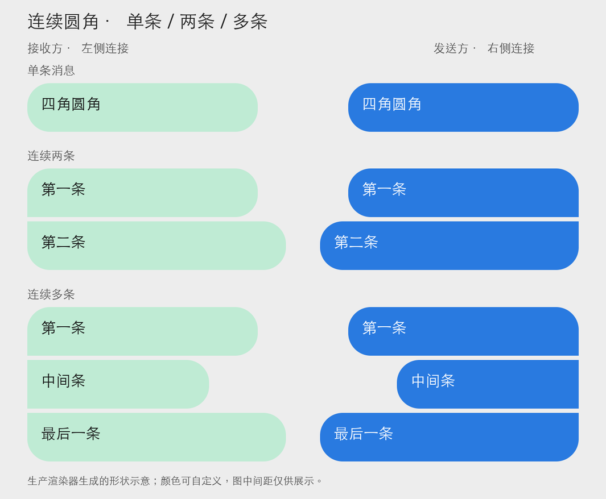

# 1.8-26 连续圆角气泡

按用户明确指定的四角规则，将 1.8-25 的“叠边”替换为“连续圆角”。设置名称、说明和单条/两条/三条预览同步更新。保留既有样式偏好值 `1`，原先选中叠边的用户升级后直接使用新样式，无需重新选择。

| 组内位置 | 发送方 | 接收方 |
| --- | --- | --- |
| 单条 | 四角圆角 | 四角圆角 |
| 首条 | 右下角直角，其余圆角 | 左下角直角，其余圆角 |
| 中间条 | 右上、右下直角，左侧圆角 | 左上、左下直角，右侧圆角 |
| 末条 | 右上角直角，其余圆角 | 左上角直角，其余圆角 |

两条消息分别使用首条、末条形态；三条及更多消息在两者之间使用中间条形态。关闭合并时使用单条形态。连接处为真正的直角，其余角沿用用户设置的圆角半径，短气泡继续使用已有的半径适配。

## 实现范围

- [渲染策略](../../../Controllers/CSBubbleStylePolicy.m) 使用四个独立圆角半径组成同一个路径，移除叠边底片、双竖线及其透明度图层；自定义颜色、透明度和按压高亮继续生效。
- 移除旧装饰专用的 6pt 固定边宽，使小圆角和较窄气泡使用正常的拉伸区域。
- 修正 3 倍比例下浮点舍入导致模板多出一行/列透明像素的问题，例如 `49.00000000000001` 应为 49 像素。实际内容与直角边缘因此保持在同一像素网格上。
- [设置页](../../../Controllers/CSBubbleStyleSettingsViewController.m) 和 [预览](../../../Controllers/CSBubbleStylePreview.m) 继续使用同一生产渲染器；预览随条数与合并开关变化。
- 保留原生长文本分段的既有接缝处理。语音/视频通话记录继续支持背景颜色，并保持独立圆角气泡。

合并策略、合并适配器、气泡适配器和 Hook 文件与本次任务开始前逐字节一致，已有的相邻气泡刷新、缓存复用以及 1.8-23 间距算法均未修改。初始文件保护结果见 [preservation.json](preservation.json)。

## 效果图

以下图片通过生产 CoreGraphics 渲染器生成，经过九宫格拉伸后组合示例文字，展示单条、两条、多条消息。图中颜色可自定义；示例文字和展示间距不代表微信实际文字配色及聊天行间距。它不是微信真机截图。

生成程序为 [render-preview.m](render-preview.m) 与 [compose-preview.py](compose-preview.py)。渲染产生的单张气泡图位于本次临时构建目录，路径见 [build-paths.json](build-paths.json)。

## 聚焦核心的验证

| 验证 | 结果 |
| --- | --- |
| 气泡策略、渲染与图片所有权 | 36,947 项检查通过 |
| 气泡真实适配器生命周期 | 476 项检查通过 |
| 合并策略/导航 | 145,544 项检查通过 |
| 合并适配器/导航生命周期 | 6,515 项检查通过，UIKit 测试替身 |
| Rootless 正式构建 | arm64 / arm64e 通过，最低编译目标 iOS 15.0 |
| 包体和调试符号 | 构建/暂存/包内 dylib 一致，双架构 UUID 匹配 |

气泡像素回归直接按需求枚举四角规则，覆盖半径 1/2/4/16/30、1–3 倍比例、收发方向、四种分组状态、自定义不透明/半透明底色及高亮。检查拉伸后的四角、完整气泡内颜色一致性、无装饰残留、透明边距，以及小圆角像素网格。原生分段在不同分组状态和方向下仍与经典圆角的既有分段渲染一致。

运行命令为 `bash Tests/verify-bubble-style.sh` 和 `bash Tests/verify-message-merge.sh`，只回归本次涉及的核心模块。完整输出见 [气泡回归日志](bubble-style-tests.log) 和 [合并回归日志](message-merge-tests.log)。构建命令与结果见 [build-command.json](build-command.json)、[build-result.json](build-result.json)、[build.log](build.log)。

已检查生成的样式图；本次没有安装到设备，尚未完成微信真机交互和滚动验收。设置页的编译成功与离线像素回归不等同于真机验证。

## 安装包

- [Rootless 1.8-26 安装包](../../../packages/com.wechat.improve_1.8-26_iphoneos-arm64.deb)，815,212 bytes。
- [配套调试符号](../../../packages/WeChatImprove-1.8-26-dSYMs.zip)，3,452,511 bytes。

安装包 SHA-256：`f39262e732e6668b515f981e35f2ec01bc7ed0d3f39141139f3c4739246ba63e`。

符号包 SHA-256：`1f5ac8c0313a337fa2590713a1365a5182122c823fd0bb98a7efb9639f91e3c8`。

完整哈希、架构和 UUID 校验见 [verification.json](verification.json)。构建使用既有工作副本及独立临时输出目录，没有运行 `make clean`；全部旧安装包保留，本任务之外的已有更改未修改。没有读写数据库、重启服务或执行设备安装。
