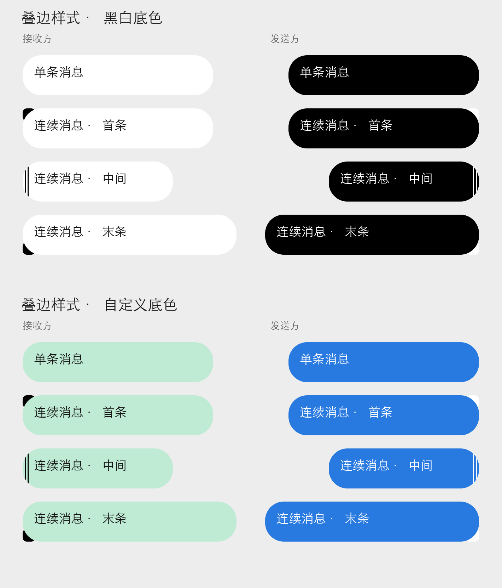

# 1.8-25 叠边气泡、通话背景与设置页

本次在已恢复的 **1.8-23** 代码上实现用户确认的方案：新增“叠边”样式，将外观连接到已有消息合并决策，扩展语音/视频通话记录的自定义背景，并重组设置页。沿用 1.8-23 的行高、紧密间距和头像布局算法；未重新引入已回退的 1.8-24 间距调整。

## 功能与行为

- 保留“经典圆角”，新增“叠边”。单条无装饰，连续消息首条显示头像侧上角叠边，中间条显示双竖线，末条显示头像侧下角叠边；发送方和接收方左右镜像。
- 沿用浅色/深色主题下收发双方的四组底色、透明度和圆角偏好。装饰根据底色选择黑色或白色；消息文字保持微信原生样式。
- 语音/视频通话记录支持自定义背景，保持独立气泡，不加入紧密合并分组。适配 `VoIPBubbleMessageViewModel` 和 `VoIPSignalMessageViewModel`；缺少文本分段信息时按单条处理，不仅凭消息数字类型推断支持。
- 合并组变化后同步刷新相邻可见气泡。即使原生行高查询已消费布局标记，首条、中间条、末条外观仍可更新。
- 设置页按“气泡外观 → 气泡颜色 → 连续消息 → 恢复默认”组织。外观与合并开关独立，相关选项按开关展开；恢复默认颜色只影响四组颜色。
- 设置页顶部增加收发双方的单条、两条、三条预览，支持浅色/深色切换。预览主题不修改聊天主题；关闭合并时展示独立气泡并说明启用方式。

使用入口：进入“气泡样式”，开启“自定义气泡”，在“气泡样式”选项选择“叠边”；开启“连续消息合并”后，符合现有合并规则的消息显示首条/中间条/末条效果。“正常”和“紧密”两种组内间距均可使用叠边。

## 实现与稳定性

渲染策略新增独立的合并组位置，避免将一条长文本的原生分段位置误作多条消息的分组位置。分段长文本继续采用既有绘制方式；叠边只作用于完整原生气泡。

装饰绘制在原生气泡范围内，不修改内容位置、点击范围或行高。背景和装饰在同一个透明度层中绘制，避免半透明区域叠加变深。小圆角的双竖线预留至少 6pt 的固定横向区域，避免图片拉伸时变宽；目标宽度不足时恢复原生背景。

外观缓存键纳入分组位置，原生图片赋值的快速路径同时校验分组状态。重复且无变化的布局不会追加图片赋值或像素扫描。读取合并外观是只读操作，不触发行高测量、原生模型重置或渲染。

主要实现位置：

- [气泡渲染策略](../../../Controllers/CSBubbleStylePolicy.m)、[气泡适配与缓存](../../../Controllers/CSBubbleStyleAdapter.m)
- [合并决策与相邻刷新](../../../Controllers/CSMessageMergeAdapter.m)、[通话气泡 Hook](../../../Hooks/BubbleStyleHooks.xm)
- [设置页](../../../Controllers/CSBubbleStyleSettingsViewController.m)、[设置预览](../../../Controllers/CSBubbleStylePreview.m)

## 核心回归与构建

按用户要求聚焦气泡、合并及交付包，不重跑无关业务测试。

| 验证项 | 结果 |
| --- | --- |
| `bash Tests/verify-bubble-style.sh` | 27,664 项策略/渲染检查、475 项适配检查通过 |
| `bash Tests/verify-message-merge.sh` | 145,544 项策略/数学检查、6,515 项适配/导航生命周期检查通过 |
| `git diff --check` | 通过 |
| Rootless 正式构建 | `arm64` / `arm64e` 通过，最低编译目标 iOS 15.0 |
| 包体与符号验证 | 包内、暂存和构建产物的 dylib 哈希一致；双架构 dSYM UUID 匹配 |
| 原有文件保护 | 校验初始 353 个文件，只变更本任务预期的 14 个既有文件；旧安装包未改变 |

新增回归覆盖四种分组位置、收发方向、明暗底色、1–3 倍显示比例、自定义颜色与透明度、长文本分段、小圆角拉伸、过窄目标回退、通话缺少分段信息、分组变化后缓存失效、追加/删除首条/替换发送者后的相邻外观刷新，以及关闭合并后装饰清除。

与任务开始前的 1.8-23 快照逐函数比较，`CSPrepareModel`、`CSNativeProfile`、`CSMessageMergeMeasure`、`CSMessageMergeResetGeometry` 未改变；`CSMessageMergeRender` 仅增加外观刷新调用。合并策略文件未在本任务中修改。

测试计数与退出状态记录于 [test-results.json](test-results.json)，来自本次已完成的执行输出；未另存测试完整日志。构建命令、日志及包体验证分别见 [build-command.json](build-command.json)、[build.log](build.log)、[verification.json](verification.json)。原有文件和几何算法保护结果见 [preservation.json](preservation.json)。

## 样式预览与验证边界

下图由生产 CoreGraphics 渲染器生成，并执行与气泡对应的九宫格拉伸后组合示例文字，用于核对形状、镜像与颜色。它是生成的样式示意图，不是微信实机截图，也不代表实际聊天行间距。示例文字使用便于阅读的颜色，聊天文字仍由微信原生控制。

当前机器没有可用的 iOS Simulator runtime。设置页和通话 Hook 已通过双架构 iOS 编译，但未进行交互式 UIKit 或微信真机验收，也未安装到设备。真机验收重点是通话记录背景与点击、设置页切换、连续消息追加/删除后的首末形态，以及滑动历史消息时的外观稳定性。本次通过代码比较确认没有调整 1.8-23 的间距算法，不将离线回归等同于实机滚动验证。

## 交付产物

| 产物 | 大小 | SHA-256 |
| --- | --- | --- |
| [Rootless 1.8-25 安装包](../../../packages/com.wechat.improve_1.8-25_iphoneos-arm64.deb) | 817,394 bytes | `22b2e1cb63ae110ec9fd54770fde277fafb0f1a65616dcc0dd2586b84c1b7388` |
| [配套调试符号](../../../packages/WeChatImprove-1.8-25-dSYMs.zip) | 3,455,027 bytes | `3fd1002335f43786d0e667d99352e12733c8dd255b66e05f6f21c7c04460c56a` |

dylib SHA-256：`4588aac295323c059a40b31adb2377e5bde1003ba4d5a09e795f00c6baa0a1a4`。

- arm64 UUID：`27D14E76-69F0-32E8-95C7-511A64E2F92C`
- arm64e UUID：`64C463AE-AD13-3585-8129-453624DA4D05`

构建来自既有工作目录 `/Users/zhangshichao/Documents/Workspace/WeChatImprove`，使用单独的临时构建输出目录，没有运行 `make clean`，没有切换工作副本、读写数据库、重启服务或执行设备安装。保留任务开始前的其他未提交更改及全部旧安装包。Rootful 本轮未验证。
