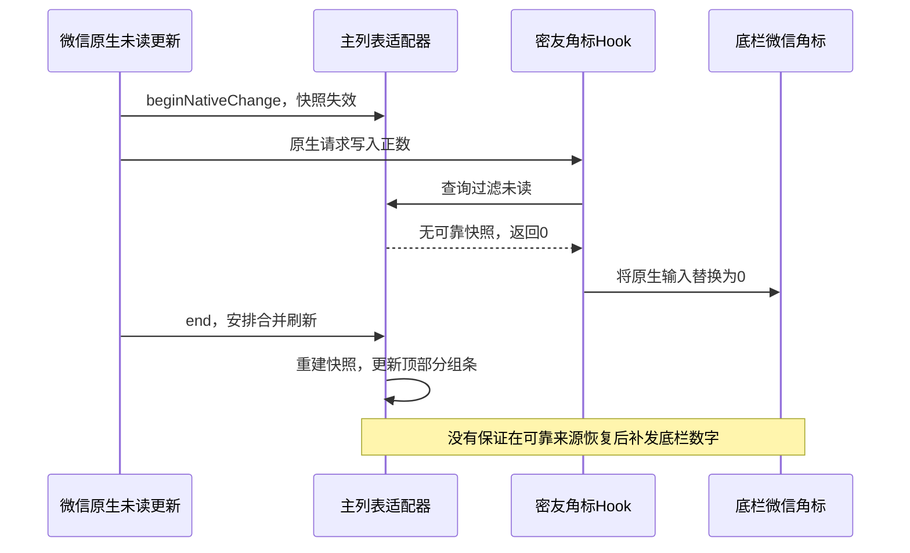

当前版本设置密友／密群后的微信底栏数字角标排查，2026-10-29。

本轮结论：当前源码存在一条与反馈高度吻合的缺陷链。密友保护需要过滤未读时，底栏计数依赖主会话列表的派生快照；设置页面覆盖主列表、普通消息事务及离屏状态会使快照不可用；getter 用 `@0` 表达不可用，底栏 Hook 据此把原生正数覆盖为零；可靠快照重建后，没有保证向底栏重新发布计数。隐私兜底的临时零值与角标恢复未衔接，造成普通未读也消失或停在旧状态。

这是源码和隔离执行确认的可达机制。尚未取得用户手机上的原生输入、getter 分支及发布日志，不能将某个具体分支称为现场已抓到的唯一根因。

本轮按“分析排查”执行，没有修改生产源码或正式 Tests，没有回退、安装、打包、重启或迁移。工作区为 `/Users/zhangshichao/Documents/Workspace/WeChatImprove`，实际源码版本声明为 `2.1-6`；README 的 `2.1-5` 已过期。开始时核对授权清理交付后的 602 项清单，全部 SHA256 一致。手机实际加载的 dylib／包版本本轮未读取。本项目为 iOS 注入插件，本轮不启动 Web 前后端、不使用服务 URL 或端口，也不读取或更换微信数据库。

**触发入口与直接覆盖点。**

`Controllers/CSCloseFriendPolicy.m:54` 将 friends 和 groups 合并成 `protectedUserNames`。`Controllers/CSGroupListAdapter.m:183` 的 `closeFriendAlertBadgeCount` 判断是否需要过滤：会话隐藏生效，或者 `enabled && silenceMessages`。在非 blocked 情况下，无需过滤或总名单为空时返回 nil，后续原生计数透传；名单非空且需要过滤时，开始接管公开数字。默认 hideSessions 和 silenceMessages 都开启，但不能把默认值当作设备当前配置。临时解锁会话不取消 silenceMessages，因此解锁也可能继续接管。

`Hooks/CloseFriendNotificationHooks.xm:27` 的 `ChatTab` 只接管实际 root 为 NewMainFrameViewController 的项，导航 controller 解包首项。它不硬编码 index 0，也不取决于当前选中的 tab。`:105` 将非 nil 过滤结果替换原生数字，`:108` 将过滤零转换为 nil 字符串，`:111` 在过滤零时抑制 show-dot。`:113` 的策略通知观察者还会主动向已登记的微信 tab 写入过滤数字，零值时移除红点。因此保存第一项后可以立即发生覆盖，不必等待下一条消息。

`Controllers/CSGroupListAdapter.m:188` 对需要过滤时的非主线程、blocked 返回零；`:191` 拒绝无缓存、changeDepth 非零、dirty、版本／epoch／账号不匹配等来源；`:205` 对无效投影或计算期间失效返回零；`:209` 在没有任何合格主 adapter 时返回零。`@0` 是非 nil 对象，Hook 会用它替换原生数字。这里改变的是输出参数，没有沿该链清除微信真实会话未读。

| 状态 | getter | 原生输入为 7 时，数字 setter 的最终参数 |
| --- | --- | ---: |
| 非 blocked、无保护对象 | nil | 7 |
| 需要过滤、来源有效、普通未读 7 | 7 | 7 |
| 需要过滤、来源暂不可用 | 0 | 0 |
| 来源有效、只有受保护对象有数字未读 | 0 | 0，属于正常过滤 |

**消息为什么会令角标消失，以及为什么之后不更新。**

`Hooks/SessionGroupHooks.xm:200` 将 `onSessionTotalUnreadCountChange:` 包进 `NativeNotification`（`:46`），有已附着 adapter/table 时依次调用 begin、原实现、end。`Controllers/CSGroupListAdapter.m:762` 的 begin 先失效 modelRevision，再增加 changeDepth。因此原实现执行期间，该 adapter 无法提供 getter 所需的有效快照。

仓库已有微信 8.0.78 原生静态材料，记录原始未读回调同步通知 delegate `updateUnReadCount`，再同步调用底栏数字 setter；原生零值／空串会隐藏 badge。材料和证据边界见 [历史原生分析](../tabbar-wechat-badge-2.1-6-2026-10-29/native/README.md)。本轮没有把这些材料冒充手机运行日志。

`Controllers/CSGroupListAdapter.m:774` 的 end 会请求刷新；`:584` 到 `:589` 更新的是 `self.chrome` 顶部分组条。refresh 完成处未见明确的底栏重发保证。目前显式底栏重发在密友策略通知观察者，普通消息不会因此自动变成策略变更。后续原生动作仍可能再次调用 setter，因此结论是“恢复没有保证”，不是“微信永远不再写角标”。

另有两个放大条件：

- 离开主列表时，`Hooks/SessionGroupHooks.xm:73` 置 presentationSuspended；`Controllers/CSGroupListAdapter.m:163` 清掉 cachedNativeSections，普通离屏刷新又在 `:492`、`:711` 早退。底栏的全局数字依赖页面可见性相关缓存，设置页、聊天页或其它 tab 到消息时可能持续无可靠来源。
- `CSGroupPrivacyActive`（`:17`）只考虑会话隐藏，不包含消息静音；getter 却同时考虑 silenceMessages。当会话隐藏未生效（如临时解锁），分组关闭或进入相应搜索分支时，refresh 的 `:532` 分支清空缓存，但静音角标过滤仍需要这份缓存。此时来源可能持续缺失，仅在刷新末尾补写一次也不够。

**本轮重新执行的隔离验证。**

为保留历史审计，复制已有矩阵探针到本目录 `recheck/probe/`，重新从当前生产文件提取 getter、ChatTab 和三个内容 Hook，编译真实 policy/projection。8 个输入文件均匹配 2.1-6 交付 SHA。编译使用 `-Wall -Wextra -Werror`；本轮运行 60 个矩阵组合、12 个受控生命周期、4 个 controller 构造场景，共 2,507 项检查、268 条事件，0 失败。

| 保护名单 | 所选对象未读 | 普通数字未读 | 快照状态 | 原生数字输入 | 过滤后传入原实现 |
| --- | ---: | ---: | --- | ---: | ---: |
| 空 | 0 | 7 | 有效或失效 | 7 | 7 |
| 一位密友 | 0 | 7 | 有效 | 7 | 7 |
| 一位密友 | 0 | 7 | 无缓存／dirty／事务中／版本失配 | 7 | 0 |
| 一个密群 | 0 | 7 | 有效 | 7 | 7 |
| 一个密群 | 0 | 7 | 无缓存／dirty／事务中／版本失配 | 7 | 0 |
| 密友或密群 | 5 | 7 | 有效 | 12 | 7 |
| 密友或密群 | 5 | 7 | 无缓存／dirty／事务中／版本失配 | 12 | 0 |

“所选对象无未读”不等于“其它会话无未读”。第三、第五行直接说明这不是扣除密友贡献后的合法零。

受控生命周期还验证：有效 getter=7 并写入 → 事务中写0 → dirty时写0 → 来源恢复、getter=7，但没有执行setter时角标仍维持0 → 再执行setter才恢复7。该生命周期手工设置 adapter 状态，不执行真实 adapter begin/end/refresh，不能用它证明设备运行时间或真实后续 setter 缺失。

本轮运行未加载 UIKit、微信、底栏样式或真实消息调度。账号、会话输入、adapter 状态、controller 和原生 setter 效果为明确标注的 host 替身；实际编译执行的策略、投影和提取 Hook 来自当前源码。检查通过说明旧行为可重现，不代表问题已修复，也不代表真机四象限已验证。

可复核文件：[结果](recheck/probe/results.json)、[源码清单](recheck/probe/source-manifest.json)、[关键数值用例](recheck/probe/required-cases.json)、[精简生命周期](recheck/compact-evidence.json)、[原始事件](recheck/probe/events.jsonl)。重新运行命令为 `python3 docs/audits/closefriend-badge-current-2026-10-29/recheck/probe/run-selection-content-probe.py`，仅覆盖本目录隔离产物。

**设计意图与修复边界。**

`Controllers/CSGroupListAdapter.h:18` 明确说明零代表隐私接管但没有当前可靠来源。`Tests/CloseFriendAlertTests.m:195` 验证有效来源应保留普通未读；`:207` 和 `:208` 又明确要求过期来源返回零。历史意图核对见 [design-history.md](../tabbar-wechat-badge-2.1-6-2026-10-29/selection-followup/design-history.md)。因此零值兜底有意存在，缺陷在于它与正常消息事务、页面缓存生命周期及恢复发布的集成。

后续修复应同时处理三个点：区分“不介入、暂不可得、可靠结果”；使底栏所需的可靠过滤来源在静音生效、分组关闭及主列表离屏时仍有正确维护路径；在同账号／epoch 的可靠来源重建后按事件重发底栏。正常过滤零、blocked 与切换账号时的隐私边界需要保留。不能简单将所有 `@0` 改 nil，也不能强制 badge.hidden=NO；前者会透出受保护未读总数，后者无法恢复正确数字。

底栏样式 Hook 主要包裹 layout，适配器移动原生 badge 的 frame，不改 controller 根结构或数字计数。本次内容覆盖链没有样式开关条件；它足以在不改变几何的情况下造成问题。此前独立几何问题仍需以最终数字非零、hidden=NO 时的真实 frame／裁剪链单独判定，不能凭当前材料排除所有样式问题。

现场最终闭环只需一次最小取证：保持非空名单，选择已读的密友或密群，让一个普通会话保留数字未读；记录新普通消息到达前后原生输入、getter及快照状态、最终 setter 输入、可靠刷新后是否重发。若观察到正数→过滤零→写零，且来源恢复后没有重发，即可将该机制确认到现场。底栏样式开／关各一次可区分是否另有几何影响。既有 [只读采样说明](../tabbar-wechat-badge-2.1-6-2026-10-29/selection-followup/runtime-capture.md) 与脚本可复用，本轮没有运行设备采样。冷启动曾可见不要求 ChatTab 一定失败，也可能是当时快照有效；具体原因须按日志判断。

结束时的源码、正式 Tests、现有构建／历史包保存情况见 [preservation-after.json](preservation-after.json)。本轮新增内容全部位于本审计目录，生产逻辑保持原样。
