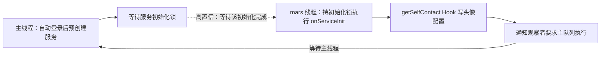

**微信冷启动／持续使用发热、长时间后台后卡首屏：分析报告（2026-10-18）**

> 本文记录优化前的审计证据，源码快照由 manifest.json 固定。后续 1.8-8 的修复、测试、安装包和待执行真机验收见 [实施记录](/Users/zhangshichao/Documents/Workspace/WeChatImprove/docs/audits/performance-resume-2026-10-18/implementation.md)。
结论：后台恢复卡首屏已经定位到一条有生产日志和匹配二进制支持的高置信线程互等链；CPU／温升则存在数条可以确认的额外工作和通知放大路径，目前没有真机 CPU 时间采样，不能把某个模块量化为截图中 57.62% 的来源。这两个问题可能共享配置通知这个放大因素，但不能直接视为同一故障。

本次覆盖 34 个 Hook 文件、88 个 controller/adapter 实现的功能入口、启动和前后台路径，并重点追踪高频、持续及跨线程操作。对生产程序只做静态读取；新增本报告、证据和两个有界主机诊断脚本，没有改动生产源码、重新打包、安装、切换服务或访问手机账号／数据库。源码和安装包身份记录在 [manifest.json](manifest.json)。

**环境和证据边界**

| 项目 | 已核实内容 |
| --- | --- |
| 项目目录 | `/Users/zhangshichao/Documents/Workspace/WeChatImprove`；分析时 HEAD `8ec39548`，已有构建产物改动保留 |
| 手机／微信 | iPhone15,3（iPhone 14 Pro Max），iOS 27.0.1 / 24A446，微信 8.0.78 / 8.0.78.34 |
| 用户已确认 | 聊天分组、触摸轨迹、底栏持续动画开启；首次打开指彻底结束微信后重新启动 |
| 尚未确认 | 后台保活开关、拖尾密度／自定义图片、底栏动画具体模式、消息与会话规模、其余功能开关 |
| 日志 | `/Users/zhangshichao/Downloads/WeChat-2026-10-18-070030.ips` |
| 日志插件 UUID | `B7CCDE0F-4271-3684-9800-2E08F10DA33C`，架构 arm64e |
| 匹配安装包 | `packages/com.wechat.improve_1.8-7_iphoneos-arm64.deb` 中的 arm64e；逐一核对包内二进制 UUID |
| 不匹配的后续包 | `1.8-7-b1` 及当前构建目录的 arm64e UUID 为 `2FA741FB-73FD-3B97-AE3C-9461F8F271D6`；不能拿它的地址直接解释这份日志，也没有证据称 b1 已修复问题 |
| 匹配微信本体 | `/tmp/wechat-8.0.78-inset-analysis/WeChat`，UUID `9CD58B8E-B7AB-3487-ADBD-2AC0AA16A5DE` 与日志一致；仅静态读取 |

截图显示 CPU 20.70% 和 57.62%，以及发热程度从“发热”到“较严重”。截图没有标明这是微信进程 CPU，因此它能说明设备负载与热状态，不能直接证明某个插件函数占了这些比例。热状态还受 GPU、屏幕、网络、充电和此前累积负载影响。

日志发生在 03:30:46 启动、07:00:27 捕获的进程中，二者相隔约 3 小时 29 分 40 秒；这不是已经测得的后台驻留时长。系统记录的是 `FRONTBOARD / 0x8BADF00D / process-exit`：退出未能在 5 秒内完成，最终 `SIGKILL`。它不是已证实的内存越界，也不是一份 CPU 过热终止记录。watchdog 观察窗口内微信自身 CPU 只有 `0.054s / 0%`，`71%` 属于 `Elapsed total CPU time`，当时 `Thermal State: nominal`。这些字段不否认此前截图的发热，只说明卡住时主要表现为等待。

**1. 后台恢复卡首屏：服务初始化与主队列通知相互等待（最高优先级）**

生产线程 0 的调用链已经用匹配微信本体的 Objective-C 元数据和 LC_FUNCTION_STARTS 边界定位：

```text
自动登录返回／结束登录逻辑
→ WCAccountControlMgr onWCAccountAutoLoginControlLogicStop:
→ MMExtensionCenter / LazyExtensionAgent 初始化监听器
→ MMServiceCenter precreateServices:
→ MMServiceCenter getService:
→ NSRecursiveLock lock
→ __psynch_mutexwait
```

线程 27（mars::stn）同时处在：

```text
MMContext getService:
→ MMServiceCenter getService:
→ WCFinderDataService onServiceInit / dataServiceInit / resetFinder
→ FinderDataService configService:dbPath:prefetchDbDir:
→ CommonAffDataUtilsObjcStatic getWxUsername:
→ 插件 CContactMgr getSelfContact Hook
→ NSUserDefaults setObject:forKey: 保存本人头像 URL
→ NSNotificationCenter postNotificationName:object:userInfo:
→ NSOperation waitUntilFinished
```

插件加载地址为 `0x133770000`，日志帧偏移 `0x3b860`，运行时地址 `0x1337ab860`。匹配包的 `0x3b688` 注册函数明确把 `CContactMgr / getSelfContact` Hook 到 `0x3b7c8`；该函数在 `0x3b85c` 调用 `setObject:forKey:`，返回地址正是 `0x3b860`。键为 `com.wechat.tweak.user.avatar.url`。当前源码对应 [UserInfoHooks.xm:72](/Users/zhangshichao/Documents/Workspace/WeChatImprove/Hooks/UserInfoHooks.xm:72)。因此这次确实有本项目代码参与等待，不是仅看到“加载了插件”就推测。

微信本体 `MMServiceCenter getService:` 的静态汇编进一步显示：

- 主线程帧 `0x11759e10c` 紧接对服务初始化锁执行 `lock` 的调用 `0x11759e108`。
- 服务创建路径先在 `0x11759e4e0` 对服务初始化锁 `lock`，再在 `0x11759e5b4` 调用 `onServiceInit`；线程 27 正停在后者返回前，帧地址为 `0x11759e5b8`。
- 该初始化锁的 `unlock` 在 `0x11759e610`，位于初始化回调完成之后。服务中心自己的表锁在更早位置已释放，不能把这两把锁混为一谈。

因此最符合证据的解释是：后台消息线程初始化服务时持有初始化锁，头像写配置触发了需要主线程执行的通知观察者；主线程正在等服务初始化锁，不能处理这个观察者。页面因此卡住，申请退出也可能超时。



**证据等级：**线程等待、插件函数和服务初始化临界区均已确认；完整运行时锁对象地址和当时首先阻塞的 observer 没有记录，所以“两个线程争用同一个实例”的最后一步仍是高置信推断，不能声称完成了全内存锁所有者取证。`waitUntilFinished` 栈也不直接记录目标 operation 的队列身份；“在等主队列观察者”由当前源码中的 observer 配置和机制实验支持，属于强推断。日志没有覆盖用户所有卡首屏案例，不能证明每一次都由同一条链造成。

当前源码至少有三处无条件注册的全局 Defaults 主队列观察者：

| 观察者 | 位置 | 功能关闭后的情况 |
| --- | --- | --- |
| 聊天头像显示 | [AvatarHooks.xm:33](/Users/zhangshichao/Documents/Workspace/WeChatImprove/Hooks/AvatarHooks.xm:33) | `%ctor` 注册仍保留，`object:nil / mainQueue` |
| 消息时间 | [MessageTimeHooks.xm:376](/Users/zhangshichao/Documents/Workspace/WeChatImprove/Hooks/MessageTimeHooks.xm:376) | 开关关闭仍接收，且先扫描全 Defaults 再比较相关键 |
| 气泡样式 | [CSBubbleStyleAdapter.m:233](/Users/zhangshichao/Documents/Workspace/WeChatImprove/Controllers/CSBubbleStyleAdapter.m:233) | 开关关闭仍接收；内部有异步合并，但外层 observer 已需在 mainQueue 执行 |

`queue:NSOperationQueue.mainQueue` 并不表示通知发布者可以立刻返回。主机有界实验中，主线程刻意等待 200ms，后台 post 在这期间一直没返回；主线程开始处理 runloop 后 observer 和 post 才完成。实验只验证 Foundation 机制，手机实际等待则已经由生产栈 `waitUntilFinished` 支持。

修复应同时处理两端：`getSelfContact` 保持读操作语义，只提取不可变值，不在宿主锁范围内同步写配置；按账号和 URL 去重、合并后再异步持久化，去掉高频 `synchronize`。观察者改为在发布线程短暂接收、显式异步到主队列，并在入队前合并，不再通过 mainQueue observer 阻塞发布者。只关消息时间／气泡或只去掉 `synchronize` 均不充分：本次阻塞点在前面的 `setObject`。

**2. 冷启动 CPU 峰值：重复配置通知叠加首屏全量工作**

冷启动会进行登录、服务初始化、会话与未读恢复、首屏布局。插件又叠加以下工作。用户已开启分组，这条路径具有实际配置关联；触摸轨迹则主要在操作时增加成本，不应将它当成无触摸冷启动的唯一解释。

| 路径 | 当前确认的额外成本 | 场景、边界与优先级 |
| --- | --- | --- |
| 读取本人联系人 → 写 Defaults | `getSelfContact` 每次遇到非空头像 URL 都 `setObject+synchronize`，没有新旧值比较、没有功能开关；聊天页加载／出现也重复写对方头像 | 启动、消息处理及账号读取均会触发，是 CPU 与卡死共享的首要放大因素；不等于每次 API 调用都物理写磁盘 |
| 消息时间配置变化 | [MessageTimeHooks.xm:363](/Users/zhangshichao/Documents/Workspace/WeChatImprove/Hooks/MessageTimeHooks.xm:363) 每次全局 Defaults 通知先物化 `dictionaryRepresentation` 并扫描整个微信域，之后才比较消息时间键 | 无合并、关闭也接收；频繁原生设置或头像写入会触发无关扫描。应只读固定键、合并并做值比较 |
| 聊天分组 | [CSGroupListAdapter.m:383](/Users/zhangshichao/Documents/Workspace/WeChatImprove/Controllers/CSGroupListAdapter.m:383)、[CSGroupNativeBridge.m:157](/Users/zhangshichao/Documents/Workspace/WeChatImprove/Controllers/CSGroupNativeBridge.m:157) 在主线程读取所有会话，访问身份／联系人／未读／置顶并构建快照及投影 | 真正模型变更会令快照失效；40ms 合并不等于增量读取。会话多、批量补消息时更明显；结构不确定或业务行还会整表 reload/layout |
| 全局文字定制 | [WCCustomTextHooks.xm:208](/Users/zhangshichao/Documents/Workspace/WeChatImprove/Hooks/WCCustomTextHooks.xm:208) Hook 所有 `MMUILabel.setText/setAttributedText`，一般文本每次新建并执行两个正则，以判断是否“微信(数字)”／“通讯录(数字)” | 简化 UI 默认 YES，即使替换字典为空也先做这部分工作。首屏、滚动、未读刷新都可能反复付费；无事件静止时不自行循环 |
| 语音下载旁路 | [VoiceForwardHooks.xm:59](/Users/zhangshichao/Documents/Workspace/WeChatImprove/Hooks/VoiceForwardHooks.xm:59) 对每个数据分块都投递主线程；[CSMessageActionCoordinator.m:358](/Users/zhangshichao/Documents/Workspace/WeChatImprove/Controllers/CSMessageActionCoordinator.m:358) 先查账号再判断终帧 | 没开启语音转发或没有待处理操作也执行。账号查询会再次 `getSelfContact`，间接触发头像 Defaults 写入和全局通知；应在入口过滤不相关回调 |
| 转账旁路 | [ReceiveTransferHooks.xm:820](/Users/zhangshichao/Documents/Workspace/WeChatImprove/Hooks/ReceiveTransferHooks.xm:820) 两个收消息入口对所有 type=49 投递主线程，然后才判断自动收款开关 | type=49 包含多种 app 消息，不只是转账。批量同步时可能堆积无用主队列任务，应在入队前用安全配置快照和类型／内容过滤 |

分组已经有非活跃／离屏暂停、3 次恢复预算、2 秒交互等待上限、普通可见行局部刷新、投影缓存和分组栏记录判重。不能重复指认历史版本里的“后台永远全量重刷”或“无界 50ms 重试”。剩余重点是真实消息驱动的全量原生快照和首屏工作叠加。也不能直接把微信私有可变模型搬到任意后台队列读取；应先在受支持线程安全取快照，再对纯值计算做优化。

**3. 使用一段时间发热：确定的通知反馈问题，以及已开启的视觉效果**

**布局设置存在同名通知反馈环，应优先修复。** [LayoutHooks.xm:276](/Users/zhangshichao/Documents/Workspace/WeChatImprove/Hooks/LayoutHooks.xm:276) 的 `reloadSettings` 发送 `com.wechat.enhance.settings_changed`，同文件 287–294 又将它注册成这个通知的处理函数。修改字体／缩放／恢复默认、备份恢复都会发出这条通知。回调没有退出条件、去重或节流。

本次用全新通知名运行相同结构，单次外部 post 后在本机得到 100 次回调，2.899ms 达到人工上限；最大调用栈深度为 1，属于排队反馈而非同步栈递归。这证明该结构能持续制造通知。这个时间不是手机性能基准；也没有证据表明用户那次纯冷启动一定触发了布局设置通知。修复是接收后更新／失效化自己的缓存，不再重发输入通知。

**用户开启的触摸轨迹有明确的高频成本。** [TouchTrailHooks.xm:477](/Users/zhangshichao/Documents/Workspace/WeChatImprove/Hooks/TouchTrailHooks.xm:477) 在 `UIApplication.sendEvent` 中反复读取多组配置。若选了自定义图片，每次事件还做文件检查和 `imageWithContentsOfFile`，没有图片缓存。若开启拖尾，每个触点在最高密度下可按最短 0.01s 创建一个 UIView 和淡出动画；实际频率受触摸事件率限制，默认密度不是每秒 100 个。淡出完成只移出 window，数组在抬手前仍保留这些视图，所以长手势会积累已不可见对象。应缓存设置／图片，限制存活数量，回收完成的拖尾，合并触摸采样。

触摸模块还有两个需专项验证的生命周期风险：map 唯一初始化点是 Hook 系统类 `UIApplication +load`，若注册 hook 时它已经执行则无法可靠初始化与回收；“仅录屏显示”的系统监听器放在设置页，退出设置后可能未更新持久化显示状态。它们是代码设计缺口，未取得本次真机初始化时序，不能在本报告中宣称已证实永久泄漏。

**底栏持续动画会持续增加渲染能耗。** [CSTabBarNativeAdapter.m:258](/Users/zhangshichao/Documents/Workspace/WeChatImprove/Controllers/CSTabBarNativeAdapter.m:258) 使用无限呼吸／心跳；扩散模式还动画 `path/opacity/shadowRadius` 并使用 mask。它已有判重、几何缓存和 reduce-motion 支持，所以不应说每次 layout 都无限创建新动画，但用户开启后可见底栏本身就需要持续合成。它更直接对应 GPU／合成负担和热量，不能用截图证明它独占 CPU 57.62%。建议提供轻量效果，在失活／不可见时停动画，并按系统热状态降级；静态底栏应能保持相同外观。

**4. 其余功能逐项评估，避免遗漏和误归因**

| 功能 | 结论及当前限制 |
| --- | --- |
| 列表圆角 | 已有 path／mask 缓存、几何差异比较、重入保护、有限层级遍历。仍增加 cell 布局及 owner 查找；发现页出现时有额外异步 reload。Defaults 变化会使配置缓存失效。没有证据表明它在静止首屏无限刷新。 |
| 气泡样式 | 图像缓存 128 个／8MB、相同图片快速返回、每 binding 合并刷新；CPU 重复绘图已有限制。主要优先问题是全局 mainQueue Defaults observer。 |
| 消息时间实际排版 | formatter 按线程缓存，model 按时间／设置版本缓存，label 字体／颜色／测量有版本判重；不能说每帧新建 formatter。主要问题是设置变化的全域扫描及通知线程边界。 |
| 消息合并 | 只扫描可见行并合并发布，没有发现常驻轮询。但只以页面 viewDidDisappear 暂停，没有与分组同等的 App inactive 门禁；若后台仍获执行时间且聊天 window 仍挂着，可能继续做可见行更新。 |
| 消息手势／复读 | 手势 adapter 首次创建和重绑会读取账号，间接触发头像写配置；开关关闭仍有首次绑定成本。重复 layout 已仅更新几何，不是每帧完整账号解析。实际消息发送由用户动作触发。 |
| 语音转发实际媒体操作 | 读取／完整性检查在独立队列，60s／180s 超时是单次操作保护，不是常驻 timer。高频问题在所有原生语音下载回调的旁路处理。 |
| 防撤回／原文定位 | 事件驱动，有 512 项去重上限；定位 CADisplayLink 只短期等待显示稳定，有尝试次数／8 秒 deadline／离页取消。不是常驻逐帧任务；当前日志不支持将其作为主因。 |
| 顶栏头像／分隔符 | 新聊天页加载和出现均更新；多次 setter 立即重复排版，联系人分隔符图片有同步读取。头像请求异步且 URL 判重，不能说每次出现都重复下载；新 view 使用独立 session、图片处理回主队列仍有优化余地。 |
| 输入框样式 | `MMInputToolView.layoutSubviews` 每次重复应用占位文本、颜色解档、字体／段落／属性字符串，缺少值不变判重；是否形成额外布局反馈还需原生 setter 证据。 |
| 头像圆角／旋转 | 无限旋转限 tag=101 的“我”页头像，防重复添加；不是全部聊天头像同时旋转。若开启会增加可见时合成成本，不证明系统挂起后仍在运行。 |
| 聊天附件布局 | 网格 frame 计算反复读配置和排序数组，总开关关闭可早退；范围限附件面板，无持续计时器。ctor 的一次同步配置属于启动附加工作。 |
| 后台模糊 | 生命周期事件驱动；返回时窗口快照与约 0.22s 过渡有短时内存／合成峰值，已有反转和快照清理；没有保活或轮询，不支持当作数小时卡死主因。 |
| 后台运行／保活 | 用户未确认开启。源码会循环播放静音、10–60s timer、申请后台 task，扩大持续处理消息的机会；有前台清理。多条生命周期路径有未验证当前状态的延迟回调，快速切换存在过期后台操作重新启用风险；过期 handler 引用全局 task ID、关闭时未完整结束 task、停止音频未恢复 session，也值得重构。不能说 iOS 一定允许它后台持续几小时。 |
| 红包 | 关闭前仍做 type=49 URL 初筛；开启后待查询参数无 TTL／上限，请求无回包可能留存。执行并发限 5（串行 1），取服务重试最多 3 次，每次间隔 80ms，不能称无限重试。worker `dispatch_sync(main)` 是另一条等待边，但这份栈未落在此处。 |
| 自动收款 | 除入口无用投递外，开启后延时任务缺少账号代次／过期处理／transfer ID 去重及总量限制；长后台可能扩大恢复时任务批次。实际双入口是否对同笔转账重复触发尚待验证。 |
| 配置自动备份 | ctor 初始化 manager；DidBecomeActive 同步检查，到 24h 周期则在该通知线程复制 Preferences plist／插件文件并保存索引。可能增加特定启动／恢复的 IO 停顿，但不是每次都执行，也不备份全聊天数据库。 |
| 授权检查／插件设置 | 打开插件入口／设置页时每次清缓存、查联系人、写缓存，并有重复刷新；不在普通首屏循环运行。设置页倒计时和分组设置账号检查 timer 不能混为全 App 常驻。 |
| 界面净化／入口／朋友圈后缀／收藏验证／游戏表情 | 主要在页面出现或明确动作时运行，未找到可解释正常静止长时 CPU 的独立持续任务。不要因文件多就判定为主因。 |
| 版本／更新控制 | 返回值替换或跳过热更新方法，未找到自身循环；影响宿主行为的兼容性仍需对应启用项和原生运行日志，当前栈不足以归因。 |

**5. 建议修复顺序与可验收行为**

1. **先拆掉同步通知等待链。** 让 `getSelfContact` 的写缓存异步、去重且保留账号边界；对三个全局 Defaults observer 改为安全异步接收与合并。验收标准是：宿主后台持锁读取联系人时能立即返回，主线程忙／服务初始化／账号变化都不能产生跨线程同步等待。
2. **立即消除布局同名通知反馈。** 一个设置变更最多产生一次需要的刷新批次，不重新广播输入通知；用有界回归证明空闲时计数稳定。
3. **收紧配置和消息旁路入口。** 固定字段快照代替扫描整个微信 Defaults；账号读取优先用经验证的账号上下文，避免每个语音分块查询联系人；无待处理语音操作、非最终分块、不相关转账事件尽早返回。保留真正需要转发／收款的行为。
4. **按用户已开启功能优化能耗。** 触摸轨迹缓存和对象回收；底栏动画可见性／热状态降级；分组对消息批次只安全获取一次快照、减少同代次重复遍历。不能破坏分组坐标、未读、置顶、账号隔离和左滑删除。
5. **再处理次级主线程工作。** 正则预编译并先过滤前缀／目标 label；输入框与顶栏差异化更新；自动备份异步化并保证一致性；后台任务统一状态机、代次和取消；红包／转账待处理项加边界。

仅切关功能可以帮助做能耗对照，但不是同步通知问题的修复。特别是消息时间／气泡关闭后，观察者仍在；本报告不建议用清空聊天记录、重置账号、删除数据库来规避这些代码问题。

**真机验证需要把“忙”和“等”分别测量：**

| 场景 | 采集重点 | 对照方式 |
| --- | --- | --- |
| 强制结束后的冷启动 | 微信进程 CPU 时间、首帧／可交互时间、主线程 Time Profiler，分组扫描／Defaults 通知次数 | 同一设备／账号／聊天数据，每组冷却到相近热状态；固定亮度、网络、充电状态；至少 3 次，报告中位与最差 |
| 首屏静止 3–5 分钟 | CPU 是否回落、GPU／合成与热状态、是否仍有自发通知 | 底栏动画单独开关，触摸不操作，区分持续动画与消息输入 |
| 连续滚动／长手势 | 触摸图片读取、拖尾活跃／保留对象数、主线程和帧率 | 轨迹关闭／开启；自定义图片和拖尾密度单独控制 |
| 固定消息输入与语音下载 | main queue 工作数、getSelfContact／Defaults 写次数、分组快照次数 | 保持消息量相同，对比分组与旁路优化前后；不要用真实转账作为自动测试流量 |
| 后台 30 分钟／2–4 小时后恢复 | 恢复可交互时间、自动登录／服务初始化、线程等待与锁调用链 | 使用原有安装／账号；同时覆盖无消息、有补消息、弱网恢复、快速前后台切换；卡住时优先抓全线程栈 |
| 修复后的正确性 | 账号切换、头像更新、未读数、分组坐标、语音完成、取消、设置即时生效 | 设备真机验收，不能用主机 Foundation 探针代替 |

若开发环境支持 Instruments，可使用 Time Profiler、System Trace／线程等待分析、Allocations 和能耗／图形指标。仅看设备信息页百分比无法完成函数归因。诊断计数应聚合，避免逐事件写日志制造新的 IO 和 CPU。

日志还显示 MiYou、HBB9.1.9、wcplugins、广告屏蔽等多模块同时加载。现有证据已经直接落到本项目的写配置链，不能把责任简单推给其他插件；真机 A/B 如有需要应保持微信版本、数据和包来源一致，单独控制变量。

**本次已经完成的验证与尚未完成项**

- 已完成：日志结构化解析；包内 arm64e 和微信本体 UUID 匹配；出错插件函数及 Hook 注册反编译；微信两条关键调用链映射；服务初始化 lock／onServiceInit／unlock 静态边界核对；有界通知同步和 Darwin 反馈探针；当前功能实现交叉审阅。
- 未完成：手机 Time Profiler／GPU／温升归因、运行时锁实例地址验证、具体 observer 身份、各功能贡献百分比、修复后的真机验收。本次是分析，未声称问题已经修复。
- 保存证据：[crash-summary.json](crash-summary.json)、[wechat-symbolicated-frames.json](wechat-symbolicated-frames.json)、[plugin-crash-function.json](plugin-crash-function.json)、[plugin-hook-registration.json](plugin-hook-registration.json)、[MMServiceCenter-getService.asm](MMServiceCenter-getService.asm)、[native-lock-selectors.json](native-lock-selectors.json)、[notification-probe-result.txt](notification-probe-result.txt)。
- REA Evidence IDs：`ev_8a3f31615a62da0745a44816de4395ec5dc362a33d5eeaedd9cd53518b8d20bf`（匹配插件函数），`ev_c4b0315cb8765fe4aafe05a36a7884d346034464a03d1f9f4b65ac79763f0732`（Hook 注册）。反编译伪代码用于解释已发布二进制，不等同于原始源码。
- 原始 objdump 可能显示最近的无关导出符号 `_O266DecReleaseOutputPicture`；本次函数命名依据匹配的 Objective-C method IMP 和 LC_FUNCTION_STARTS，未把那个邻近符号当成实际调用函数。
