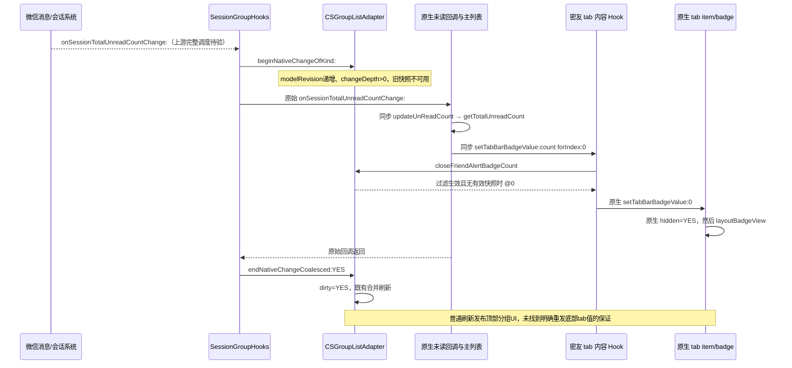

# 回退 2.1-6 与微信 tab 数字角标排查

日期：2026-10-29。工作区：`/Users/zhangshichao/Documents/Workspace/WeChatImprove`。目标微信：8.0.78。本轮先完成严格回退，再做只读分析和审计目录内隔离实验；没有实施角标修复，没有生成或安装新包。

## 1. 回退完成且哈希一致

**生产源码和正式 Tests 已恢复为授权清理交付后的 2.1-6：历史清单 602/602 文件 SHA256 一致，无新增或缺失的源码/测试路径。版本声明均为 2.1-6。** 与该交付内容比较的 `git diff --no-index --exit-code` 返回 0，差异文件为 0 字节。排查结束时再次核对，结果见第 8 节。

需要纠正一个历史文件名的歧义：`authorization-cleanup-2026-10-28/source-sha256-before.json` 与 `baseline/` 保存的是**清理前 2.1-5**，交付 2.1-6 的清单是 `source-sha256-after.json`。本轮没有把清理前的旧授权代码恢复回来。独立验证从 `baseline/ + cleanup.diff` 重建全部 10 个清理变更文件，重建 SHA 全部等于 after；该清单另与当时 365 个构建输入、2.1-7 开工时的 599 个非 Finder 元数据基线文件交叉吻合。原清单额外含 3 个 `.DS_Store`，也一并核对，共 602 个。

回退执行顺序及结果：

| 项目 | 操作 / 结果 | 证据 |
| --- | --- | --- |
| 生产增量 | 先 `git apply --reverse --check -p1`，再反向应用历史 `tabbar-badge-fix-2.1-7/production.patch`，退出均为 0 | [执行记录](logs/rollback.log)、[反向检查](logs/reverse-patch-check.log) |
| 恢复的生产文件 | `Controllers/CSTabBarNativeAdapter.m`、`Hooks/TabBarStyleHooks.xm`、`Headers/CSUserInfoHelper.h`、`control`；没有保留部分 2.1-7 逻辑或诊断开关 | [逐文件回退哈希](rollback-sha256.json) |
| 恢复的原有 Tests | `Tests/verify-tabbar.sh`、`Tests/TabBarUIKit/UIKit/UIKit.h`、`Tests/TabBarUIKit/TabBarUIKit.m`；使用先核对为历史 SHA 的 Git blob 恢复 | 同上 |
| 撤除的 2.1-7 新 Tests | `Tests/TabBarBadgeTests.m`、`Tests/extract-tabbar-badge-hooks.py`、`Tests/verify-tabbar-badge.sh`；撤除前保存在本审计 `pre-rollback-snapshot/` | [回退前清单](source-before-rollback.json) |
| 交付来源核对 | 10 个变更文件重建、365 个构建输入及当前 602 个文件均吻合 | [独立来源验证](rollback-provenance.json)、[验证脚本](verify-rollback-provenance.py) |
| 相对 2.1-6 的差异 | 602 文件内容/路径一致，退出 0，stdout 0 字节 | [diff 结果](rollback-diff-result.json)、[空 patch](rollback-diff.patch) |
| 编译一次 | `make all -j4 SCHEME=rootless PACKAGE_VERSION=2.1-6`，arm64 + arm64e，通过；6 条历史警告，未增加 | [构建结果与完整参数](build-result.json)、[日志](logs/build-2.1-6.log) |
| 历史产物 | 保留现有 2.1-5、2.1-6、2.1-7 等全部包与 symbols；不覆盖、不删除；构建使用临时 `.theos` 和构建目录 | [开始时产物清单](historical-artifacts-before.json)、[结束核对](final-preservation.json) |

两处关键恢复哈希：

```text
Controllers/CSTabBarNativeAdapter.m
7eeac3627d62361d93a6bcdb8c3c00dc236286fb355c51455eaae4a71659374c
Hooks/TabBarStyleHooks.xm
a30fdb29e98707a944f2bdb2f020fdee7e8ecdcd29bc863a580140a85f7a5617
```

本工作区在本轮开始前已有大量相对 Git HEAD 的历史未提交改动，详见 `git-status-before.txt`，因此没有用 `reset --hard`，也不声称当前相对 HEAD 干净。“空 diff”指相对**历史 2.1-6 交付内容基线**；SHA 和临时内容树比较证明文件字节/路径一致，不证明历史 Git 索引、文件模式或整个仓库元数据一致。审计文档、隔离诊断、保留的历史构建/包不在生产源码差异范围内。

编译没有执行 package/install/clean，没有启动或切换服务，没有操作设备账号、数据库或用户消息数据。6 条警告为两架构各一条 `UILocalNotification` 弃用、`statusBarFrame` 弃用及链接器旧选项提示。本轮按“编译一次”要求只验证 rootless 方案的双架构，没有重复打两种包。

## 2. 本次结论：优先查微信 tab 专属的内容覆盖

**已证明存在一条可让微信 tab 原生 badge 隐藏的条件路径：密友过滤需要生效时，会话变更事务使供过滤使用的快照暂不可用；过滤 getter 把“不可用”返回为 `@0`；微信 tab 专属 Hook 将原生正数覆盖为 0，微信原生 setter 随后隐藏原生 badge。** 这条路径不需要移动 badge，也不以底栏样式开关为条件。它比通用几何故障更符合“只有微信、冷启动能看到、更新后消失”的新反馈，列为现场首选假设。

**尚未确认用户现场命中了它。** 当前未知密友是否启用、是否隐藏会话/消息静音、保护名单是否非空、策略是否 blocked、实际原生 count、当次 adapter 状态；关闭底栏样式后的同条件结果也未验证。如果过滤不生效，getter 会返回 nil，下面的内容替换不发生，不能据此改密友逻辑。

回退的是当前工作区代码，不等于手机已加载 2.1-6。本轮未安装/卸载设备插件；用户反馈对应的实际已加载插件版本尚未核验。下面的静态分析与 host 实验都严格使用 2.1-6，现场采样须另记录真实版本。

冷启动可见只证明当时最终像素可见，不证明启动期间未执行过滤，也不证明原生 count 一定为正、后续一定由插件改零。通讯录/发现正常显著提高微信专属路径的优先级；不同 tab 的内容、尺寸、布局触发和选中状态不同，不能仅凭这点断言共用几何代码在全部输入下无缺陷。2.1-6 的几何问题仍单独保留，见第 5 节。

此外，`CloseFriendNotificationHooks.xm:33` 将 Hook 安装排到主队列异步执行；安装前原生写入与安装后下一次写入可能有不同处理。静态代码不能证明冷启动那次数值实际落在哪一侧，也不能证明快照/策略状态相同。本轮不把“初始来自原生、后续必被覆盖”当成已观测事实，需按第 6 节采样确认。

## 3. 谁在什么时候写微信 tab

### 3.1 直接写入点

| 文件:行:方法 | 实际行为 / 触发条件 |
| --- | --- |
| `Hooks/CloseFriendNotificationHooks.xm:27:ChatTab` | 按实际 `viewControllers[index]` 的 root 是否为 `NewMainFrameViewController` 判断；导航项解包根页，不是写死 index 0。因此通常只命中微信会话 tab，通讯录/发现透传。 |
| 同文件 `:105:setTabBarBadgeValue:forIndex:` block | ChatTab 才求过滤值；返回 nil 时透传，返回正数时替换为过滤数字，返回非 nil `@0` 时**将任何正数输入改成 0**。 |
| 同文件 `:108:setTabBarBadgeString:forIndex:` block | nil 决策透传；正数变十进制字符串；`@0` 决策**改为 nil**。 |
| 同文件 `:111:showRedDotOnTabBarItemAtIndex:` block | `@0` 时直接 return，阻止原生 show；它自身**不会主动隐藏已经可见的数字**。 |
| 同文件 `:113:CSCloseFriendPolicyDidChangeNotification` observer | 策略改变时主动重算，对已记录会话 tab 写 count；0 时再 remove dot。普通消息不等于必定发生策略通知，两者须在运行日志中分开。 |
| `Controllers/CSGroupListAdapter.m:183:+closeFriendAlertBadgeCount` | 底栏、App 图标和通知共用过滤 getter；没有底栏样式 enabled 条件。 |

微信 8.0.78 的静态实现已独立核对：原生 item 的数字 `<1` 分支设置 `badge.hidden=YES`；controller 的 nil/空字符串分支设置 badge hidden。对应 IMP、指令地址及 `.asm` 见 [native/README.md](native/README.md)。插件在这里改的是传入内容，最终隐藏由微信对**同一个原生 badge**完成，不能称为“原始消息未读数据已清零”。

### 3.2 getter 为什么可能给出零

| 条件 / 位置 | 结果 |
| --- | --- |
| `CSGroupListAdapter.m:185–186`：未 blocked，且不需过滤或保护名单为空 | nil，保留原生输入。过滤包括隐藏会话，或 `enabled && silenceMessages`，不只看隐藏会话开关。 |
| `:188`：策略 blocked；或需要过滤时不在主线程 | `@0`。blocked / 账号边界属于既有隐私语义，本轮不主张直接绕过。 |
| `:191–193`：折叠 owner、无缓存、changeDepth>0、dirty、revision/epoch/账号不匹配 | 跳过该 adapter。若找不到另一个可用主 adapter，`:209` 返回 `@0`。 |
| `:205`：投影无效或计算期间版本/epoch/策略变化 | `@0`。 |
| `:206`：有效投影 | 只返回 `.count`，不携带 `.redDot`。因此合法 `{count:0, redDot:YES}` 也得到 `@0`。 |

这里把“无可靠答案”和“已知过滤后没有数字”合并为同一种值。过滤生效、原生请求本应显示且无其它有效主 adapter 可供统计时，这种退路可形成内容覆盖；是否错误还须确认存在本应显示的非保护可见未读，并排除合法过滤零、blocked 或账号边界。不是所有用户、所有新消息必现。

还有一条稳定的无快照条件：session 隐私活跃判断 `:17–19` 只包含 blocked 或未揭示的 hideSessions；badge 过滤还包括 silenceMessages。若只需静音过滤、session 隐私不活跃、会话分组关闭（或相应搜索分支），`refresh:532–536` 会清掉 `cachedNativeSections`，getter 仍要求它，于是可能持续返回 `@0`。这与短暂事务窗口要分别核验。

### 3.3 消息、未读回调、事务与发布时序



调用边及证据：

1. `Hooks/AIReplyHooks.xm:18`、`Hooks/ReceiveTransferHooks.xm:17` 的 `AsyncOnAddMsg:MsgWrap:` Hook 都先保留原参数调用原实现，之后处理 AI/支付，未找到它们直接写底部 badge。**AsyncOnAddMsg 到原生 session 重算/扩展分发的完整线程和顺序未闭环**；没有把图中的虚线边写成同步已证实。
2. `Hooks/SessionGroupHooks.xm:46:NativeNotification` 在有 adapter/table 时包 begin/body/end，不要求样式或分组开关。主列表消息/更新入口在 `:93/:94/:100`，未读汇总及 session 变更回调在 `:200/:201`。adapter 可从 owner 或 `m_delegate` 找到（`:34`）；无有效 table 直接原样透传，不包事务。
3. `CSGroupListAdapter.m:762:beginNativeChangeOfKind:` 先失效快照并增 depth。微信原生 `MainFrameLogicController.onSessionTotalUnreadCountChange:` 同步通知 delegate 的 `updateUnReadCount`；后者同步读取原生 total，再以 index=0 写 badge。**这条同步边本轮已用 8.0.78 二进制闭合**，详见 `native/`。delegate 不响应时不走该边。
4. `:774:endNativeChangeCoalesced:` 结束事务，`:747:requestCoalescedRefresh` 和 `:707:scheduleRefresh` 置 dirty，普通通知既有合并为 80ms（`:718`）。后台、离屏或交互可以进一步推迟；本轮未新增延时。
5. `:468:nativeSectionsForAccount:` 重建并校验快照；`:583–589:refresh` 更新的是 `self.chrome` 的**顶部分组按钮**。未找到普通刷新结束主动重写底部微信 tab 的生产路径。未来是否被原生后续 setter 自然恢复，仍需日志。
6. 原生 `MainFrameLogicController.getTotalUnreadCount` 自身有未就绪返回 0 的分支。若现场原始输入本就为 0，不能把这次归零算成插件覆盖，须继续核对原生 readiness / 未读变化。

详细分模块记录见 [message-chain-analysis.md](message-chain-analysis.md) 与 [notification-analysis.md](notification-analysis.md)。前者“待闭环同步边”描述的是源代码只读子项的证据边界；本主报告和 `native/README.md` 补充了后续二进制核对结果。

## 4. 四象限：现场观测与受控实验分开

### 4.1 真实设备四象限尚缺运行字段

本轮没有已连接、可读取的微信真机运行会话，不能采到现场对象状态。当前真实记录如下，未知项没有用替身值填充。机器可读版本见 [quadrants-site.json](quadrants-site.json)。

| 底栏样式 | 阶段 | 用户反馈的微信数字 | badge 对象是否同一 | count / string | hidden / alpha | frame / 父视图 | item 是否被样式接管 |
| --- | --- | --- | --- | --- | --- | --- | --- |
| 开 | 冷启动后 | 可见 | 未采集 | 未采集 | 未采集；可见不能代替 getter 值 | 未采集 | 仅知配置开，实际 applied 未采集 |
| 开 | 新消息后 | 不可见 | 未采集 | 未采集 | 未采集；不可见不等于 hidden=YES | 未采集 | 未采集 |
| 关 | 冷启动后 | 待验证 | 未采集 | 未采集 | 未采集 | 未采集 | 待验证 restore 后状态 |
| 关 | 新消息后 | **待验证** | 未采集 | 未采集 | 未采集 | 未采集 | 未采集 |

用户另反馈通讯录、发现数字正常；未提供这两个 tab 在四象限逐格的 frame/内容数据。“我”、额外 tab、99+、纯红点与具体样式档位也没有本次现场观测。

### 4.2 审计目录内内容探针

隔离编译真实 2.1-6 policy/projection，并原文提取 getter、ChatTab 及数字/字符串/红点 block。15 个场景 × 四个受控标签，**1,062 条断言全部通过，180 条事件记录**。冻结的 8 个输入与 2.1-6 SHA 一致，`-Wall -Wextra -Werror` 编译通过，没有改生产/正式 Tests。详见 [probe/content-probe.md](probe/content-probe.md) 与 [结果](probe/content-results.json)。

以 `change-depth` 场景说明最关键的观测：

| 受控标签 | setter 输入 / 决策 | 同一个替身 badge 的结果 |
| --- | --- | --- |
| style=0，cold | 初始数字 12；不调用通知 setter；只读 getter 得 0 | 数字 12，hidden=NO，frame 未变 |
| style=1，cold | 同上 | 同上 |
| style=0，message | 独立数字输入 13；getter 得 0；原 IMP 收到 0 | count=0，hidden=YES，frame 未变 |
| style=1，message | 同上 | 同上 |

字符串独立输入 `99+` 时同样被改成 nil。独立 show-dot 实验则只抑制原 IMP，**不主动隐藏已有数字**。非 ChatTab 对照透传。另用真实 projection 验证了 `count=0/redDot=YES` 被仅取 `.count` 丢掉 dot 信息。

这些标签的严格边界：style 开/关只是标记，**未加载底栏样式实现**；cold 是“初始化为可见 12 且不调用内容 setter”的受控状态；message 是主动调用提取 block，另有明确标记的合成 number→string→dot 序列，均非微信真实启动/收消息时序。固定 frame `{{32,4},{24,16}}` 只验证内容路径无需改 frame，不证明真机层级、alpha、裁剪或覆盖。hidden 规则在 host 中显式实现，并另由 `native/` 静态证据核对，没有把 host 规则当成原生证据。

## 5. 候选逐项收敛

| 候选 | 当前结论与依据 | 现场还缺什么 |
| --- | --- | --- |
| 密友策略把微信 tab 数字改为 0 / string 改 nil | **确认存在条件路径，现场首选假设。** ChatTab 选择性、getter 的无快照 @0、同步事务边、原生隐藏均有证据。 | 过滤条件、原始输入>0、过滤结果=0、实际 item 写入与 hidden 的关联日志。 |
| 分组/折叠将原始未读数据清零 | **未发现此生产写入。** `CSGroupNativeBridge.m:458/:402` 复制原始 unread 到不可变行；投影零值是独立表示，不等于修改 `MMSessionInfo`。 | 若 native 原始输入为 0，继续追原生重算/就绪/阅读同步，不能直接指控投影。 |
| 分组生命周期间接导致底栏零值 | **确认条件性关联。** 事务与 dirty/cache 失效使 getter 无答案；只有静音过滤时还可能稳态无缓存。顶部 hide_all_badge / hide_group_badge（`:589`）只改 chrome，未直接写底部。 | 当次 adapter 是否唯一、是否有效，刷新完成后是否又发底部 setter。 |
| 样式将第 0 个 badge 推到不可见处 | **2.1-6 通用几何问题仍存在，和内容零值是两回事。** adapter `:181/:208–212` 在改宽后的基线平移 badge，Hook `:73` 原生 layout 后会 apply；不写 badge hidden/count/string。隔离几何复核见 [geometry-analysis.md](geometry-analysis.md)。 | 当次内容正确且 hidden=NO 时的真实 frame、item bounds、裁剪链、相邻/覆盖视图。不能用“越出 item”直接等同屏幕看不到。 |
| 通知/红点 Hook 在消息后重置 | 数字/字符串替换和策略通知 observer 已定位。dot Hook 的 @0 只抑制 show；系统通知/App 图标的 badge 写入不是底栏对象。未找到 AsyncOnAddMsg 两个项目 Hook 直接重置底栏。 | 是否发生 policy-change；被抑制 show 和已发生隐藏要分开记录。 |
| 原生自身返回 0 | 原生 readiness 守卫确实存在，未排除；不能预设传入正数。 | `getTotalUnreadCount` 自然返回值和 controller-input。 |

本轮不把“通讯录/发现正常”作为几何无缺陷的绝对否证，但据此把检查顺序收敛为：**先内容输入/输出及 hidden，再几何与覆盖**。若关闭样式后同样发生且日志显示被改零，支持内容路径；若只有开样式发生、内容未变且 hidden=NO，优先转向样式几何。两类故障也可能叠加。

## 6. 最小真机采样与判定

已提供仅位于本审计目录的观察脚本 [runtime-badge-probe.js](runtime-badge-probe.js) 和 [runtime-capture.md](runtime-capture.md)。脚本不替换 IMP/参数/返回值，不调用过滤或未读重算，不设 timer，不写用户设置，不记录消息/联系人/账号原文；只在自然事件发生时记录输入、返回值和读取显示状态。它只做过 JavaScript 语法/静态审查，**尚未设备执行**，不可当成已采日志。

最小回传：同一账号保留现有设置，先记录密友 enabled、隐藏会话、消息静音、当前是否揭示、会话分组开关；对样式开/关各做“冷启动有数 → 一条新普通消息”，回传四个标记附近日志。无需清空未读或修改隐私名单。完整步骤与字段解释见采样文档。

判定标准：

- 原生 controller 输入>0、过滤结果=0、对应 item 输入=0/隐藏：确认内容覆盖；用同期策略与 cache 状态区分合法隐私零、无快照零或账号边界。
- 原始输入就是 0：先查原生未读/readiness，不称为插件将正数清零。
- 内容仍正数、hidden=NO、alpha 正常但 frame 与 item 无交集：先确认几何异常；还须证明真实裁剪、屏幕范围或遮挡与不可见的关联，才能把消失归因到几何/层级并决定 adapter 修改。
- 有效刷新后无后续底部 setter，且仍隐藏：支持“写零后缺重发”；需要观察完整事件窗口，日志缺失不能当作证明没有调用。
- getter 为 nil：该次密友过滤没有替换；不据本报告修改过滤策略。

设备能力缺失、读取失败、私有关联 key 被 strip、无法读取当前 epoch/账号相等性时必须保留 unknown；脚本会显式标记可用性。存在读 getter 和日志带来的时序开销，本轮不据此承诺真机性能或测量帧率。

当前脚本有意不读取账号字段，账号相等性比较均标记 unavailable；epoch 只记录自然 snapshot 调用入参与 adapter 属性，不主动求当前全局 epoch。它可收敛内容与几何问题，但不宣称一次就能分清所有账号/epoch 失效原因。未配对的调用 ID（例如原生异常跳过 onLeave）也不能用于因果结论。

## 7. 若要修：最小建议，本轮未实施

若日志证实首选假设，改动边界应在 `CSGroupListAdapter +closeFriendAlertBadgeCount` 与 `CloseFriendNotificationHooks` 的**结果状态和可靠发布时机**：区分“不介入”“暂不可得”“已知过滤总数”，避免把暂不可得当成真实零；在可靠会话状态完成后按事件发布一次对应账号/epoch 的过滤结果。优先复用已有刷新完成边界，不新增固定延时、轮询或整栏重载。仍保留原生 badge 对象与原生显隐规则。

不能直接把所有 `@0` 改 nil 或全部透传原始 count：合法过滤零、blocked、账号边界可能故意防止隐私未读泄漏。暂不可得时保留何种先前显示、何时更新、旧账号状态是否可用，需要依据实测选择最小分支，不能借修角标改变密友策略。若确认只丢 dot，应同时表达合法 count 与 dot 状态，而非强制 hidden=NO。

若现场过滤为 nil/输入输出不变、badge 只是越界，则只考虑 adapter 几何基线配对问题；不能用本文的内容候选替代几何证据。此前 2.1-7 的修改已全部撤回，**本轮没有按任一路径实施补丁**。

## 8. 验证、保存与未覆盖部分

| 验证 | 结果 / 文件 |
| --- | --- |
| 回退后 602 文件 SHA、路径与版本 | PASS；[rollback-sha256.json](rollback-sha256.json) |
| 独立重建历史交付与空内容 diff | PASS；[rollback-provenance.json](rollback-provenance.json)、[rollback-diff.patch](rollback-diff.patch) |
| 编译一次 | PASS，rootless 双架构、6 历史警告、无 deb；[build-result.json](build-result.json) |
| 隔离内容实验 | PASS，1,062 断言，180 事件；[probe/content-results.json](probe/content-results.json) |
| 隔离几何实验 | 运行结果及基线已知失败观测见 [geometry-analysis.md](geometry-analysis.md)；这是缺陷证据，不冒充生产回归通过 |
| 运行探针语法检查 | `node --check runtime-badge-probe.js`，结果见 [日志](logs/runtime-probe-syntax.log)；未设备执行 |
| 排查结束再核对 | PASS，602/602 匹配、0 差异；[final-preservation.json](final-preservation.json)、[逐文件 TSV](source-hash-comparison.tsv)；生产/正式 Tests 仍为 2.1-6 |
| 新包 / 历史包 | 本轮未出包；历史 `.theos` / packages 1,260/1,260 文件匹配，含 packages 的 35 个文件、16 个 deb；[逐项核对](historical-artifacts-comparison.tsv) |

没有为本轮修改或新增正式 Tests，也未重跑正式回归全集；这次验证范围是严格回退哈希、一次可构建性验证和审计目录内诊断。历史回归结果不冒充本轮重测。

尚未覆盖：真实四象限运行值、用户密友/分组生效配置、设备二进制与 Hook 安装核验、完整消息上游派发时序、真实裁剪/覆盖链、不同样式/深浅色/多 tab/99+ 的设备矩阵和真机性能。它们是现场确认缺口，不用推测填补。本轮交付为**严格回退 + 条件机制及首选假设 + 最小现场采样方案**，等待用户看结论后决定是否修。
