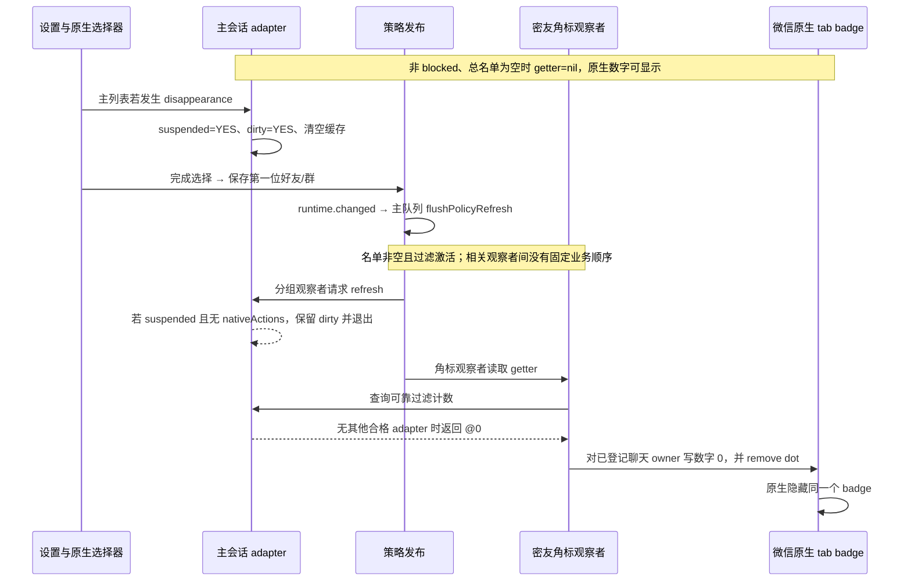

# 2.1-6 微信角标：保护名单触发问题的收敛排查

日期：2026-10-29。工作区：`/Users/zhangshichao/Documents/Workspace/WeChatImprove`。生产基线为授权清理交付后的 **2.1-6**；微信静态证据为 **8.0.78**。本报告承接用户新增的稳定条件：保存任意一位密友或密群后微信 tab 数字消失，清空总名单后恢复。没有实施修复，没有修改正式 Tests，没有新包或设备安装。

## 1. 回退完成且哈希一致

**生产源码和正式 Tests 仍与 2.1-6 交付清单的 602/602 文件完全一致；两处版本声明均为 2.1-6。** 本次补充排查结束重新执行本目录的隔离核验脚本，结果与逐文件对照见 [final-preservation.json](final-preservation.json)、[source-hash-comparison.tsv](source-hash-comparison.tsv)。`.theos/` 与 `packages/` 的历史文件 **1,260/1,260** 保持原路径和 SHA，其中 packages 有 35 个文件、16 个 deb，原 2.1-5、2.1-6、2.1-7 成品及 symbols 均保留。

上一步已先反向应用 `tabbar-badge-fix-2.1-7/production.patch`，恢复已有 Tests 并撤除三个 2.1-7 新 Tests；没有保留任何 2.1-7 生产逻辑。完整回退操作、独立基线重建、相对交付内容的零字节 diff，以及一次 rootless arm64/arm64e 构建通过、6 条历史警告的记录，见 [回退报告第 1 节](../README.md#1-回退完成且哈希一致)。本次补充排查只新增审计文件及隔离 host 产物，没有再次运行生产构建、正式回归或打包。

基线权威文件是 `authorization-cleanup-2026-10-28/source-sha256-after.json`。`source-sha256-before.json` 与该次 `baseline/` 是清理前 2.1-5，不能用它们单独代表 2.1-6。当前相对 Git HEAD 的历史未提交改动没有被重置；“一致/空 diff”指相对 2.1-6 的生产与正式测试交付内容，不表示整个仓库相对 HEAD 干净。手机实际已加载插件版本本轮未读取，工作区回退不等于设备已切换版本。

## 2. 直接结论：零值兜底是设计，普通未读持续丢失是集成缺陷

**`@0` 不是一个误写成零的普通错误返回。历史实现、测试与交付说明都明确要求：需要隐私过滤、但来源未知、dirty、过期或 blocked 时，公开角标先显示中性零值，允许暂时少显示普通未读。** 因此不能把所有不可计算的 `@0` 简单改成 `nil`，那会让包含受保护会话贡献的原生总数重新露出。

**有效来源下保留普通会话未读，同样是原有契约。** 若只有密友未读、普通会话未读为零，过滤结果零属于正常行为；若普通会话还有数字未读，却因来源始终不提供、或来源恢复后未重新发布而长期停在零，则是快照供给与角标发布衔接的功能缺陷，不能解释为“选了密友就应该隐藏全部数字”。

目前已确认三条源码可达条件：

1. 保存第一项打开过滤入口，而设置覆盖期间主列表可能已经清空快照；策略观察者会把不可计算的零主动写给微信 tab。这条路径不需要新消息。
2. 新消息的原生未读回调在插件 begin/end 事务中同步写 tab；这次查询可以恰好落在 changeDepth/revision 失效窗口，因而将原生正数改为零。
3. 需要消息静音过滤时，即便会话隐藏暂时解除，getter 仍要求快照；而某些关闭分组/不投影的 refresh 分支直接清掉快照，可能持续不可计算。即使之后快照恢复，项目也没有保证在该恢复点重发底部角标。

这些条件比共用几何逻辑更贴合“名单空正常、非空消失，且只影响微信 tab”。**还没有用户设备的实际返回原因和事件日志，不能把上述任一分支宣称为现场已抓到的唯一根因。** 也尚未确认“所选对象无未读、普通会话确有未读”及“样式关闭、名单非空”两个现场对照。

## 3. 设计意图的可核对证据

| 证据 | 具体内容 | 判断 |
| --- | --- | --- |
| `f747a6a476d1`，2026-10-20 首次实现 | 同时引入 getter、三个 tab 内容 hook 和策略观察者；测试规定 friend=8、ordinary=3 输出 3，原始 friend unread 仍为 8；epoch/revision 失配输出 0 | 可靠过滤保留普通未读、未知回退零，从一开始就并存 |
| `6987c113b5b7` 的任务 6 报告 | “Unknown/dirty/blocked source displays neutral zero”；同时说可以 **temporarily undercount ordinary notifications** | 容忍临时少计，不是规定长期清掉普通未读 |
| 同次交付 README:32 | “会话来源过期、未知聚合或尚未加载时，公开角标暂时显示中性值，可能少显示普通未读；不会通过清除真实未读来隐藏密友。” | 零值是输出隐私策略，不是清除真实消息未读 |
| 当前 `Tests/CloseFriendAlertTests.m:195–208` | 可靠来源输出 3、新可靠来源输出 5；epoch/revision 失配输出 0；disabled 输出 nil | 当前正式测试继续维护这些局部语义 |
| 旧真机验收 S02 | 可靠来源下准确，未知来源可中性零；状态为“待验证” | 不得将旧记录当成真机已经通过 |

完整 Git 命令、commit/blob/输出 SHA、精确摘录和测试覆盖缺口见 [design-history.md](design-history.md) 及 [history/manifest.json](history/manifest.json)。历史记录证明实现意图，不代表每项隐私取舍都能追溯为本轮用户曾逐项批准，也不代表端到端恢复流程经过设备验收。

## 4. 谁写微信 tab、每条路径最终写什么

### 4.1 三个 Hook 与策略观察者

| 文件:行:方法 | 接管条件 | 结果 |
| --- | --- | --- |
| `Hooks/CloseFriendNotificationHooks.xm:27:ChatTab` | 当前 index 对应 root 是 `NewMainFrameViewController` 或子类；导航项展开 firstObject | 只有匹配项才接管；主线程匹配后把 owner 放入弱集合 |
| 同文件 `:105:setTabBarBadgeValue:forIndex:` block | ChatTab 匹配 | nil 决策透传 count；正数替换成过滤计数；非 nil 的 `@0` 将任何原生正数替为 0 |
| 同文件 `:108:setTabBarBadgeString:forIndex:` block | ChatTab 匹配 | nil 决策透传 string；正数转十进制字符串；`@0` 把字符串改成 nil |
| 同文件 `:111:showRedDotOnTabBarItemAtIndex:` block | ChatTab 匹配且 getter 为 `@0` | 直接 return，不执行原生 show；此 block 本身不会把既存数字 badge 隐藏 |
| 同文件 `:113–125:policy observer` | 已登记存活 owner、当前 root 仍匹配、方法 ABI 符合、getter 非 nil | 主动调用数字 setter；0 时另外调用 removeRedDot。getter=nil 时不主动恢复原始数字 |

8.0.78 静态证据证明：原生 item 数字 setter 在 `<1` 分支向原生 badge 发送 `setHidden:YES`；字符串 setter 在 nil/空串分支也隐藏 badge。生产 Hook 不用自行改 hidden 就能通过输入内容让原生 badge 消失。IMP、地址、ABI 及汇编见 [原生未读与隐藏链](../native/README.md)。

这里清零的是公开输出参数，并未找到这条路径修改原始 `MMSessionInfo` 未读的行为。App 图标和通知也调用同一 getter，但它们与底栏 badge 是不同输出对象。

### 4.2 getter 的完整返回路径

`Controllers/CSGroupListAdapter.m:183:+closeFriendAlertBadgeCount` 每次读取当前 policy。`filtering` 为会话隐藏生效，或 `policy.enabled && silenceMessages`。名单是 friends 与 groups 的并集。默认 silenceMessages=YES，但未把默认值当作用户设备当前值。

| 位置 | 条件 | 返回 / 最终内容行为 |
| --- | --- | --- |
| `:185–186` | 非 blocked，且（无需过滤或保护并集为空） | nil；三个内容 Hook 透传后续原生请求 |
| `:188` | blocked；或已经需要过滤但不在主线程 | `@0`；数字=0、字符串=nil、show-dot 被抑制 |
| `:191–193` | 某 adapter 是折叠 owner、无 cachedNativeSections、changeDepth 非零、dirty、snapshotRevision 与 modelRevision 不同、snapshotEpoch 与当前 epoch 不同、snapshotAccount 与 policy.accountID 不同、或 policy.accountID 与当前账号不同 | 跳过该 adapter；不代表其他 adapter 必定也无效 |
| `:197` | 来源有效，缓存 key 同账号/epoch/modelRevision/policyRevision/foldedNames 匹配 | 返回已计算的 filtered NSNumber，可能是正确的零 |
| `:205` | 投影无效，或计算期间 modelRevision / epoch / policyRevision 改变 | `@0` |
| `:206–207` | 合格来源、有效投影 | 返回投影 `.count`；不带 `.redDot` 信息 |
| `:209` | 遍历后一个可用主 adapter 都没有，包括集合为空 | `@0` |

blocked 不走空名单透传。enabled=NO 或无需任何过滤时，名单非空也未必接管。revealed 解除会话隐藏，却不取消 enabled+silenceMessages 条件；因此已进入解锁设置页不能据此认为底栏已经交还原生。

## 5. 受控数值验证：选中无未读对象也可能把普通 7 改为 0

本目录 [隔离探针](probe/README.md) 编译真实 2.1-6 policy/projection，逐字提取真实 getter、ChatTab 和三个内容 block。覆盖 `3 种名单 × 候选未读 0/5 × 普通数字未读 0/7 × 5 种快照状态 = 60` 格，每格独立执行数字、字符串、纯红点事件；另有 12 条受控生命周期和 4 个 ChatTab 构造阶段。**共 2,507 项检查、268 条事件、0 失败**，严格 `-Wall -Wextra -Werror` 编译通过，compile/stderr 日志为空。

下面是数字事件实际结果。有效=有匹配的可靠快照；失效=无缓存、dirty、changeDepth 非零、revision 不一致四种状态，每一种分别运行。受控原生输入仅为两行数字未读之和，不模拟全部微信聚合/免打扰/readiness 规则。

| 名单 | 普通数字未读 | 候选对象未读 | 原生数字输入 | 有效快照 getter → 原 IMP 输入 | 四种失效快照 getter → 原 IMP 输入 |
| --- | ---: | ---: | ---: | --- | --- |
| 空 | 7 | 0 | 7 | nil → 7 | nil → 7 |
| 空 | 7 | 5 | 12 | nil → 12 | nil → 12 |
| 一位好友 / 一个群 | 7 | 0 | 7 | 7 → 7 | 0 → 0 |
| 一位好友 / 一个群 | 7 | 5 | 12 | 7 → 7 | 0 → 0 |
| 一位好友 / 一个群 | 0 | 5 | 5 | 0 → 0，符合过滤目标 | 0 → 0，但无法仅凭输出判断原因 |
| 一位好友 / 一个群 | 0 | 0 | 0 | 0 → 0，确实无数字未读 | 0 → 0 |

**所选对象没有未读，并不等价于“密友之外没有未读”。** 第三行直接验证了普通 7 被不可用快照退回 0；第四行验证有密友未读时可靠结果也应保留普通 7。空名单时“候选对象”尚未受保护，候选的 5 仍包含在原生总数内。

逐事件原始数据见 [events.jsonl](probe/events.jsonl)，普通 7 的关键用例见 [required-cases.json](probe/required-cases.json)，全部 60 格见 [matrix-summary.json](probe/matrix-summary.json)。各组合内前后沿用原 host badge，每条生命周期七阶段也保持同一对象，固定 frame 哨兵不变；这证明内容替换无需几何变化，**不证明真机对象层级或实际 hidden/frame**。

探针通过表示当前行为符合这些已知路径，不表示问题已修复。生命周期使用手工状态赋值，未执行真实 adapter begin/end/refresh、策略观察者、原生消息调度或底栏样式；原 IMP 的可见效果是明确写出的 host 边界，另有静态微信实现交叉佐证。

## 6. 保存第一项后立即消失的条件链

源码真正的保存点是原生选择器点击“完成”、关闭完成后回调，而非每次勾选。`CSNativeContactPicker.m:35–94` 与 `CSCloseFriendSettingsViewController.m:190–214` 可核对这一点。以下是一条可达链，尚非用户设备 trace：



对应位置为 `SessionGroupHooks.xm:73–79`、`CSGroupListAdapter.m:157–166`、`:214–227`、`:492–493`；保存与发布为 `CSCloseFriendBridge.m:45–58`、`CSCloseFriendRuntime.m:208–221/:42`、`CSCloseFriendManager.m:102–115`。完整源码快照、行号和事件边界见 [selection-timing.md](selection-timing.md) 与 [source-references.md](source-references.md)。

即便分组观察者先收到通知，挂起早退也可能使缓存仍不可用；反之若它成功重建可靠非零快照，角标观察者就有机会发出正数。不能假定通知观察者必定先运行。策略观察者的数字发送还会再次经过 tab Hook 查询 getter，精确路径须看两次实际返回。

## 7. 冷启动 → 新消息 → 写零 → 恢复机会

### 7.1 ChatTab 的成功条件与启动解释

ChatTab 要求 `viewControllers` 为 NSArray、index 有效，取对应项；若是 UINavigationController 则取其栈的 firstObject，最终类型必须为 `NewMainFrameViewController` 或子类。它不检查选中页、不看导航 top、不写死 index=0，也不缓存一次失败。额外非导航 wrapper、空栈或类型不同会匹配失败。

8.0.78 静态核对补充了限制：`MainTabBarViewController.init` 在正常返回前已经创建 NewMainFrame，以其作为 `StatusBarMonitorNavigationController` 根并替换数组 **index 0**，然后 `setViewControllers:`。该导航的父类链确实通往 UINavigationController。普通未读更新也明确用 index 0。见 [native/README.md](native/README.md)。

因此“刚启动时数组未建好/仍是占位，ChatTab=false”是可能存在的早期条件，却没有证据证明首个 badge 写入就发生在这里；不能默认解释成正常页面显示后还要等一阵才建立聊天 root。底栏样式源码没有替换 viewControllers 或导航 root，不会因样式本身改变这项类型判定。对其他插件重排、额外模式或其他 wrapper，不把正常静态 index 0 路径扩大成永远不变的保证。

“策略尚未加载，所以返回 nil”作为通用解释则不成立：`CSCloseFriendRuntime.m:34` 初始 blocked=YES，边界 snapshot 也会 blocked；只要已安装 Hook 且 ChatTab=true，getter 就给 `@0`。只有明确的非 blocked 且无需过滤/空名单等条件才给 nil。

### 7.2 消息时序中已经闭合的同步边

```text
冷态：可能已有有效过滤快照与正数；无需依赖 ChatTab 曾失败
    ↓ 收到新消息（AsyncOnAddMsg 到未读扩展的完整上游调度待采）
MainFrameLogicController.onSessionTotalUnreadCountChange:
    ↓ SessionGroupHooks:200 → NativeNotification:46（有 adapter/table 时）
beginNativeChangeOfKind: 失效 modelRevision，changeDepth++
    ↓ 调原始未读回调
原生同步 delegate.updateUnReadCount → logic.getTotalUnreadCount
    ↓ 同步 setTabBarBadgeValue:count forIndex:0
ChatTab=true 且需要过滤；没有其他有效主 adapter
    ↓ getter=@0 → Hook 输入替换为0 → 原生 badge.hidden=YES
原始回调返回 → endNativeChangeCoalesced:YES → dirty/既有合并刷新
    ↓ 若重建得到可靠快照，getter可恢复普通数字
但只有再次执行内容 setter，已有 badge 才会恢复数字
```

同步证据来自 8.0.78 的 `MainFrameLogicController.onSessionTotalUnreadCountChange:` 与 `NewMainFrameViewController.updateUnReadCount`，见 [原生静态链](../native/README.md)。getter 自身不会主动写 badge。原生 `getTotalUnreadCount` 未就绪也能返回 0，所以现场必须记录 **替换前** 的原生输入；不能默认每次都是插件把正数变零。

### 7.3 有哪些恢复机会，哪里没有保证

普通 `refresh` 的 `CSGroupListAdapter.m:583–589` 更新的是顶部分组条，不是底部 tab。引用分析没有找到“可靠快照重建后保证重发底部角标”的项目闭环。现有主动 tab 重发在策略通知观察者，普通新消息不等价于又发一次策略通知。

但 refresh 保留 table reload/layout、原生 dataSource/delegate、title、completion、nativeActions 等调用边界，页面 appearance 和之后的消息/未读事件也可再次触发原生 setter。故结论是**恢复没有保证**，不是“微信永远不再写”或“必须等下一条消息”。

更需要核对的稳态分支为 `CSGroupPrivacyActive:17–19` 不包含 silenceMessages，而 `refresh:532–543` 在非会话隐私、分组关闭等条件下清空 cachedNativeSections；getter 的静音过滤仍要求它。这使“没有可靠来源”可能持续，单加一次刷新后重发也不能解决。

新探针中的一条实际受控序列为：

| 阶段 | getter | 原 IMP 累计调用数 | 同一 host badge 数字 / hidden |
| --- | ---: | ---: | --- |
| 冷态有效，ChatTab 已匹配，执行 setter | 7 | 1 | 7 / NO |
| 失效事务窗口执行 setter | 0 | 2 | 0 / YES |
| dirty 窗口执行 setter | 0 | 3 | 0 / YES |
| 来源恢复有效，但不执行 setter | 7 | 3 | 0 / YES |
| 后续执行 setter | 7 | 4 | 7 / NO |

完整七阶段记录见 [lifecycle-example.json](probe/lifecycle-example.json)。它证明无需假定“冷启动不匹配”也能形成该序列，不证明真机的事务持续时间或后续 setter 是否缺失。

清空 friends/groups 总并集后，在非 blocked 下 getter 变 nil，之后的原生请求可透传。策略观察者本身在 nil 时不写回总数。用户看到“清空后恢复”与解除接管一致，但恢复具体由哪个原生/间接 setter 完成，仍需采样。

## 8. 四象限与候选归因的边界

本轮没有设备运行字段。以下“可见/不可见”来自用户反馈，不能用它反推 hidden、count 或对象同一性；两处样式关的结果保持待验证。

| 底栏样式 | 时点 | 用户反馈的微信数字 | badge 同一性 | count/string | hidden/alpha | frame/父视图 | item 实际被样式接管 |
| --- | --- | --- | --- | --- | --- | --- | --- |
| 开 | 冷启动后 | 可见；该现场名单/策略字段未采 | 未采 | 未采 | 未采 | 未采 | 只知配置开，applied 未采 |
| 开 | 新消息后 | 不可见；新线索为非空名单可稳定触发 | 未采 | 未采 | 未采 | 未采 | 未采 |
| 关 | 冷启动后 | 待验证，须保持同一非空名单 | 未采 | 未采 | 未采 | 未采 | 未采 |
| 关 | 新消息后 | 待验证，须保持同一非空名单 | 未采 | 未采 | 未采 | 未采 | 未采 |

通讯录/发现正常与 ChatTab 的专属接管相符；这提升内容路径优先级，却不能从逻辑上否证共用布局只在第 0 项特定几何组合下出错。2.1-6 独立几何探针仍有 3,872 次可见 badge 与 item 无交集记录，见 [geometry-analysis.md](../geometry-analysis.md)。越出 item 不自动证明被真实裁剪/屏幕不可见；若 count 已被改零、原生 hidden=YES，仅修位置也不能恢复数字。两者须分别取证。

会话分组/折叠投影未发现把原始未读数据清零；它们通过快照失效间接触发保守零。AsyncOnAddMsg 的项目 AI/支付 Hook 未发现直接写底栏数字；完整消息上游调度仍未闭合。纯红点的 `.count==0 && .redDot==YES` 信息丢失是另一个已确认边界，但不能拿来解释全部数字丢失。

## 9. 若要修，最小改动点与行为取舍（本轮未实施）

| 候选 | 能解决什么 | 隐私与行为影响 / 未解决项 |
| --- | --- | --- |
| 所有不可计算的 `@0` 改 nil | 后续原生 setter 可保留原总数 | 普通数字恢复，同时可能包含密友/密群的贡献；可能泄漏受保护未读。blocked/账号边界尤其不能放行。改变历史隐私契约，不建议直接采用 |
| 保留未知零，可靠快照完成后主动发布一次过滤结果 | 修补短暂 dirty/depth 后没有后续 setter 的停零 | 不暴露受保护贡献，普通数字按可靠结果恢复；若分组关闭/离屏分支始终不供快照，只有重发仍是0 |
| 区分“不接管、不可计算、已算出零/正数”，并补齐过滤所需来源与事件发布 | 同时解决持续无来源和恢复无重发 | 保持未知/blocked 的保守输出，真实零继续隐藏，普通未读有可靠来源后恢复。需要按实际命中路径补最小来源维护条件，不能宣称一行修好 |
| 暂时复用上一次过滤数字 | 某些短暂窗口可避免闪零 | 只有同账号/epoch/策略与可证明安全的来源版本才可考虑；旧值可能对应已被新保护的对象，不能无条件复用 |

建议先用第 10 节日志确认实际拒绝原因。若命中这里已证明的内容路径，优先在 **`CSGroupListAdapter` 的来源维护/可靠发布点，以及 `CloseFriendNotificationHooks` 已有 owner 发布衔接** 做最小修补：需要过滤时确保可靠来源不依赖可见分组 UI；来源可靠后通过原生 setter 发布过滤结果，按账号/epoch/策略校验，防止递归和重复发布。是否必须调整返回接口，要由命中的路径决定，不要求整块重构。

修补成功应让普通会话的数字未读正确显示，并继续排除应被静音的受保护贡献；会话是否可见与公开未读输出是两个既有策略维度，不能因 revealed 就一律透传。底层真实未读数据、原生 badge 对象和形状不需改变，也不需定时器、固定等待、整栏重载或先动样式几何。共享 getter 同时服务 App 图标/通知，若改它还需验证这些输出不会跨账号或策略边界暴露未读。本轮没有应用上述任何方案。

## 10. 尚缺证据与可回传的最小日志

[runtime-capture.md](runtime-capture.md) 提供现有环境下的最小复现步骤；[selection-runtime-probe.js](selection-runtime-probe.js) 只在本审计目录，未进入生产或正式 Tests。它观察自然 getter、消息事务、refresh、原生 tab/item 写入和 UI 状态，并增加保存 profile、策略调度/flush、presentation suspension、controller 建立标记；不输出 profile 参数、消息、联系人或账号原文，不替换参数/返回值，不主动重算未读。只完成语法和静态审查，**未设备运行**。

最有区分力的一轮是：普通会话 A 有数字未读、候选 B 无未读 → 空名单记录 → 选择 B 并点完成保存 → 返回主列表记录 → 收一条普通消息 → 清空名单记录 → 保持同一非空名单关闭样式再做对照。不要为复现打开 A 将其标为已读，不需重置账号或数据。好友与群可分别做一次。

必须从实际日志回答：

- 原生输入是否 >0；filter 是否为0；item 是否实际收到0/字符串nil；同一个 badge 是否随后被原生设 hidden。
- 当次名单并集是否非空、enabled/silence/revealed/blocked；是否有非保护会话数字未读；只见原总数>0不足以判断过滤零错误。
- 写零时各 adapter 的 cache、dirty、depth、revision/epoch 是否匹配，是否另有可用主 adapter；返回主列表后是否重建可靠来源。
- 可靠 getter 恢复正数后是否有新 tab setter；清空时具体哪个事件重新发布数字。
- 冷态最早可采 setter 的 ChatTab/root、策略和来源状态；样式关时同条件是否仍发生。

现有探针是第一轮线索采集，并未独立覆盖上述所有证明条件。必须保留以下解读边界：

- `updateProfile:error:` 只记录 enter/leave，未读 BOOL 返回值、store 读回或 changed，因此不是“保存成功”标记。`flushPolicyRefresh` 是外层范围，没有完整标出分组观察者和通知观察者各自的进入/退出；不能据它单独确定两个观察者的顺序。
- 自然 snapshot 返回会采 enabled/revealed/blocked/revision/protectedCount/hideSessions/silenceMessages，并与同线程嵌套 filter 关联；手动 capture 中的样本则明确是此前观察值，不代表当前 policy。脚本没有直接记录 getter 的拒绝分支、被采用 adapter 或实际投影的 count/redDot。
- 通知观察者直接查询、App 图标 setter 重入查询、tab setter 重入查询都会产生 filter 日志。现有脚本不观察 UIApplication 的这个 setter，也不直接输出 controller/app/observer 到 filter 的 parentCallId。只能结合已配对的同线程 enter/leave 区间判断嵌套，不能把相邻 filter 或一个 getTotalUnreadCount 正数随意归给另一个 tab 请求。
- 账号与当前全局 epoch 的原子匹配不可用。cachePresent=true、dirty=false、revision 相等不独立证明当前账号的来源可靠；refresh leave 也不等于成功发布。脚本没有采全 privacyRefreshPending、nativeActions、app active、交互等 guard，也未定位 nativeSections 成功发布点。
- 新增生命周期标记没有接收者指针，suspension 观察实例属性 setter；begin/end 未打印 kind/coalesced 参数。多 adapter 或嵌套事务时，不能把每个 depth 窗口都称为消息事务。rootState 的 chatTabMatch 是根据当前 root 独立推算，不是原 C ChatTab 的实际返回，也未验证弱 TabOwners 登记。

只读 UI 限主线程；不能通过匿名计数假装已验证实际普通/保护未读分布。attach 后不能补回早期 setter、Hook 安装或占位 root 窗口；后续替换 IMP 也可能漏采。新增 `rootAfterSetViewControllers` 只读 index 0，其他项看每次 setter 的实际 index/root 或手工 capture 全部 entries。未配对回调、被诊断读取抑制的回调或日志缺失都不能证明事件绝不存在。如果首轮日志仍有多对象/来源关联歧义，需要在隔离诊断中补相应边界，不能据现有字段直接宣称现场已闭环。

四象限真机字段、真实裁剪链、设备性能、完整 AsyncOnAddMsg 上游调度和具体恢复事件尚未覆盖。当前证据足以确认历史契约、名单触发入口、可达内容改写路径及快照供给/恢复发布缺口；现场首选假设是**密友过滤需要接管时，可靠快照供给/恢复发布没有闭合**。下一次应补上述最小运行数据，再据实际分支决定修补点。

## 11. 交付文件与验证

| 内容 | 文件 / 结果 |
| --- | --- |
| 原回退与首次构建 | [../README.md](../README.md)、[../build-result.json](../build-result.json)；一次构建通过，无新包 |
| 设计历史与正式测试覆盖 | [design-history.md](design-history.md)、[history/manifest.json](history/manifest.json) |
| 保存/离屏/通知/恢复源码链 | [selection-timing.md](selection-timing.md)、[source-reference.json](source-reference.json) |
| 原生 root/index 初始化 | [native/README.md](native/README.md)，同一份 8.0.78 镜像 |
| 隔离矩阵与生命周期 | [probe/README.md](probe/README.md)、[probe/results.json](probe/results.json)；2,507检查、268事件、0失败 |
| 实际采样准备 | [runtime-capture.md](runtime-capture.md)、[runtime-probe-syntax.json](runtime-probe-syntax.json)；仅语法审查，未设备执行 |
| 结束保留核对 | [final-preservation.json](final-preservation.json)；源码/正式Tests 602、历史产物1,260，全部一致 |

本轮没有生产逻辑改动、正式测试改动、版本提升、新包或设备安装；新增诊断及其 host 可执行文件仅位于此审计目录。
