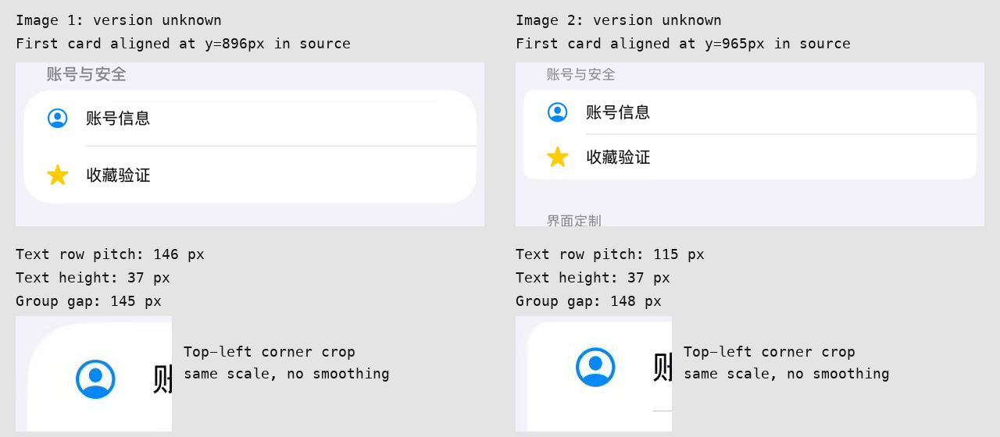

# 两张未知版本截图的独立像素核验

本目录仅分析附件，未修改生产代码、测试、版本或 packages。两张图依次称图1（`img1-title-zaibuhui-0715.jpg`）和图2（`img2-title-mofa-0618.jpg`）；**不把任一张图标为微信 8.0.78、8.0.80 或某个 iOS 版本**。

## 来源与元数据

| 图 | 输入 SHA256 | 尺寸 |
| --- | --- | --- |
| 图1 | `fe4854a6f85d633dc3e34cf844f140254a777da4e7ec4b24ac96456d19307f25` | 1280×2774 JPEG RGB |
| 图2 | `f2dd8108a19d1f03ecf1f3bfbcfade12ebfbcf6a8bec19748158b5a6ad42495f` | 1280×2774 JPEG RGB |

两图均只有 JFIF 1.1 信息，density 为 1×1、无单位；Pillow 的 EXIF 字典为空，文件中不存在 EXIF/XMP 标记。没有能读出的系统、微信、插件版本或设备型号。JFIF density 不表示设备显示 scale。截图内也不展示这些版本号，文件名、账号名、状态栏和外观均不足以建立版本对应关系。

## 方法与结果

使用 ffmpeg 单帧解码为 `rgb24`，亮度按 `0.299R+0.587G+0.114B` 计算。本文坐标为从零开始的像素坐标，矩形两端均包含；高度为 `bottom-top+1`。完整解码命令、解码器版本、原图与 raw RGB 的 SHA256 在 `metadata-and-metrics.json`。

白底阈值为亮度≥252，沿 x=1000 量白色连续带；正文阈值为亮度<120，在 x=215…449 统计有深色文字的行。分隔线/JPEG 噪声会切断白带，所以**白带高度不等同于精确 UITableView rowHeight**，文字起点差对行节距更直接。

| 度量 | 图1 | 图2 | 含义 |
| --- | --- | --- | --- |
| 第一卡片顶部 y | 896 | 965 | 差69px，但顶部呈现上下文不同，不能单凭此推断 layout inset |
| 第一行白色连续带 | y896…1037，142px | y965…1075，111px | 图1更高 |
| 第二行白色连续带 | y1043…1185，143px | y1080…1193，114px | 图1更高 |
| 账号信息正文深色包围框 | x222…382，y950…986，高37px | x222…382，y1004…1040，高37px | 该行字号的像素高度、水平起点相同 |
| 两行正文起点差 | 1096−950=146px | 1119−1004=115px | 图1多31px，即+26.96%；直接证明分组内部行节距不同 |
| 参考 y1100 卡片白底范围 | x61…1218，1158px | x61…1219，1159px | 左右边界相同到约1px；不是卡片宽度变大 |
| 下一分组白卡顶边 | 1331 | 1342 | 下述分组空档的另一端 |
| 两卡之间非白空档（x1000） | 145px | 148px | 仅差3px；本例的主要差异是行内高度，不是分组间距 |
| 正文左边界到卡片左边界 | 222−61=161px | 222−61=161px | 水平布局一致 |
| 页面底色采样 (700,1250) | (243,242,248) | (243,242,248) | 一致 |
| 卡片采样 (1000,1100) | (255,255,255) | (255,255,255) | 一致 |
| 分组标题深色包围框（阈值180） | y837…873，高37px | y909…940，高32px | 可复现视觉差异，但灰色文字阈值敏感，不据此认定动态字号原因 |

`text-rows.csv` 和 `white-runs.csv` 包含其余可见设置项。界面定制分组的文字行节距图1通常为146px，图2通常为115px（个别行1px舍入），与第一组结论一致。账号信息卡底部两图接近，但图2能容纳更多界面定制行，是行节距差异的结果。

## 圆角估计与边界

用“全宽减顶行白色跨度再除以二”的轮廓代理值，在亮度阈值252下得到：

| 图 | 全宽 | 顶行跨度 | `(全宽-顶行跨度)/2` |
| --- | --- | --- | --- |
| 图1 | 1158px | x160…1135，976px | 91px |
| 图2 | 1159px | x96…1183，1088px | 35.5px |

因此，“图1顶部拐角吃掉的水平长度明显大于图2”有像素依据。**91/35.5px 不是已测得的 `CALayer.cornerRadius`**：JPEG、抗锯齿、连续圆角形状与首个命中像素行都会影响该公式。阈值250…254重测，图1代理值63.5…94.5px，图2为19.5…36px；254时图1检测顶行还下移3px。这证明不应拿该公式倒推精确系统圆角常量。全部阈值见 `corner-threshold-sensitivity.csv`，派生图提供相同比例的角部对照。

## 不能把分辨率比当作已知 px/pt

用户给的3.257px/pt是**假设两图经过从393pt@3×等比放大**所得，输入图本身不证明这个假设。当前源码 [CSCustomViewController.m:47](../../../../Controllers/CSCustomViewController.m#L47) 的头像80pt（frame应用在517–520行）、[CSSettingTableViewCell.m:379](../../../../Controllers/CSSettingTableViewCell.m#L379) 的文字起点相对卡片54pt可以提供一个有用的条件核验，但截图插件版本未知，不能直接拿当前源码强行校准。

仅在“截图使用当前同一尺寸实现”的前提下，头像非背景包围框约238×239px，除以80pt约为2.975…2.988px/pt；正文相对卡片左边界161px，除以54pt为2.9815px/pt。两个条件核验彼此接近，却和3.257有约9%的差异。这是对“已知393pt模型”的反例，**不能反过来断言设备就是3×、屏幕就是某一机型或截图没有裁剪/缩放**。

因此本分析以像素与比值为结论：146/115=1.2696。若套用户条件比例，行节距是约44.8/35.3pt；若套当前代码条件比例，约为49.0/38.6pt。两种互斥换算表明，不能以截图直接断言“图1正好是系统默认44pt”或“图2就是系统11pt圆角”。实际 pt 值需要原始设备 bounds、scale、截图处理链和截图所用插件 build。

## 能证实与不能证实

能证实：图1的设置行节距更大、卡片顶部拐角范围更宽，正文像素高度、水平起点、卡片宽度、底色相同；分组间空档近似相同。图2标题为“魔法”，而图1为“再也不会”；头像与账号尾号也不同，不能把两图当成配置一致的受控对照。

不能证实：两图与8.0.78/8.0.80的对应关系、系统版本、设备型号、插件 build、系统动态字号/微信字号/显示缩放设置，以及卡片实际layer圆角或rowHeight。顶部也呈现不同层叠形状，绝对 y 差异不能用来单独判断列表 padding。像素证据不支持把系统版本或微信版本直接写成根因；需要源码作用域证据和带版本、配置的设备对照。

