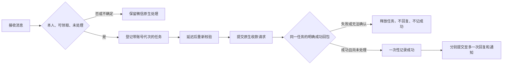

# 语音清理与自动收款／红包检查

日期：2026-10-18。工作基线为已回退的 1.8-11。用户补充：群里别人之间转账，自己的自动回复是在对方确认收款后出现。

本轮已完成语音等价清理，以及自动收款、红包的源码检查和替身复现；以下资金功能改造是待实施方案。本轮未修改收款／红包生产逻辑，未重新打包，未操作真实微信收款或发消息。没有把 1.8-12、1.8-13 的分组动画改动带回。

## 1. 已完成的语音清理

仅改动三个生产文件：

- `Controllers/CSMessageMediaProvider.m`：删除两个媒体准备调试断言；移除由 `terminalCompletion || localComplete` 派生的 `complete` 属性与赋值，判断处直接读取原有状态。
- `Controllers/CSVoiceForwardAdapter.h`、`.m`：删除 `CSMessageForwardBinding.logic` 只写不读的弱引用及赋值。

未发现这些语音生产路径中遗留的常规诊断日志或文件写入。`failureHint`、失败回调、待下载计数、账号代次、一次准备重试、消息身份核对与防重复提交仍有实际用途，保留。协调器中实际使用的 `operation.logic` 也保留。

运行 `CS_TEST_VOICE_CORE=1 bash Tests/verify-message-actions-execution.sh`：2,261 项通过。该检查使用主机替身，未调用真实发送接口。

## 2. 群转账误回复的原因与边界

确认存在两项足以造成误回复的缺陷：

1. **把群消息的可见性当成收款资格。** `Hooks/ReceiveTransferHooks.xm:412` 只检查 App 消息、转账关键字、部分 XML 子类型和私聊／群聊开关，没有核对实际收款人。群消息的 `m_nsToUsr` 是消息投递方向，不能证明钱转给当前账号。项目已有头文件 `HeadersFile/WCPayInfoItem.h:139` 声明了 `transfer_receiver_username`，当前自动收款完全没有读取它。
2. **把流程调用当成收款成功。** `Hooks/ReceiveTransferHooks.xm:743` 调用 `startReceiverConfirmTransferMoneyLogic:Data:` 后，立刻增加成功次数／金额、发“已自动收款”通知，并在两秒后回复；没有等待确认收款的成功回调，也没有检查服务端确认结果。

替身复现：收款人为 `someone-else`、群为 `test@chatroom`，当前账号为 `self`。不产生任何支付成功回调，实际生产方法仍启动一次收款流程、增加一次成功计数，并安排一条群回复。这里证明的是插件错误尝试和错误回复，不能据此声称微信服务端会允许领取他人的转账。

关于“对方确认后才回复”，当前源码**没有** Hook `OnConfirmTransferMoney:Error:` 来触发转账回复，因此时间接近不能证明插件确实在等待收款成功。还存在回执识别漏洞：`Hooks/ReceiveTransferHooks.xm:483` 只有成功读到 XML 的 `paysubtype` 且不等于 1 才退出；XML 字段缺失时继续执行，未采用原生 `m_uiPaySubType`。替身确认：明确的 XML `paysubtype=3` 会被排除，但 XML 字段缺失、原生支付对象已经标记为 3 的消息仍被接受。

因此实际手机上的触发可能是先前转账的延迟任务，也可能是未被识别的回执消息。未取得该次原始消息及回调，不能把其中一种写成已确定事实。两种路径都应由“本人收款资格 + 本插件任务归属 + 原生成功结果”一起封住。

## 3. 其他功能与性能问题

“替身复现”表示提取了真实生产函数执行，原生服务、发送接口、延迟调度由计数器和受控队列替代；“源码确认”表示缺口可从实现直接确定，实际运行影响仍取决于宿主调用条件。

| 优先级 | 问题与触发条件 | 证据 | 影响与处理方向 |
| --- | --- | --- | --- |
| P1 | 同一笔转账经过 `AsyncOnAddMsg` 和 `AddMsg`，无业务 ID 去重 | `ReceiveTransferHooks.xm:823`；替身复现两次调用、两条回复 | 以账号、会话、transfer ID 去重；提交与成功副作用分别防重 |
| P1 | 延迟期间关闭开关或切换账号，任务仍执行 | `ReceiveTransferHooks.xm:514`、`:786`；替身复现 | 延迟任务携带账号代次与截止时间，执行前及回复前重新校验；注销即失效 |
| P1 | `startLogic` 的全局 Hook 在总开关开启时跳过原生流程，连手动收款也会自动确认 | `ReceiveTransferHooks.xm:800`；替身在私聊／群聊均关闭时仍复现 | 只拦截明确属于插件任务的逻辑实例；手动流程无标记时始终调用原生方法 |
| P1 | 红包打开回包没有插件任务归属、开关、账号及防重门槛，只要金额为正且有会话就回复／记数 | `RedEnvelopHooks.xm:489`；替身复现关闭总开关、重复回包仍回复并累计 | 必须匹配本插件的打开请求、账号代次与业务 ID；成功转换只发生一次 |
| P1 | 红包查询／打开响应没有完整的错误与字段类型校验 | `RedEnvelopHooks.xm:392`、`:404`、`:489`；替身确认错误标记和正金额并存仍处理，`NSNull` 状态会抛异常 | 校验传输层、业务层、字段类型和任务状态；异常数据不得影响原生回调 |
| P1 | 插件先处理红包回包，最后才 `%orig`，上面的异常可阻止原生回调执行 | `RedEnvelopHooks.xm:355`；调用顺序源码确认 | 捕获最小安全快照，确保原生方法执行一次，再异步处理插件状态 |
| P2 | 红包零延迟绕过串行开关和普通并发限制 | `RedEnvelopHooks.xm:429`；替身复现零延迟直接打开、延迟一秒才入串行队列 | 所有任务经过同一个有界调度入口，延迟为零也遵守并发策略 |
| P2 | 红包 Operation 在调用打开请求后就完成，未等待响应；“串行”实际只约束发起过程 | `CSReceiveRedEnvelopOperation.m:63`、`:77`；源码确认 | 活跃名额持续到响应／失败／超时，保证串行模式最多一个在途打开请求 |
| P2 | 红包查询参数无 TTL／总量上限／重复过滤，已领、抢完、缺 timingIdentifier 等早退不移除参数 | `CSRedEnvelopParamQueue.m:40`；`RedEnvelopHooks.xm:392`、`:398`、`:405`；替身复现已领项残留及 600 个重复项累积 | 先定位任务，再走终态清理；超时、失败、服务不可用统一释放所有索引 |
| P2 | 红包匹配按 sendId 或 sign 任一命中即可，冲突时也接受 | `CSRedEnvelopParamQueue.m:76`；替身复现 sendId/sign 冲突和未知 sendId 回退 | 所有已提供的身份字段必须一致；优先绑定本插件请求实例及完整上下文 |
| P2 | 红包缺 msgType/sendId/channelId 时校验分支为空，仍入队和发查询 | `RedEnvelopHooks.xm:893`、`:920`；源码确认 | 一次类型和完整性解析；缺字段不创建任务，不发请求 |
| P2 | 普通私聊自己发出的红包没有明确排除，当前账号缺失也会继续做来源分类 | `RedEnvelopHooks.xm:842`、`:878`；源码确认 | 当前账号必须已确认；私聊只接收发给本人的红包，自己的群红包按现有开关处理 |
| P2 | 收款金额来自展示文本且使用浮点换算；普通非 CDATA 金额会漏掉 | `ReceiveTransferHooks.xm:554`；替身复现次数 +1、42.50 元记为 0 | 统计以成功回包的整数分和币种为准；展示字符串只用于界面展示 |
| P2 | 红包取消不立即结束 Operation；配置不校验延迟范围 | `CSReceiveRedEnvelopOperation.m:143`、`CSRedEnvelopConfig.m:58`；源码确认 | 取消进入终态并立即释放名额，旧计时回调按代次丢弃；将配置限制在设置页已有的 0–10 秒 |
| P2 | 红包 worker 同步等待主线程、取服务失败用线程 sleep 重试；回包统计同步持久化 | `CSReceiveRedEnvelopOperation.m:108`、`:133`；`CSRedEnvelopConfig.m:81`；源码确认 | 异步提交原生调用；失败重试仅限明确未提交阶段；持久化串行异步，避免等待链 |
| P2 | 红包可变配置和统计无统一线程归属 | `CSRedEnvelopConfig.m:49`、`:81`、`RedEnvelopHooks.xm:947`；源码确认 | 不可变配置快照；任务状态和统计由单一队列管理，原生对象操作由主线程管理 |
| P2 | 红包发送失败会回退到 `AddLocalMsg:` 并返回成功 | `RedEnvelopHooks.xm:768`；源码确认 | 本地插入不能当成已发送；核对真实发送接口与 ABI，返回“已提交”或“未提交”，不伪造成功 |
| P3 | 详情页汇总只在加载时及 0.25 秒后更新一次 | `RedEnvelopHooks.xm:1112`；源码确认 | 绑定详情数据更新事件，值相同不重画；不靠轮询等待网络 |

性能风险集中在启用功能、消息突发、网络迟迟不回包、长后台后恢复这些条件。现有红包普通 Operation 并发确实限制为 5，串行限制为 1，服务获取最多尝试 3 次、间隔 80ms；不能描述成无限重试。同步等待是风险边，但这次没有实机线程栈证明它形成了死锁。也没有实测依据量化 CPU 降幅或温度变化。

## 4. 建议实施方案

### 4.1 先建立三个不可绕过的条件

自动收款必须同时满足：当前账号已确认；实际收款人就是当前账号；消息是仍可领取的转账要约。群 ID 和消息投递 `toUsr` 不能替代实际收款人。

优先读取原生支付对象的 `transfer_receiver_username`、`transfer_payer_username`、`m_uiPaySubType` 等结构化字段，必要时用有边界的 XML 解析补全。字段缺失、类型不符、来源冲突或状态无法确认时不自动处理，让微信原生流程继续。明确排除本人向他人转出、别人之间转账、已领取、退款、失效和无法识别的回执。私聊也必须核对方向与收款身份。

交易任务只绑定创建时的账号和登录代次。注销、换号，以及同一账号退出后重新登录都产生新代次；旧任务、旧响应和旧回复块不能转移到新会话。可以沿用项目已经验证的原生账号生命周期入口，但收款任务不挂靠语音协调器内部状态。

### 4.2 由原生成功结果驱动副作用

建议转账流程为：

- 给本插件创建的 controlData 和对应逻辑实例附带任务标记；在 `initWithData:` 等已验证入口把归属传递给准确的实例。未标记的手动收款逻辑始终 `%orig`。
- 请求提交返回值仅代表调用阶段的结果，不代表到账。候选完成入口包括 `OnConfirmTransferMoney:Error:` 和群转账可能使用的 `onWCPayUnionTransferConfirmCgiResponseOK:`／Error 分支；这些签名可在 `HeadersFile/WCPayReveiverControlTransferControlLogic.h` 中查到。
- 落地时须核对当前微信版本真正走的回调、参数 ABI 和成功条件。不能仅凭方法名包含 OK、Error 为 nil、回包金额大于零，或者等待两秒来认定成功。对于没有业务 ID 的响应，必须依靠先前标记的逻辑实例／原生请求关联，而非“最后一笔转账”。
- 只有匹配的成功结果才能核实收款人、付款人、币种和整数金额，并把任务从“已提交”转换为“成功”。成功标记先建立，再安排统计、回复和通知；重复回调只能读取已完成状态。
- 回复发送前再核对账号代次及当前回复开关。收到失败／取消／超时结果不回复，不生成“已自动收款”提示。超时不盲目重发收款或红包打开请求；有可靠只读状态查询接口时先核实，不能确认则交回原生处理。

### 4.3 红包采用同样的任务归属和完整生命周期

每个红包任务保存账号代次、会话、sendId、channelId、msgType、已验证 sign、创建时间、排队截止时间、查询请求身份、打开请求身份及终态。三阶段分别去重：接收消息、提交打开、处理成功副作用。

查询回包先精确关联任务，再判断已领、抢完、缺令牌、错误等终态。所有结束路径都移除主索引、sendId/sign 索引和调度项；服务不存在或请求未能提交时立即清理。多个身份字段同时提供时必须全部一致，不在冲突时用另一个字段兜底。

零延迟和有延迟都走统一调度。保留普通最多 5、串行最多 1 的设置语义，但计数覆盖实际打开请求等待回包的阶段。超时／取消只允许终结一次，旧的延时块不能重新启动任务；切换串行模式时使用一个统一活跃集合，不能让旧普通队列和新串行队列各自继续扩大发起数量。

所有入口先校验请求／回包字段类型和业务错误；解析失败保留原生回调。不要让插件异常阻止 `%orig`：安全复制最小数据，原生回调照常执行，再异步做插件解析与任务匹配。

建议自动回复只对应本插件任务。当前源码还会处理手动打开红包的回包，如果产品希望手动领取也自动回复，应明确独立范围；不能继续通过未限定的全局回包隐式实现，否则总开关语义不清楚。

### 4.4 有界调度与线程安排

建议初始边界（实现时作为集中常量，核心压力测试验证）：每账号待处理转账最多 128、红包最多 256；未提交排队期限为 30 秒加用户设置延迟；在途请求超时单独计时，不能重复使用排队计时。网络返回的真实失效时间也要采用，但须先确认它是绝对时间还是持续时间，不能猜测 `invalidtime` 的单位和含义。

使用有限任务表、单一状态队列、按最近截止时间安排的一次性定时器。没有任务时停表，不做常驻轮询。超限不挤掉已经提交的请求、不把拒绝的新任务计为成功。长后台后恢复先检查账号、开关、原生资格和排队截止时间，不批量补发已过期的领取／回复。继续服从现有后台运行策略，不为这次优化新增保活或唤醒机制。

原生服务、控制器和支付方法在经过核对的线程调用；状态队列不 `dispatch_sync(main)`，主线程也不等待工作队列。重试只针对明确没有提交的服务准备阶段，使用可取消的延迟调度替代线程 sleep。解析使用消息数据快照，避免延迟强持有整条消息或遍历／创建不对应当前场景的聊天控制器。

配置读写统一成不可变快照，校验延迟为 0–10 秒、枚举范围及群列表字符串，白／黑名单预建集合。关闭功能和修改范围时撤销不再符合条件的未提交任务，已提交结果按原账号归属处理，并重新检查是否允许回复。

### 4.5 统计、持久化与发送语义

统计来自一次性成功事件，以经过验证的整数分累计；非人民币不能一律标成“¥”。同一事件的次数、金额和最近处理 ID 要作为一个逻辑事务串行更新，持久化由专用 IO 队列完成，避免每个回包在主线程同步写盘。

近期处理 ID 缓存需有容量与保留期。若要求重启后也不重复回复，需要原子保存最近成功事件和回复提交意图；可采用有界的小型记录文件，不需要引入大型数据库。历史已有统计保留，不因为当前统计方式有缺陷就擅自清零。新增持久化格式前先备份并校验旧配置兼容。

发送前记录“已安排／已提交”，原生 `AddMsg` 返回只能表示交给发送队列，不能表示对方已经收到。进程在记录和发送之间崩溃存在不可消除的边界：建议优先避免重复回复，接受极端情况下少回一次；不能声称仅靠客户端 Hook 可以保证跨崩溃端到端恰好发送一次。`AddLocalMsg` 只用于本地消息，不作为发送成功回退。

## 5. 落地顺序与核心验收

建议分三个可独立回归的提交：

1. **自动收款正确性**：本人资格、回执排除、精确任务绑定、确认成功后副作用、双入口去重、恢复手动流程。优先解决用户已发现的群误回复。
2. **红包正确性及资源边界**：请求归属、错误／类型检查、队列清理、零延迟串行与真实在途并发、取消及超时。
3. **共同的性能与持久化**：账号边界、不可变配置、异步服务提交、统计一致性、后台恢复过期处理和详情汇总事件刷新。

核心验收矩阵：

| 场景 | 必须达到的结果 |
| --- | --- |
| 群内 A 给 B，当前账号 C；要约及 B 收款回执分别进入 | C 不提交收款，不回复，不发已收款通知，不增加成功统计 |
| 私聊／群聊明确转给本人，正常成功 | 一次提交；匹配的成功结果后最多一次回复、一次通知、一次统计 |
| 本人转给别人、收款人缺失或冲突、状态未知 | 保留原生流程，不自动尝试 |
| 双入口、重复回执、乱序回包、同 ID 不同账号 | 不重复提交和统计，不串会话／账号 |
| 领取失败、取消、超时、金额字段异常 | 不谎报成功；原生回调正常执行 |
| 任务排队后关闭开关／换号／同账号重登 | 未提交任务取消；旧结果和旧回复不能进入新账号 |
| 用户手动收款 | 原生界面与原生确认逻辑保持正常 |
| 红包零延迟 + 串行、有延迟 + 串行、切换模式 | 实际在途打开请求最多一个；普通模式上限始终有效 |
| 红包已领／抢完／缺字段／无回包／服务不可用 | 所有任务及索引最终有界释放 |
| 突发 1,000 条无关消息或大量重复交易 | 不新增支付请求和 UI 扫描；待处理项不超过边界，无任务时没有周期唤醒 |
| 后台数小时后恢复 | 逐项验证过期与账号；无过期任务集中补发 |
| 重启、发送边界崩溃、统计旧配置迁移 | 旧数据保留，防重策略明确，不把本地消息当已发送 |

仅测试收款资格／任务状态机、红包解析／队列／调度、成功副作用，以及已改动的语音核心；不扩大到分组动画、头像等无关模块。

## 6. 本轮证据与当前状态

- `before-voice-source.zip`：清理前的三个语音文件。
- `baseline.json`：本轮开始时源码和现有安装包的哈希。
- `voice-cleanup.diff`：只包含本轮语音清理，不混入此前回退。
- `voice-core.log`：2,261 项语音核心检查通过。
- `PaymentBehaviorAudit.m`、`extract-audit.py`、`verify-behavior.sh`：真实方法提取与隔离复现，不连接微信或网络；设置仅写入随机命名的测试 suite，结束后删除。
- `payment-behavior.log`：29 个断言完成，复现 12 组现有行为。这是缺陷复现成功，不是收款／红包修复通过。
- `verification.json`：源码与现有产物范围核对。

这些复现与源码证据足以确定修复方向，但不是手机原始回执样本，也没有支付网络的真实成功／失败测试。正式改造时，应先核实当前微信版本的回调协议，再将上述缺陷场景改成期望行为的回归测试，最后做本人私聊／群聊各一条及旁观者群转账的最小实机验收。
