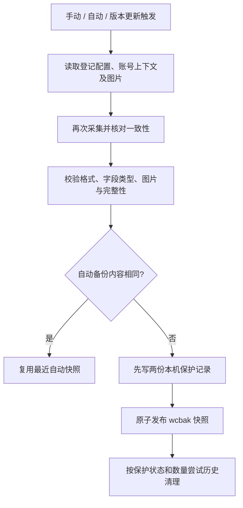

# 备份逻辑与功能说明

适用版本：**2.0-15**。核对日期：2026-10-26。存储迁移、规则证据与验收边界见 [2.0-3 迁移记录](audits/preferences-storage-migration-2026-10-24/README.md)，历史保留策略修复见 [1.9-6 修复记录](audits/backup-retention-fix-1.9-6/README.md)。

手动删除行为已按 2026-10-29 当前源码补充：无法读取、文件名非标准的备份也提供删除入口；其余内容保留上述版本的核对范围。

## 1. 备份用途与入口

备份保存插件配置、自定义图片、已经存档的账号分组和当前账号的定时任务，供恢复配置、迁移支持的设置，以及在恢复或重置出错时回退。它不是微信聊天记录备份，也不是微信应用容器的完整副本。

入口为 **插件设置 → 备份配置**。插件默认入口名称为“再也不会”，可以由用户修改。重置入口为 **插件设置 → 重置设置**，与备份共用预览、保护和恢复事务机制。

| 页面功能 | 实际行为 |
| --- | --- |
| 创建备份 | 保存当前完整配置快照，名称可以留空，留空时使用时间生成名称 |
| 从文件导入 | 校验当前格式文件并保存到本机，不直接修改当前配置 |
| 自动备份 | 控制配置变化后的自动快照；不控制版本更新备份和操作前保护备份 |
| 点击可用备份 | 查看来源版本、时间、配置和图片数量，进入预览恢复、导出、收藏、重命名、删除等操作 |
| 点击无法读取的备份 | 导出可读取的原件、重新检查或手动删除；打开时才发现文件读取失败，也进入这个管理菜单 |
| 备份与恢复状态 | 查看可用/无法读取份数、备份文件容量、待执行事务、最近自动备份及错误、版本更新备份错误和最近记录的清理结果 |
| 重试备份与恢复 | 启动恢复尚未完成时重试处理；正常启动后检查待执行计划与版本更新备份，不强制执行尚待重启的计划 |
| 修复当前配置 | 前往导航分隔图片、底栏图标、触摸轨迹图片、联系人分隔图片等原设置页，手动重新选图或移除无效引用 |
| 取消待执行计划 | 取消尚未执行的恢复/重置计划；执行中断的事务必须先完成回滚 |
| 功能说明 | 查看页面内的备份范围、调度、保留和文件分享说明 |

状态页的容量按列表中的 `.wcbak` 文件大小求和，不是整个备份目录及事务文件的总磁盘占用。当前没有“一键清空全部备份”功能。

手动、自动、导入、升级保护、操作前保护，以及收藏、保护记录异常、内容损坏或文件名非标准的备份，均可在所选记录的菜单里手动删除，并须再次确认。无法读取的备份会额外提示先导出原件。删除只针对这份本机备份及其保护记录，不修改当前插件配置，也不影响其他备份；不会递归删除同名目录或跟随符号链接删除外部文件。

恢复事务正在引用的备份仍受临时保护：尚未执行的计划可先通过“取消待执行计划”解除引用，已开始的事务须先完成恢复或回滚。事务日志无法校验、目录迁移尚未完成或文件系统拒绝删除时，会显示具体错误并保留文件。

## 2. 备份包含哪些内容

### 配置范围

配置按登记表逐项读取，不会复制整个 `NSUserDefaults`，也不会仅凭键名前缀允许导入。当前有 **315 个固定配置项、26 个模块**，另有受约束的按账号分组选中状态键和定时任务文件字段。

| 范围 | 模块 |
| --- | --- |
| 外观与布局 | 头像、后台与隐私模糊、布局与字体、气泡与连续消息、列表圆角、输入文本、消息时间、底栏样式、附件布局、聊天导航、触摸轨迹 |
| 会话与消息 | 会话分组、防撤回、消息操作 |
| 自动处理与辅助 | 红包设置、转账设置、朋友圈尾巴、游戏设置、收藏保护、定时任务 |
| 插件与界面 | 插件入口、更新控制、版本设置、备份设置、界面精简、界面文字 |

“收藏保护”模块指微信收藏功能的认证等插件设置；“收藏某份备份”是另一种本机保护状态，不属于该模块。

偏好项从三个既有域读取；定时任务使用独立文件字段，不写入微信偏好数据库：

| 内部别名 | 实际配置域 | 固定项数量 |
| --- | --- | --- |
| `standard` | 当前微信宿主的标准偏好域 | 296 |
| `legacy` | `com.cyansmoke.wechattweak` | 17 |
| `layout` | `com.wechat.enhance` | 2 |

这里的 `legacy` 是当前仍使用的配置域别名，与已经移除的旧备份格式兼容无关。

快照保留字段的“有值”和“未设置”区别，也保留日期、颜色二进制数据等类型。恢复为“未设置”会删除对应偏好项，由插件使用默认行为。

### 图片与账号记录

- 图片以实际字节存入快照，通过内容摘要去重；不会仅保存原容器的绝对路径。恢复时重建当前插件资源目录下的路径。
- 固定图片配置包括 8 个底栏普通/选中图标、导航分隔图片、触摸轨迹图片；联系人专属分隔图片从登记的联系人配置中提取。
- 分组备份包含已存档账号的分组定义、成员、名称、排序、隐藏状态和选中状态。创建完整备份不只读取当前账号；恢复时再选择账号范围。
- 红包/收款的自动处理开关、延迟、回复文字、通知偏好属于配置，可以备份。

- 定时任务按当前账号从 `Preferences/WeChatImprove/ScheduledTasks/<账号 SHA-256>.plist` 读取，包含任务名称、会话、消息、单项开关、补发选项、时区及全部时间规则。源码新增的时间段规则也保存起止时间、分钟／小时间隔及执行星期；已计算的计划点仍不作为便携配置导出。未加载账号时不采集其他账号任务。

完整逐项清单见 [配置登记表](backup-configuration-registry.md)。

### 不包含的内容

- 微信消息、聊天记录、媒体数据库、登录凭据和微信原生设置。
- 插件授权结果、校验时间、用户协议确认、头像缓存和头像 URL 等运行或缓存状态。
- 红包/转账累计统计、支付事件去重账本和支付处理状态。
- 备份历史文件、收藏/重命名等本机备份元数据、最近自动备份时间和恢复事务文件；自动备份开关本身属于配置，会保存。
- 旧分组迁移原件、旧历史快照、未登记的设置项。
- 定时任务执行记录、执行去重状态和已计算的下次时刻；正常恢复后总开关关闭，手动开启时从下一个未来时刻开始。异常恢复的本机事务回滚仍会精确还原原状态。
- 密友模块的独立加密状态及其 Keychain 凭据。当前 26 个备份模块不包含密友，不能把此功能作为密友数据备份。

## 3. 备份类型与产生时机

| 类型 | 产生时机 | 自动清理 |
| --- | --- | --- |
| 手动 `manual` | 用户点击“创建备份” | 保留，不按数量删除 |
| 自动 `automatic` | 自动备份开启，配置或资源变化后达到调度条件 | 普通未保护快照保留最近 20 份 |
| 操作前保护 `protection` | 准备恢复或重置时，保存操作前状态 | 与版本更新快照共用最近 5 份额度；事务引用中的文件不能删除 |
| 版本更新 `upgrade` | 当前插件版本尚未完成版本备份，初始化后或回到前台时尝试 | 与操作前保护共用最近 5 份额度 |
| 导入保护 | 当前格式文件导入成功 | 保留，不按数量删除 |

导入通常保留文件原本的 `id`、`kind`、名称和创建时间，并在本机记录 `importedAt`。因此导入一份原类型为“自动”的文件后，详情仍可能显示“自动备份”，但已具备导入保护。编码器也接受 `kind=imported`；当前导入流程不会强制把所有导入文件改为该类型。

版本更新备份按插件版本记录成功标记，失败会保留错误并等待重试。它不受“自动备份”开关控制，失败也不会阻止插件正常加载。**它在插件正常初始化后采集当前状态，不保证保存升级前或配置迁移前的状态。需要升级前配置时，应在升级前手动创建备份。**

## 4. 自动备份怎样调度

1. 监听已登记偏好的变化，以及账号、图片、导航、底栏、触摸轨迹、联系人专属设置等相关变化通知。
2. 从最近一次变化起，静默约 **30 秒**后进入可备份状态；持续编辑时，从本轮首次变化起约 **5 分钟**到达检查点。
3. 定时器约每 **10 秒**检查一次，因此 30 秒和 5 分钟是尝试阈值，不是精确定时承诺。
4. 只有微信在前台、自动备份开启、启动恢复屏障已就绪，而且没有未完成恢复事务时才尝试保存。回到前台会补做检查；不会依靠后台长期定时运行。
5. 保存失败后，调度器至少等待约 **60 秒**再尝试，错误可在状态页查看。

自动备份按内容去重：与同一本机来源、同一来源账号的最近自动快照比较配置及图片摘要，相同则复用现有快照。时间、名称等快照说明不参与内容判断，单独的按账号分组选中状态键也被排除；手动备份不使用这条去重规则。

因此，开启自动备份不代表每 30 秒或每 5 分钟必定增加一个文件。状态页的“最近自动备份”也可能仍显示复用快照原本的创建时间。

## 5. 创建和保存的内部流程



采集期间会核对账号、配置、资源修改代次及两次读取结果，最多尝试 3 次。持续发生变化时返回错误，不发布混合状态的快照。发布文件采用临时文件写入、同步和原子替换；新快照发布前先建立双份保护记录。

发布成功后，历史清理单独报告结果。历史文件清理失败，不会把已经保存成功的新快照报告成创建失败。恢复/重置前的保护快照直接发布，接着写事务计划，不在这一环节立即执行数量清理。

## 6. 收藏、重命名与保护异常

本机每份快照有两份保护记录：`<UUID>.meta` 和 `<UUID>.meta.bak`。其中保存收藏、显示名称和导入时间，记录绑定快照 ID，并校验结构、类型、大小和完整性。

| 保护状态 | 当前处理 |
| --- | --- |
| 两份正常且一致 | 使用记录中的收藏和导入状态 |
| 任一份缺失或无法读取 | 保留快照，显示“保护待确认” |
| 两份内容不一致 | 合并可读的收藏/导入保护，保留快照，要求确认 |
| 两份全部丢失 | 不推断为未收藏，保留快照，要求确认 |
| 原有当前格式快照只有单份记录 | 继续读取其中的信息，确认前保留，不自动清理 |

“确认备份保护状态”提供两个选择：

- **收藏并保留**：建立一致的双份记录，继续排除自动清理。
- **不收藏，按规则管理**：建立明确的未收藏状态；是否参与清理仍取决于手动、导入、自动等类型及其他保护。

确认未收藏不会立即删除文件，也不会让手动备份自动进入数量清理。两份保护记录全部丢失时，无法凭空重建原收藏或导入标记；此时文件先保留，由用户明确决定是否收藏。

重命名仅修改本机显示名称，长度为 1–128 个字符，不改写快照内原始名称。页面只提交名称变更，管理器合并最新元数据，避免重命名覆盖收藏状态。保护异常时，先确认保护状态再重命名。

**本机显示名称、收藏状态和导入标记不随 `.wcbak` 导出。** 导出保存原始快照内容；再次导入会建立本机导入保护，而不是传递原机器的收藏和重命名信息。

## 7. 自动清理与主动删除

### 自动清理的决策顺序

1. 文件无法读取或校验失败：原件保留。
2. 手动类型或不属于额度清理的类型：保留。
3. 双份保护记录缺失、损坏或不一致：保留。
4. 已收藏或有本机导入标记：保留。
5. 其余自动快照按创建时间从新到旧计数，超过 20 份的进入删除候选。
6. 其余操作前保护和版本更新快照共用一个计数，超过 5 份的进入删除候选。
7. 候选被当前事务作为来源或操作前保护引用：继续保留。
8. 删除前先保存候选和原因，再核查保护，逐份删除并更新结果。清理记录无法保存时停止后续删除。

额度作用于当前备份目录，**没有按每个账号各分配 20/5 份**。收藏、导入和保护不明确的文件不进入普通额度计数；事务引用也可能保留超额文件。因此 **20 + 5 不是全部备份的数量上限**，没有按总占用空间删除手动或收藏文件的逻辑。

例如：25 份普通自动快照加 3 份收藏自动快照，正常清理后可保留 20 份普通自动快照和 3 份收藏快照；另有手动、导入或异常原件时，还会继续保留这些文件。

清理由备份引擎的手动、自动或版本更新保存流程在**新快照发布成功后**触发。自动去重复用、打开列表、导入、修改收藏/名称以及准备恢复/重置，不会各自立即执行数量清理；后续成功创建的新快照可再次触发清理。

`cleanup.plist` 保存最近一次实际记录的清理报告，包含候选 ID、类型、原因、保护核验和删除结果。每轮最多记录 100 个事件，超额工作留待后续触发；它不是无限追加的永久审计历史。报告中的“保护保留”数量也不是所有手动/收藏备份的总数。

### 用户主动删除

可用备份的菜单提供“删除备份”，经确认后只删除所选快照及其普通保护文件，不改变当前配置。收藏备份也可以由用户主动确认删除，界面使用专属提示；**收藏保护针对自动清理，不禁止用户主动删除。**

当前事务引用的来源及保护备份拒绝删除；事务日志无法安全读取时也不会继续删除。损坏文件的页面仅提供导出原件、重新检查和取消，当前没有从该菜单删除损坏原件的入口。

## 8. 恢复配置的完整流程

1. 点击一份可用备份，选择“预览恢复”。
2. 选择模块和原所属账号。默认勾选备份里的全部模块及当前账号；其他账号要主动选择。
3. 查看变更数量、具体变化及跳过警告。所选范围没有差异时，不提供准备操作。
4. 点击“准备恢复”。再次核对当前配置、图片、账号及预览版本；变化后要求重新预览。
5. 保存一份“恢复前保护”快照，并记录受影响字段与图片的执行前/执行后状态。
6. 写入待执行事务，显示“恢复已准备”。此时当前配置尚未应用，执行前可以取消计划。
7. 用户完全退出并重新打开微信。启动阶段先核对来源、本机标识、账号、当前配置版本和事务完整性。
8. 写入图片和配置，持久化并回读核验，再确认启动交接，相关配置消费者才继续初始化。

准备后继续修改配置或切换账号，不会让旧计划直接覆盖新状态：校验失败时保留待处理并要求取消后重新预览。账号尚未就绪时先等待，可在账号就绪后重试。

这里恢复的是用户选中范围，不是删除所有现有配置再全量替换。未选模块、未选账号和备份之后新增的账号记录保留。

### 账号与关系数据规则

| 数据类型 | 恢复规则 |
| --- | --- |
| 全局外观和功能开关 | 按所选模块恢复，不自动归属某个微信账号 |
| 已存档账号分组 | 按所选账号合并，保持原账号 ID，不把其他账号分组改挂当前账号 |
| 按账号分组选中状态 | 仅对所选账号处理 |
| 定时任务 | 仅恢复原所属的当前账号，可同账号换设备；默认关闭总开关，不导入执行记录或待发送状态。旧备份无此模块或未选中时保持原任务 |
| 联系人专属配置、红包群白名单/黑名单 | 仅当来源本机标识及来源当前账号都与本机当前账号一致时处理，否则跳过并提示 |

“同一本机来源”使用安装标识判断，不仅仅比较手机型号或设备名称。换机、重装或来源标识不同的文件仍可导入，但关系配置可能被跳过。

## 9. 执行中断、回滚与取消

恢复和重置使用同一份持久化事务日志：

| 状态 | 含义与后续处理 |
| --- | --- |
| `prepared` | 计划已准备，尚未执行，重新打开微信后校验并应用；可以取消 |
| `applying` | 已开始修改；若执行中断，后续启动按日志回滚执行前状态 |
| `rollingBack` | 回滚尚未完成，重试回滚，不直接放行相关配置消费者 |
| `rolledBack` | 已回读确认恢复为执行前状态，可以归档事务 |
| `committed` | 执行后状态已核验；还需启动交接确认。已确认的事务归档后不会覆盖后续用户修改 |

未完成启动交接的 `committed` 状态，会重新检查账号、配置和交接标记；不满足条件时尝试回滚。事务日志损坏、资源不可访问或回滚写入失败时，保留错误并等待处理，不把未知状态当作完成。

取消尚未执行计划只归档计划，保留原配置、来源快照和保护快照。已开始执行的事务必须先完成回滚；已经完成且确认的恢复不能通过“取消计划”撤销，需用操作前保护快照另行准备恢复。

启动屏障针对真实待执行或中断事务，不针对普通自动备份或版本更新备份失败。相关配置消费者在事务解决前等待，备份管理入口仍供用户查看和处理。

## 10. 重置设置

重置从当前配置构造“清除所选登记项”的计划，再复用恢复预览、账号选择、操作前保护、重启执行和回滚机制。

- 只删除选中的登记配置项，恢复其未设置状态；未选模块和账号保留。
- 重置前保存可读配置和图片。真正丢失的图片会在预览中提示，允许继续准备重置，但保护快照无法找回已经不存在的图片。
- 现存但损坏、过大、路径异常或不可访问的图片，不被当作“已经丢失”；仍需修复后再操作。
- 重置计划不携带图片写入或资源目录清空任务，也不清空备份历史、微信消息、登录状态、支付账本或独立密友数据。密友须在其功能页单独执行“重置密友”（`2.0-13+entry2` 起，`2.0-15` 合入主线），验证当前密友密码并确认后清空当前账号的密友配置；不接入本节的普通重置计划。

## 11. 导入、导出和格式限制

导入依次校验文件大小、二进制格式、版本、字段登记、类型、完整性、图片及颜色数据，合格后保存。相同 ID 且相同内容的重复导入会复用原快照并保留收藏；同一 ID 对应不同内容时拒绝覆盖。

| 项目 | 当前限制 |
| --- | --- |
| 支持格式 | `.wcbak` 对应的二进制 Property List，`magic=WeChatImproveBackup`，`formatVersion=2` |
| 单个备份文件 | 最大 32 MiB |
| 单张图片 | 最大 4 MiB，单帧，可解码，像素总数不超过 1600 万 |
| 图片集合 | 最多 256 份资源，总字节不超过 24 MiB；相同字节以摘要去重 |
| 配置字段 | 最多 4096 条；未登记、重复或错误类型的字段拒绝导入 |
| 旧版格式 | 旧 `.wechatbackup`、JSON 及旧本机目录备份不再读取、导入或转换 |

导出通过系统文件分享，可选择保存到文件或其他目标。可用快照导出的是快照内容，不附带本机保护记录。无法读取的文件仍显示在列表，可导出在读取限制内的原始字节；不可访问、非普通文件或超过 32 MiB 时，原件导出本身也可能失败。导出原件不代表文件已经修复。

当前导出文件未加密，可能包含分组成员、联系人/群标识和自定义文字。完整性摘要用于检查文件内容一致性，不提供加密或来源身份认证。

## 12. 存储位置与文件职责

以下路径均相对于当前微信应用容器，与本机源码 checkout 无关。

```text
Library/Preferences/WeChatImprove/BackupV2/
├── <UUID>.wcbak          配置和图片快照
├── <UUID>.meta           本机收藏、名称和导入记录
├── <UUID>.meta.bak       本机保护记录的第二份副本
├── transaction.plist     当前待执行/中断的恢复或重置事务
├── activation.plist      已确认的启动交接标记
├── last-transaction.plist 最近归档的事务
└── cleanup.plist         最近记录的清理计划和结果
```

2.0-3 在插件加载阶段迁移旧 `Library/Application Support/WeChatImprove/BackupV2/`，同时将密友原始密文目录迁到 `Library/Preferences/WeChatImprove/CloseFriends/`。仅旧目录存在时使用不覆盖目标的原子改名；两边均存在时检查冲突后合并，全部核验并落盘后才清理旧目录。中断可重试；同名不同内容保留两边、提示冲突，不自动选择一份覆盖。迁移失败期间支持读取仍可访问的旧文件，写入和恢复应用必须等待迁移完成。旧 `BackupV2` 路径兼容与旧 `.wechatbackup`/JSON 格式兼容不是同一件事。

审计位于 `Library/Preferences/com.wechat.improve.backup-audit.plist`，仅被动记录插件事件；不拦截微信清理、不捕获宿主删除调用栈。Preferences 在已核验微信 8.0.78 的扫描规则中对文件提供继承保护；空目录仍可能被清理，卸载、重装换容器或主动删除数据不受此规则保护。

自定义图片继续使用 `Library/Preferences/WeChatImprove/`。旧 `Library/Backup` 不再扫描或转换，旧文件原样保留。日常操作通过插件页面进行；直接搬动单份 `.wcbak` 或移除 `.meta` 文件，可能使本机保护状态进入待确认。

2.0-4 修复资源清理从 `/` 开始逐层打开目录对沙箱权限的依赖；现在直接打开资源目录并核对描述符的实际路径。恢复失败区分迁移、校验、权限、存储和重开微信要求。启动失败原因保存在备份页“恢复未完成 · 查看原因”及恢复管理说明中，不因重新列出备份而消失。

被动审计增加 `restore-*` 阶段事件，包含 `stage/status/path/readRoots/journalPath/errorDomain/errorCode/causes`，不记录配置值、图片内容或密友名单。`lastRestore` 保存最后阶段，`lastRestoreFailure` 保留最近失败；详细说明见 [2.0-4 恢复修复记录](audits/restore-paths-2.0-4/README.md)。磁盘事务仍使用 `prepared → applying → committed`，成功的 `applied` 审计事件对应 `committed`，没有新增不兼容的事务状态。

## 13. 常见场景

| 现象或操作 | 解释及处理 |
| --- | --- |
| 开启自动备份后没有新增文件 | 检查前台、变化、等待时间和事务状态；相同内容会去重 |
| 关闭自动备份后仍产生备份 | 手动、恢复/重置保护和版本更新备份不由此开关控制 |
| 升级后显示“保护待确认” | 现有当前格式快照可能只有单份保护记录；文件已保留，进入菜单确认收藏状态 |
| 取消收藏后没有删除 | 取消收藏不即时清理；手动、导入或事务引用的文件仍保留 |
| 总份数超过 25 | 20/5 是两类普通快照额度，不是全部备份上限 |
| 收藏文件已无法读取 | 仍保留原件；先导出可读取原始文件，校验通过前不能恢复 |
| 修改名称后导出的名称没变化 | 重命名只更新本机显示名，导出保留快照原始名称 |
| 准备恢复后没有立刻生效 | 需要完全退出并重新打开微信，准备成功不等于应用完成 |
| 重启提示配置或账号已变化 | 取消旧计划，使用当前状态重新预览和准备 |
| 版本备份因图片失败 | 使用“修复当前配置”前往相应页面修复，再“重试备份与恢复” |
| 之前消失的备份能否找回 | 本版防止保护未知时误清理，不能凭空恢复已经删除的文件 |

普通完整备份要求资源可读取；底栏图标有专门的原生回退规则，空路径或确定不存在的图标在快照中按未设置处理，保存过程不改动现有偏好。重置允许处理真正丢失图片的规则见第 10 节。

## 14. 开发维护对应关系

| 代码 | 职责 |
| --- | --- |
| [CSBackupSettingsViewController.m](../Controllers/CSBackupSettingsViewController.m) | 备份列表、收藏、重命名、删除、分享、保护确认和修复入口 |
| [CSBackupPreviewViewController.m](../Controllers/CSBackupPreviewViewController.m) | 模块/账号选择、差异与警告、准备恢复/重置 |
| [CSResetSettingsViewController.m](../Controllers/CSResetSettingsViewController.m) | 重置入口及当前状态生成 |
| [CSBackupManager.m](../Controllers/CSBackupManager.m) | 串行操作队列、主线程回调、生命周期、导入导出与版本更新备份 |
| [CSBackupRegistry.m](../Controllers/CSBackupRegistry.m) | 精确配置域/键登记、模块、类型和账号范围约束 |
| [CSBackupAssets.m](../Controllers/CSBackupAssets.m) | 图片采集、校验、引用转换和当前容器路径重建 |
| [CSBackupCodec.m](../Controllers/CSBackupCodec.m) | 当前格式编解码、大小/结构校验、完整性摘要 |
| [CSBackupStore.m](../Controllers/CSBackupStore.m) | 原子发布、双份保护记录、异常原件、删除、清理和事务文件 |
| [CSBackupEngine.m](../Controllers/CSBackupEngine.m) | 一致性快照、自动去重、预览、保护、事务应用与回滚 |
| [CSBackupScheduler.m](../Controllers/CSBackupScheduler.m) | 静默阈值、持续变化检查点和失败重试 |
| [CSBackupBootstrap.m](../Controllers/CSBackupBootstrap.m) | 启动屏障、事务完成后的功能放行和账号边界交接 |
| [CSBackupMutation.m](../Controllers/CSBackupMutation.m) | 资源变更代次，避免采集跨越图片和配置写入过程 |
| [BackupLifecycleHooks.xm](../Hooks/BackupLifecycleHooks.xm) | 原生登录/退出边界，失效旧账号上下文 |

1.9-6 已删除 `CSBackupInfo`、`CSBackupLegacyReader` 和旧格式专项测试。后续变更设置时，需同步检查登记表、资源标记、变更通知和账号范围，不能仅增加设置页而假设备份会自动覆盖。

当前回归证据见 [1.9-6 验证报告](audits/backup-retention-fix-1.9-6/README.md)，原缺陷分析见 [备份保留分析](audits/backup-retention-2026-10-22/README.md)。历史设计文件描述的是设计时点，本文以当前实现为准。


2.0-5 为有效的 `prepared` 事务持久记录一次进程启动尝试。同一进程的前台重试仍可继续；下一次启动若事务尚未进入写回阶段，则自动撤销并归档，保留当前配置、源备份及保护备份，同时在备份页显示上次失败原因。`prepared` 尚未写入配置，因此撤销时不重放可能已经过期的 before 数据；已经进入 `applying/rollingBack` 的事务继续执行并核验真实回滚。不能读取或校验的事务、迁移冲突、无法持久写入/归档的事务仍保留并报错，不以删除日志伪装成功。旧版本没有尝试记录的事务会先获得一次真实启动尝试。

v2 快照的图片采用 `csbackup:<摘要>` 引用和内嵌图片数据。导入旧插件版本的有效 v2 快照时，预览会说明来源版本，恢复会重新构造当前资源目录下的路径；图片不会写回源容器。只有绝对图片路径而缺乏可移植引用的载荷明确拒绝，并保留原件；缺失引用资源也在准备前报错，不静默跳过图片。审计增加插件版本字段，以及 `restore-import`、`restore-metadata`、`restore-read-snapshot`、`restore-startup-attempt`、`restore-prepared-expired`、`restore-rollback`、`restore-archive`，详见 [2.0-5 兼容与事务收尾记录](audits/restore-compatibility-2.0-5/README.md)。
