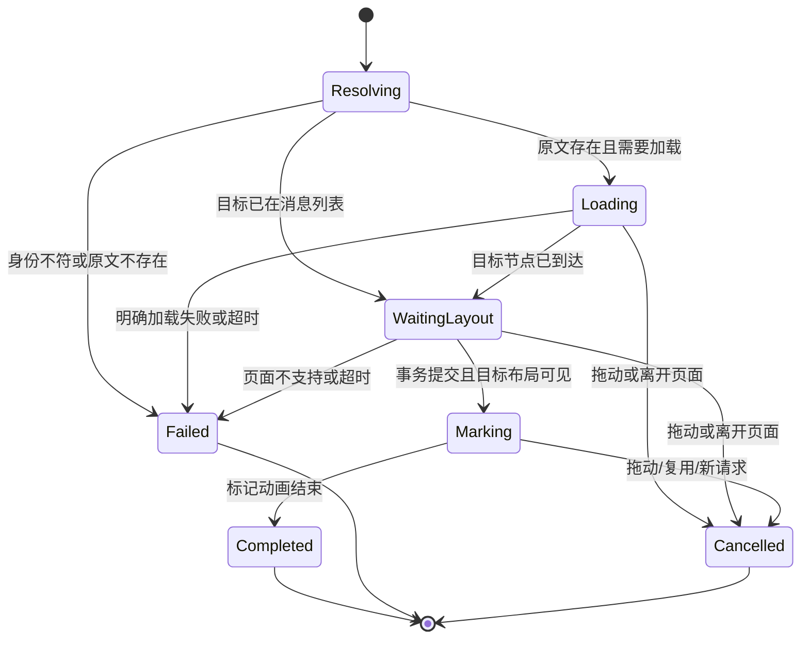

# 气泡样式与防撤回定位重构方案

日期：2026-10-16。目标环境：微信 8.0.78 / Rootless，用户安装版本 1.6-2。

状态：方案与源码审查完成，本文不代表已实现、已打包或已通过真机验收。本轮不修改功能源码、不替换已有包、不操作微信数据库。

## 1. 用户现象与完成目标

用户最新确认的 1.6-2 现象：

| 场景 | 实际表现 |
| --- | --- |
| 气泡样式 | 不生效 |
| 群聊，尚未退出当前聊天页面 | 蓝色文字能跳到对应位置，但没有原文标记 |
| 私聊，尚未退出当前聊天页面 | 点击蓝色文字无任何反应 |
| 群聊、私聊退出聊天页面后重新进入 | 点击蓝色文字均无任何反应 |

**此前将防撤回问题收窄为“缺少高亮”不完整，已被本次补充纠正。** 优先级调整为：先修复私聊点击与页面重建后的引用/上下文恢复，再确保最终定位和标记。要覆盖新插入的提示与从本地记录重新加载的历史提示两条路径。

沿用项目现有功能：气泡开关、1–30 pt 圆角、己方/对方及浅色/深色配色、红包/转账配色；拦截对方撤回、允许自己撤回、提示开关、蓝色原文链接。保留现有配置键、原消息、历史提示和旧包。

完成标准：设置后的样式实际出现在目标气泡上；点击原文链接后，原消息可见且明确标记；无法完成时明确说明原因。两者在合并开/关、头像隐藏、时间显示及复用时独立工作。不能把接口调用返回、行高数学正确或本地编译成功当作实机功能成功。

## 2. 证据与尚未确认的原因

| 代码事实 | 影响与判断 |
| --- | --- |
| `BubbleInfo.h` 有 `getNewBubbleImage:` 及三种 `getBubbleImage:` 入口；当前只 hook 三参数方法 | 单入口覆盖不足是明确设计风险；尚无证据证明 8.0.78 的具体绘制一定绕过该方法 |
| 上一轮交付时气泡路径对后台调用返回原生图；当前工作区已改为样式快照与调用线程局部绘图 | 旧包存在后台绘制失去自定义样式的可能；当前源码改动不能证明设备旧包已恢复。必须核对实际安装包与调用线程 |
| `bubbleName` 包含 `Sender` 被用来判断方向，包含 `pay` 等被用来判断类型 | 名称约定不能可靠替代消息模型；方向误判、误染普通卡片的风险存在 |
| `bgBubbleInfo` 把红包标志关联在返回的 BubbleInfo 上 | 对象是否被多个模型共享/复制不明，不宜作为消息身份的可靠载体 |
| 配置通知更新插件缓存，但没有气泡自身明确的可见视图重新应用流程 | 依赖微信再次取图，原生缓存或已显示 Cell 可继续保持旧图 |
| RGBA 全零被判为“未配置”；设置页读取还会写入默认色 | 用户保存的透明黑会被误判并覆盖。这是确定的设置语义缺陷 |
| 导航在首次 `scrollToMessage:...` 时传 `highlight:YES`，随后合并刷新、layout、偏移纠正，最后立即清理请求 | 没有独立验证最终高亮仍存在；符合“位置到了但没有标记”的现象，具体覆盖时序仍需实机记录 |
| `CSMessageNavigationFinishedLoading` 在一次检查后只要请求仍活跃就判失败 | 原生事务未提交也可能误判为加载失败 |
| 目标未加载、没有完成回调时，请求没有明确截止时间 | 请求可能一直保留，重复点击同一目标可能被吞掉 |
| 蓝色链接入口仅在 `tip.m_nsToUsr == currentSession` 时接管，其余直接 `%orig` | 若版本改变提示字段会静默失去插件处理。与私聊/重进后静默无响应相关的重点疑点，仍需记录实际字段和入口命中才能定因 |
| 逻辑控制器点击读取 `m_nsPattern`，系统消息链接点击从 href 解析 ID；两者都依赖当前页面和会话字段 | `m_nsPattern` 不是两条路径的共同唯一来源，不能仅凭重进失效就宣布是该字段未落库；还须验证重载后的 href、回调、模型与页面绑定 |
| `handleRevokeMessage` 将插入提示成功作为是否拦截的返回值 | 提示插入失败可能让本可保护的原消息继续被撤回，应分离业务结果 |
| `HideChatTimeHooks.xm` 的隐藏撤回提示开关对全部 SystemMessage 模型返回零高度并禁用布局 | 会误隐藏其他系统消息，缺少类型判断与复用恢复，纳入必要联动修复 |

头文件仅提供候选接口与签名，不提供真实继承、调用线程、参数业务含义及先后顺序的证据。当前源码已有未对应旧包的修改，本轮保留它们，不依据文件名猜测安装状态。

主要参考：`Hooks/BubbleStyleHooks.xm`、`Hooks/RevokeHooks.xm`、`Hooks/HideChatTimeHooks.xm`、`Controllers/CSMessageNavigation.m`、`Controllers/CSBubbleStyleSettingsViewController.m`；`HeadersFile/BubbleInfo.h`、`CommonMessageCellView.h`、`BaseChatCellView.h`、`SystemMessageCellView.h`、`ILinkEventExt-Protocol.h`、`BaseMsgContentViewController.h`、`CMessageMgr.h`。

## 3. 三种路线

| 路线 | 优点 | 局限 |
| --- | --- | --- |
| 只修现有 Hook | 修改量小，可快速验证后台取图和高亮时序 | 仍依赖单一入口、隐式刷新、共享元数据，后续组合问题难定位 |
| **保留原生 Cell，重构样式应用和导航完成协议（推荐）** | 保留微信布局与交互，明确模型身份、状态、缓存和结束条件，能够单独测试 | 需要真实入口诊断和受支持消息类型的验收 |
| 自建聊天 Cell / 完全重画所有消息 | 表面上掌控全部显示 | 必须重做语音、图片、引用、菜单、无障碍等大量行为，性能和兼容代价过高 |

推荐第二种。气泡绘制与原文导航是两个独立组件，共享已核验的原生桥接和页面绑定信息；不共享可变的“当前聊天/当前消息”全局状态。

## 4. 气泡样式：最终显示由真实消息 Cell 驱动

### 4.1 配置与消息描述

- `CSBubbleStyleConfiguration` 读取同一组现有 keys，产生只读快照和 generation。缺失值用默认色；RGBA 全零是合法配置，读取不写回。非法数值有限化并夹取，圆角维持现有 1–30 pt 范围。
- `CSBubbleDescriptor` 在真实模型绑定时取得方向、消息种类、原生分段形状、主题、显示 scale 和模板度量。方向使用已验证的 `isSender`，类型使用消息类型/结构化支付字段，不能仅靠 `bubbleName` 或全文包含“转账”判断。
- 长文本“同一消息内部的分段”与“多条连续消息归组”是两个独立维度。本次不新增聊天合并形状，不把归组直接写成原生 position。
- 当前普通文字/语音等原生气泡、红包/转账各自登记适配能力。图片、视频、表情、引用/业务卡片仅在确实存在可替换背景且验收通过时纳入；不能覆盖内容本身。未知类型保留原生。

### 4.2 统一 renderer，单一应用所有者

主方案：以真实 `CommonMessageCellView` 的背景视图作为最终样式应用对象。在已核验的绑定、原生更新和布局完成入口，取原生基线图及 descriptor，再应用本模块生成的图像。只改背景图片及必要的高亮图片，不改气泡 frame、消息尺寸、昵称、头像、时间或点击区域。

`CSBubbleRenderer` 生成小尺寸可拉伸模板，保留原生形状语义、必要内边距、image scale、orientation、resizingMode 等元数据。模板尺寸由圆角与原生度量推导，不按完整长消息像素尺寸生成大图。对于无法映射的形状，保留原生并记录一次原因。

视图记录绑定 token、消息身份、样式 generation、当前原生基线图和本模块生成图。相同描述不重复赋值；Cell 复用时清理自有状态；关闭功能时恢复最新原生基线，不能恢复其他消息的旧图。背景图片被原生重新赋值时重新验证绑定和基线，不把自己生成的图当作新基线。

若运行时确认原生异步赋图会覆盖上述入口，在**已绑定的背景视图**上增加窄范围赋图适配，带重入保护；不全局替换所有 UIImageView 的图、不遍历子视图猜测背景。若确认图片 getter 才是该类型的唯一可靠入口，则由能力表选择 getter 路径；同一消息类型只能有一个应用所有者，禁止 getter 与 Cell 两层重复改图。

所有候选 getter 都先记录真实调用关系，不盲目同时 hook 四个重载。若需要多个包装入口，嵌套调用只允许最外层应用一次，正常/高亮参数含义必须由运行时和原生图验证，不能把匿名 BOOL 直接当成发送方向。

### 4.3 线程、刷新与缓存

- UIView 读取和赋值只在主线程；离屏图像生成只使用不可变描述、局部 Core Graphics context 和明确 scale，不在后台读 UIView/UIScreen/可变全局颜色。
- 主线程优先复用小模板缓存；若必须异步生成，返回结果须核对消息 token、generation、主题和目标视图，丢弃过期结果，不持有 Cell 强引用。
- NSCache 建议延续 128 项/8 MiB 成本阈值，另限制单模板像素上限；阈值不是绝对进程内存上限。key 包含颜色/配置代次、方向、类型、形状、主题、scale、模板度量及高亮状态，比较使用规范化的实际值。
- 设置变化、浅深色变化、聊天背景样式变化只标记受影响的可见背景，主线程合并应用一次；离屏 Cell 下次绑定时使用最新快照。不为改颜色调用全表 reloadData 或重算消息行高。
- 默认不记录逐帧日志、不启动计时器或 DisplayLink；诊断模式只记录有界计数与首次失败原因。

## 5. 防撤回：分离保留原文、提示与点击导航

### 5.1 事件处理与提示身份

将撤回拦截改为明确结果：`NotHandled`、`PreserveOriginal`、`NativeSelfRevoke`，提示写入结果单独记录。仅在已识别且核验为需要保护的他人撤回事件时拦截；自己撤回、无法识别和无可靠身份时按原生处理。

解析限定的撤回 XML 结构，处理 CDATA 与实体；ID 严格完整解析。禁用外部实体解析，不能因普通文字出现“撤回”或“recalled”就认定为撤回事件。优先结构化身份判定自己撤回，语言文本仅作为经过约束的兼容依据。

一次事件由账号、会话、原消息服务器 ID 标识并去重；多个微信入口交给同一协调器，避免重复插入。提示失败不撤销已经作出的保护决定。内存去重有界；重启后的重放是否需要查重，通过原生局部查询能力验收，不扫描整个历史库。

新提示带版本化的可重建引用：服务器 ID、存在时的本地 ID，运行上下文持有账号/会话。引用写入经验证能持久保留的链接内容，`m_nsPattern` 只作兼容补充，不是唯一真相。不要新增聊天数据库或迁移微信表。

保留 `revoke_jump_<serverID>` 旧链接解析，旧提示不批量重写。缺少有效 ID 时显示普通摘要，不创建永远不可跳转的蓝色链接。本地 ID 只在服务器 ID 缺失且存在可信本地引用时使用；同时存在时必须一致，不能在不匹配后用本地 ID 猜另一条消息。

隐藏提示开关只作用于明确识别的撤回提示，保留其他系统消息；复用和开关切换恢复本模块修改的视图与测量状态。隐藏提示不影响保留原文。为保持当前行为，本轮不改变防撤回总开关关闭后旧链接的可点击策略。

### 5.2 点击路由与明确结果

**区分持久身份与页面状态。** 原消息引用必须能从重新加载的提示恢复；控制器、Cell、关联对象和导航请求仅为当前页面的短期状态。退出页面取消请求/标记是正确行为，但不能成为历史链接永远失效的原因。

页面每次进入、Cell 每次绑定都根据真实所有者重建弱引用上下文，并标记新的页面 generation。点击时重新读取提示引用及当前账号/会话，创建全新请求；不能要求它复用“提示刚插入时”的模型、Cell 或关联对象，也不能让上次页面的去重状态吞掉新点击。

会话按明确规则解析：当前 Cell 所属聊天与模型 chatContact 必须一致；私聊以当前账号与对端为关系，群聊以群 ID 为会话、真实发言人为成员。提示的 from/to 是兼容校验依据，不能把“to 必须等于聊天 ID”当作所有私聊/重载情况的必要条件。若独立证据冲突，拒绝导航并明确反馈；不删除身份校验来换取表面可点击。

旧提示读取顺序：实际点击 href → 在提示正文中解析明确的自有链接元素 → 兼容 `m_nsPattern`。每条来源都严格解析协议与 ID；同时存在多个来源但身份冲突时不任选一条。普通正文中碰巧出现数字或相似字符串不能成为导航目标。历史 href 若未由微信保留，需要先证实持久可用的载体再确定新引用格式；不能只加另一处内存关联对象掩盖问题。

从实际系统消息 Cell / model.delegate / 所属控制器获得页面上下文，不用前台窗口猜测。结合聊天绑定、提示模型 chatContact、发送/接收字段建立一致性检查，不再只依赖提示 `m_nsToUsr`。

头文件列出的多个 `onLinkClicked` 变体和逻辑控制器入口，仅安装运行时确认需要的适配。普通网页、电话、群成员等链接仍交还原生。已识别为本插件链接后必须得到明确结果：已定位、加载中、不可定位或用户取消，不再在关键失败处静默 `%orig`。

同一点击若经多个回调进入，使用请求 token 去重；用户的新点击可以替换旧请求，不能因某个旧请求一直未完成而永久吞掉重试。

### 5.3 导航状态机与目标标记

- 消息查询遵循原生管理器已验证的队列约定，不把私有同步查询任意搬到后台；UI 操作留在主线程，避免在滚动回调查询数据库。
- 原生负责查询原文、加载历史和基础滚动；优先使用已验证的 `scrollToMessage`，不能把 calculateOffset 当 marginTop。
- 完成信号以目标身份、真实节点出现、表格事务结束、布局可用共同判定；任意一次加载回调都不能直接等同于目标成功/失败。
- 合并模块提供明确的完成通知或结果：`settled / deferred / unavailable`。导航期间暂停其滚动锚点纠正；必要布局完成后才计算最终目标矩形。
- 每个请求至多做一次最终位置纠正。短消息在实际无遮挡区域中可见；长消息显示顶部及可见的首个内容片段，不因整 section 包含时间行而偏移。
- **先稳定位置，再显示本模块拥有的原文标记。** 原生首次导航使用不高亮路径，最终标记统一管理，避免原生提前高亮后被后续刷新覆盖或双重闪烁。
- 默认视觉：目标气泡外围短暂的描边/淡色标记，约 1.2 秒，随后清理。不覆盖原气泡颜色、不改变尺寸、不屏蔽点击；长文本只标记可见内容部分。目标为没有气泡的图片/表情时标记内容矩形。
- 标记放在聊天页面的专用非交互覆盖层，按当前目标内容矩形坐标定位并裁剪到有效可视区域，不参与消息测量。无需每帧更新；用户拖动、布局结构改变、Cell 复用或请求失效时立即移除。
- 减弱动态效果开启时使用静态描边停留后消失；VoiceOver 可提示“已定位原消息”。正常成功不弹阻断式对话框。
- 请求进入 Loading 或 WaitingLayout 时共用一个可取消的单次截止任务，建议从首次等待起默认 8 秒，状态变化不重置期限；仅对活跃请求有效，成功/失败/取消销毁。不是周期轮询，聊天静止时没有常驻定时器。失败给出清楚的短提示并允许再次点击；上一次请求的迟到回调不能影响新请求。

## 6. 与现有功能的边界

| 模块 | 所有权 |
| --- | --- |
| 消息合并 | 相邻关系、头像/昵称合并覆盖、安全间距、布局版本及完成事件 |
| 气泡样式 | 背景图像、模板缓存、主题/设置变化，不改行高或隐藏头像 |
| 消息时间 | 时间文本、点击可见性及位置，不识别红包、不驱动导航 |
| 隐藏头像 | 用户隐藏偏好与原生显示条件，不由气泡或原文标记强制恢复 |
| 防撤回 | 事件判定、保护决定、提示引用、查询与导航请求 |
| 目标标记 | 一次导航的临时可视提示，不修改原生消息样式和数据 |

共享桥接函数应从合并命名空间提取为中立的聊天原生桥接，避免关闭/缺少合并模块让其他功能失去上下文。重构顺序逐模块替换，旧新实现不能同时控制相同属性。

## 7. 验证与交付

### 7.1 本地测试补齐真实缺口

- 配置：全零透明颜色、部分缺失、非法值、只读不写回、样式代次变化。
- 绘制：真实 renderer 正常/高亮、浅深色、己方/对方、分段与支付类型的图像快照；验证圆角、拉伸中心和模板像素上限。
- 适配：绑定到背景图的最终结果、原生重新赋图、复用、异步结果过期、开关恢复；覆盖 getter 重载是否相互调用及缺少接口时的回退。仅测纯函数不够。
- 撤回：结构化 XML、自撤回、重复入口、提示插入失败仍保持正确保护决定、旧新链接、无有效 ID、不误隐藏其他系统消息。
- 页面重建：丢弃原 controller/Cell/model 和全部关联对象，以从存储重建的提示创建新页面；分别测试 href 存在但 pattern 缺失、私聊 from/to 变化、旧请求失效、重复重进和账号不匹配。替身重建测试不等于验证微信真实落库，后者必须实机完成。
- 导航：真实入口适配代码调用到查询、加载、布局完成和标记；刻意乱序回调、原生事务未结束、重复点击、一次纠偏、缺失目标、一次性超时、用户拖动取消。
- 标记：必须在布局稳定后出现；短消息、长文本、无气泡内容；标记不改变气泡图像或行高；复用/取消后消失。

### 7.2 设备诊断与验收

首个诊断构建记录实际微信版本、注入器、插件版本与构建指纹。对同一条提示按“插入后 → 首次点击 → 退出 → 重进绑定 → 再次点击”比较以下状态：提示本地 ID、href 是否存在及解析是否成功、pattern 是否存在、from/to 与当前账号/会话的关系、模型 chatContact、页面 generation、点击回调命中、请求创建/拒绝原因、原文查询和导航阶段。只记录会话关系布尔值及进程内脱敏关联标识，不导出消息正文或联系人明文。群聊与私聊分别采样，不能用群聊首次成功代替其他情况。每个特性记录能力检查、入口是否命中、线程、应用成功计数与最近一次失败阶段。点击记录 request token 和状态阶段，不记录聊天正文、联系人明文或无限增长日志；诊断默认关闭，有界按需导出。

先确认气泡实际赋图成功，以及群聊/私聊首次点击、退出重进四个导航场景均成功，再验证标记和扩展组合：

| 场景 | 必须观察到的结果 |
| --- | --- |
| 私聊与群聊的己方/对方普通消息 | 圆角和配色对应设置，合并关闭也有效 |
| 浅深色切换、改变颜色/圆角、开关气泡 | 可见消息更新；关闭恢复原生，无需重进或重启 |
| 红包、转账、引用、长文本及混排 | 只修改已适配背景，不误染正文/卡片，不残留旧消息样式 |
| 群聊/私聊新插入提示，原文已加载 | 两者都能点击、滚动正确且目标出现约 1.2 秒标记 |
| 群聊/私聊退出后重进同一聊天 | 同一条旧蓝色链接仍可点击、定位并标记；不要求重新收到撤回消息 |
| 群聊/私聊多次进出及微信进程重启后加载历史提示 | 引用可重建、请求无旧页面依赖；不因 pattern 缺失静默失效 |
| 新旧格式提示混排 | 旧版本已生成的有效链接继续工作，不批量修改历史记录 |
| 蓝字原文需要加载历史 | 加载和合并布局完成后标记，不提前闪一下就消失 |
| 键盘打开、长原文、合并/头像/时间组合 | 目标内容位于有效视口，标记不改变其他设置 |
| 快速连续点不同链接、拖动、离开页面 | 旧请求/标记及时取消，不跳回旧目标 |
| 原文已删除或加载失败 | 有明确失败反馈，无永久等待或误跳 |
| 开启隐藏撤回提示 | 仅撤回提示隐藏，其他系统消息保持原生显示 |

同一设备、账号、数据和其他插件配置，关闭/开启组合做至少三轮滚动 A/B；记录 hitch、CPU、缓存及内存变化，10 分钟脚本观察能耗。静止聊天无周期唤醒；一次跳转只有有界的一次性等待与动画。没有实机数据不声明零卡顿或零额外耗电。

发布使用新版本号，保留 1.6-0、1.6-1、1.6-2 包，记录源码指纹和包 SHA256；未验证完成的包标为诊断/测试包。关闭单一功能不等于回退整包，不用新账号或空聊天数据库替代用户现有环境验收。

## 8. 实施顺序

1. 给现有入口增加可关闭的阶段诊断，确认 1.6-2 的取图调用，并首先区分私聊/群聊新提示和退出重进后的引用、会话关系与点击路由；不以猜测宣布根因。
2. 重构配置/renderer/Cell 应用闭环，先验证普通气泡，再纳入支付和分段消息。
3. 重构提示引用恢复、私聊/群聊会话解析和每次进入页面的绑定，先修复首次私聊与退出重进无反应；再重构导航状态机和布局完成后的可靠标记。旧提示、页面重建与微信重启均为交付门槛。
4. 分离防撤回保护与提示写入，修复只隐藏撤回提示的类型判断及恢复。
5. 跑新增回归、双架构编译和真机组合验收，再交付可作为日常使用候选的新包。

本方案提供可实现、可诊断、可验收的边界，不承诺未经设备验证的“完美”。
