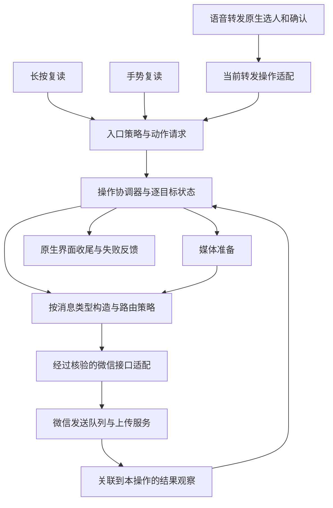

# 语音转发与复读重构方案

日期：2026-10-17。状态：设计提案，尚未实施。

设计基线：本轮工作目录中的 1.7-17 源码，HEAD 为 `2aa7bcb8`。实施前重新记录三个目标 Hook、设置页、公共适配器及相关私有头文件的哈希；不把此版本标识当作设备当前安装版本。本轮仅新增本文档，不修改功能源码、配置、安装包或微信数据。

## 1. 目标与范围

保留用户已经认可的功能、入口、操作习惯和现有配置，重构语音转发、长按复读、手势复读及其直接依赖。完成后，同一消息的核心准备和发送能力由共享组件负责，入口差异由明确策略表达。

完整性以“旧版本能完成的用户场景，新版本仍能完成”的对照验收为准；不能用减少支持类型、关闭多选、取消兼容路径、要求重新设置或静默拒绝来换取实现简单。

修复误收集目标、部分失败无反馈、重复提交风险和无效持有，不把这些缺陷列为应保留的功能。下载完成自动续发是本提案明确提出的体验完善：保留一次用户操作的意图，不引入确认前发送。

不扩大为全项目重写。聊天分组、气泡、消息时间、撤回、红包、收款、游戏辅助、后台模糊等模块保持现有职责；本次对共享菜单和消息发送的改动需要验证与这些功能组合使用。

## 2. 方案选择

| 路线 | 优点 | 局限 | 决定 |
| --- | --- | --- | --- |
| 共享发送组件＋明确的微信适配层，分阶段迁移 | 能保留当前能力，消除重复实现，隔离版本差异，可逐场景验收和回退 | 需要先核验私有调用语义 | 推荐 |
| 只抽工具函数、继续保留三套发送分支 | 初期改动较少 | 状态、幂等、失败处理继续分裂，后续容易再次漂移 | 不作为最终结构 |
| 全部改成直接操作底层发送／上传服务 | 插件表面上更可控 | 必须自行重建微信消息语义、界面收尾与上传生命周期，兼容成本最高 | 不采用 |

## 3. 功能不缩水清单

### 3.1 入口和开关

| 入口 | 保留行为 | 配置契约 |
| --- | --- | --- |
| 长按语音转发 | 原生选人和确认体验、单选／多选、私聊／群聊目标、己方／对方语音、取消 | 沿用 `com.wechat.enhance.voice_forward.enabled` |
| 长按复读 | 在当前会话发送一条新的同内容消息，保留菜单名称、图标及原有可用范围 | 沿用 `com.wechat.enhance.repeat.enabled` |
| 手势复读 | 己方／对方、左滑／右滑分别配置；不新增长按复读开关依赖 | 沿用手势总开关及四个动作键值 |
| 手势转发 | 保留现有 `onForward:` 原生入口；其中语音增强按语音转发策略接入 | 不重新定义已有手势转发语义 |
| 其他手势 | 引用、删除、收藏、撤回、禁用及现有触发反馈 | 动作枚举值和设置数据保持兼容 |

关闭长按复读只取消该入口，不影响已经配置的手势复读。语音转发与复读开关互不强制联动。关闭功能后禁止接受该入口的新任务；尚未提交的对应任务取消，已经交给微信的任务继续由微信负责，不能通过开关反向撤销已发送消息。

菜单构造、可用性判断和动作执行使用同一入口策略。菜单只按插件自己的 action 标识去重，保留原生和其他插件菜单项及其相对顺序。不得把语音转发存在作为添加复读菜单的条件。

### 3.2 消息能力

| 消息 | 源码中的现有覆盖 | 重构要求 |
| --- | --- | --- |
| 文本 1 | 长按／手势；逻辑控制器文本发送；手势另有聊天控制器回退 | 保留多行、Unicode 和正文；维持既有 @、群消息前缀等实际表现，不擅自引入新语义 |
| 图片 3 | 重发／发送队列路径 | 保留原图／缩略图关联和媒体获取能力，接收端可打开 |
| 语音 34 | 长按／手势复读、语音转发；数据与语音扩展信息构造 | 可播放，格式、时长和群聊路由正确；已下载／未下载都可完成 |
| 视频 43 | 专用转发生成、通用转发生成、CaptureVideoInfo 发送及队列兼容路径 | 保留这些能力，经验证的路由按能力选择，接收端可播放 |
| 表情 47 | MD5 字段／内容解析、AddEmoticonMsg；手势另含表情对象与逻辑控制器回退 | 不能只迁移最短的 AddEmoticonMsg 路径；保留己方／对方处理能力及游戏表情组合行为 |
| 名片 42 | 手势分支明确处理；长按允许列表未包含 42 | 保留已有手势能力，不以重构为由删除，也不未经确认扩大长按菜单范围 |
| 位置 48 | 长按允许；使用通用发送分支 | 保留实际发送和接收端打开能力 |
| 应用消息 49 | 文件／引用等使用重发分支 | 逐子类型保留现有可用能力；不能把所有 49 都当成文本或空包装 |
| 其他类型 | 手势存在通用发送路径 | 记录旧版实际可用范围，迁移通用兼容路径；禁止仅凭上述枚举新增狭窄白名单而删掉能力 |

类型号存在不等于所有子类型已验证支持。第一阶段必须区分“源码允许”“旧版真机可完成”“新实现已完成对照验证”。旧版可用场景未迁移通过时，不删除对应兼容实现，也不把新实现标记为发布就绪。

保留现有设置键、默认值、备份／恢复和重置语义；本次不把全局开关改为按账号配置。任务身份和媒体隔离则必须包含账号。

## 4. 目标结构

原生转发依然拥有选人、确认和其原生生命周期；插件在核验后的消息准备／提交边界参与。图中的共享组件不意味着所有原生回调都被插件接管。

建议组件如下；小型值对象可放在同一头文件，不要求每个概念拆一个文件。

| 组件 | 输入／输出及职责 |
| --- | --- |
| `CSMessageActionPolicy` | 配置＋入口＋消息描述 → 是否可用、类型策略；集中开关和支持范围，不直接发消息 |
| `CSMessageActionCoordinator` | 动作请求 → 逐目标结果；维护操作身份、取消、状态和资源生命周期 |
| `CSMessageMediaProvider` | 账号＋消息身份＋媒体描述 → 准备好的媒体资源；合并并发下载，处理就绪、失败和超时 |
| `CSMessageSendAdapter` | 已准备的目标请求 → 提交结果；统一私有方法签名、路由能力与线程约束 |
| `CSVoiceForwardAdapter` | 原生转发操作 → 精确选中目标、确认事件、允许参与的消息边界；维护原生流程的单一所有者 |
| `CSMessageSendObserver` | 已验证的微信事件 → 本操作结果；按消息身份关联，绝不观察到任意消息就修改当前任务 |
| `CSMessageActionMenuAdapter` | cell 消息上下文＋入口策略 → 插件菜单项；复用图标、只在必要范围内接入 |

按类型构造逻辑先作为发送适配器内部独立实现单元：文本、语音、视频、表情、图片／名片／应用消息／通用兼容。只有复杂度需要时再拆独立策略文件，不建设通用插件注册框架。

复用 `CSGetService`，不再复制三套服务中心查找逻辑。扩展现有 `CSChatNativeBridge` 的必要读取能力，避免另起同名类声明。`WCPLMessagePersistenceAdapter` 保持本地插入职责；它返回的“调用已执行”不能被解释为发送成功。

三个 Hook 保留原入口。迁移完成后，它们主要负责提取上下文、校验入口、调用共享组件和按契约衔接原生方法，不再保留完整发送算法。

## 5. 操作身份、逐目标状态与幂等边界

每次用户有意触发的操作创建新的 operationID。任务保存账号及账号代次、源会话和稳定消息身份、入口、源消息类型／子类型、确认状态、目标快照、路由版本及取消标记。复读的目标必须与触发时的聊天上下文一致；异步完成时不能改用“当前最上层聊天”或全局当前逻辑控制器。

原生 cell 和页面使用弱引用。必须持有的消息／媒体资源有明确所有者；UIKit 和原生可变消息对象不跨线程随意访问。源消息只读，不能通过发送包装修改其共享扩展对象。

每个目标单独维护以下状态：

| 状态 | 含义／允许动作 |
| --- | --- |
| Created／AwaitingConfirmation | 已创建，转发尚未确认；不得提交 |
| Preparing／WaitingForMedia | 获取媒体、构造参数、核验账号和目标；可以取消 |
| Ready | 可以提交，但尚未调用有副作用的发送接口 |
| Submitting | 已进入发送调用；尚不能证明成功或未受理 |
| Accepted | 有可靠证据表明微信已接管；后续上传重试归微信管理 |
| Succeeded | 观察到匹配当前账号／目标／消息的成功事件 |
| FailedBeforeAcceptance | 确定尚未被接管的失败；允许选择安全兼容路由或明确重试 |
| FailedAfterAcceptance | 微信已接管后报告失败；使用原生失败消息和其重试流程 |
| Unknown | 调用可能已产生副作用，但无法确认结果；禁止自动换路由再发 |
| Cancelled | 仅指尚未提交的任务已取消；已受理消息不能标记为撤销发送 |

`Accepted` 不冒充 `Succeeded`；`void` 方法正常返回也不自动证明受理。适配器明确区分“已验证同步受理”“仅调用已返回”“已验证无副作用拒绝”。超时和异常默认不证明未受理。

同一操作、同一目标只能拥有一个提交所有者；重复回调不重复提交。每个目标有独立的发送包装和客户端身份，跟踪原生最终赋予的本地 ID。不同操作不共享去重键，用户主动连续复读同一消息两次仍然发送两条。

插件只能保证自身在已知边界内不重复提交，不能宣称微信服务端全链路 exactly-once。进程重启后优先使用微信现有发送记录和队列，不自动重放内存中断的意图；不新增无依据的持久化重发队列。

多目标返回结果集合，不再使用一个 BOOL。部分失败仅处理明确失败的目标；不得对整批执行原生回退。明确受理／成功的目标不重新提交，未知目标不自动重试。反馈用“已提交／失败／待确认”对应证据，不能用“发送成功”覆盖未知结果。

## 6. 语音转发与原生流程的衔接

第一优先选择：保留原生选人、确认、逐目标转发和界面收尾，在核验后的消息构造或最小发送边界提供合法语音包装。只处理已经绑定本操作的语音、目标和生成包装，不能仅凭全局开关修改所有 `GenForwardMsgFromMsgWrap:` 调用。

不继续把 `OnForwardMessageSend:` 默认当作“发送之前”的入口。头文件只表明它是 delegate 回调，真正发生在原生发送前、发送后还是清理阶段，必须通过目标版本证据确定。正常通知／清理回调保留原生语义，不能因为插件有一条发送调用返回就直接吞掉。

如果目标版本确实需要插件负责语音提交，则在明确的发送前边界接管该消息，并验证原生不会再次提交。该替代路线仍使用原生 UI，且必须证明关闭确认页面、附言、成功提示、取消和管理器清理的行为完整。两种所有权方案在单次操作中只能选择一种。

目标只来自本次确认对应的 `ForwardMessageLogicController.getToContacts` 或经版本验证的等价接口。能力不同时可保留有限、明确、类型安全的字段适配，例如已核验的 `m_toContacts`；不扫描所有 forwardMessageLogics，不收集通用 contacts 或任意字符串。

选人取消、目标调整、重复确认、页面关闭均按 operationID 和原生逻辑对象关联。读取目标时保留顺序并按用户名去重；发送时重新校验当前账号。不能把安全校验失败改成猜测接收人。

附言等原生确认页中已有能力必须列入对照验证：它可能由原生流程单独发送，插件不得遗漏，也不得重复代发。多目标中其他消息类型保持原生流程。

## 7. 媒体准备与消息构造

一次操作只准备一份可复用的源音频及解析结果，多目标使用不可变资源引用。并发操作处理同一源文件时，可按账号、源消息身份和文件代次合并读取／下载；取消一个订阅者不取消其他订阅者。

本地文件存在不等于准备完成。结合经核验的下载状态／完成通知、文件有效性和媒体属性判断就绪，覆盖零长度、部分文件、读取失败和文件在准备期间变化的情况。对确无通知的兼容版本才允许有期限、可取消、次数受限的就绪检查，不使用永久定时轮询。

文件大小检查在读取前进行。内存并发预算限制同时加载的资源量，超预算任务排队；支持原生文件路径的发送路线优先使用路径。不能为了限内存给所有旧版可用媒体统一增加 20 MB 功能上限。若某条接口只接受整块 NSData，则保留已验证可用范围并限制同时准备数；不能把待解决的资源问题包装成“不支持”。

语音时长在内部使用明确单位，边界按已验证接口转换；精确时长不先向上取整到秒再乘回毫秒。旧代码通过数值大于 300 猜单位的规则作为待替换兼容行为，须用设备证据验证替代值。格式、结束标记、下载状态和扩展信息字段使用集中、命名的版本语义，不在三个入口散落魔数。

文本使用已验证文本发送路线。视频保留 CaptureVideoInfo 与通用生成路径。表情保留 MD5 解析、表情对象解析、逻辑控制器及队列兼容能力。应用消息保留实际需要的子类型载荷，不统一重建成空消息或普通文本。

新包装重置消息身份，保留本类型必要载荷；必须验证 copy 的深浅行为和扩展对象共享情况。原图、语音、视频及微信原始媒体文件不被改写或删除。任务自己创建的临时资源才由任务清理，并遵守宿主发送方的资源持有期。

## 8. 线程、性能和资源生命周期

状态迁移和 UIKit 操作先统一在主线程执行，保持串行且只做轻量工作；文件读取与纯数据解析放入专用后台操作队列，初始最大并发为 1。微信服务查询、原生消息对象读写和发送调用遵守已验证线程契约，未知契约暂保留原调用线程，不盲目异步化。

后台完成回到状态执行线程后，重新检查 operationID、账号代次、取消状态及源消息身份。通过这些检查不能让旧账号任务在新账号下发送。切换聊天页不重定向任务；已确认转发可继续，已触发复读保持原目标，失去安全发送上下文则提示无法继续。

原生提交不需要插件按上传完成逐条阻塞；按微信受理能力调度，并遵守其限流。大量同步准备或提交可分批让出主线程，但只能在接口允许时采用。

类和方法能力缓存按宿主构建／运行时配置管理，账号服务不能作为跨账号永久缓存。字段读取只探测受支持的确定接口；正常路径不产生未知键异常。移除无用途菜单遍历；图标按必要的主题参数缓存。没有操作时，不创建轮询、显示帧回调或额外保活任务。

媒体生命周期以最后一个使用者和宿主持有契约为准，不能在“方法返回”时提前销毁仍会被上传服务读取的临时文件。结果观察超时只释放插件不再需要的状态，不删除微信失败记录，不假装取消了已受理发送。

## 9. 私有头文件与兼容接口规范

业务头文件只暴露类型明确的动作请求、媒体描述和结果对象。新增的私有发送声明集中于一个适配层专用头文件；已有 WCHeaders 声明通过合适的 category／共享声明扩展，避免重复定义同一类。HeadersFile 保留为参考，不批量引入其整个依赖树。

每个被调用的私有接口记录：类／实例方法、完整参数和返回 ABI、实际语义、线程、对象所有权、可能副作用、可用替代路线、证据版本。`respondsToSelector:` 仅证明存在；签名兼容不等于语义兼容。`initWithMsgType:` 按头文件中的 long long 类型核验，下载方法保留实际 BOOL 返回，但不把 BOOL 当作下载已完成。

服务获取统一复用 `CSServiceCenter`。结果未知的发送调用不能通过捕获异常自动变成“可以再调用另一服务”。上传服务有多个时选择经能力验证的一条；保留替代服务作为受理前可选择的兼容路线。

下面证据必须在相关路线切换前取得，否则该路线继续使用现有实现并阻止删除旧分支：

1. 原生选人、确认、逐目标发送与 OnForwardMessageSend 的真实顺序和清理所有者。
2. AddMsgToSendTable 的副作用、受理证据、本地 ID 写入时机及状态值含义。
3. AddLocalMsg 与各 ResendVoiceMsg 服务的前置条件、返回后资源生命周期及重试所有者。
4. 可可靠关联到账号／会话／消息的发送结果和媒体下载完成事件。
5. 语音时间单位、格式字段、copy 的共享关系和视频／表情特殊路由。

这些是实施验收条件，不是已经验证的事实。真机证据缺失时不发布会删除现有能力的新路径。

## 10. 错误、反馈和诊断

错误分为媒体未就绪、下载失败、账号已变化、源消息失效、目标无效、接口不可用、明确提交失败、微信接管后失败、结果未知。可恢复错误提供对应行为；不要统一变成 NSLog 后结束。

短任务优先沿用原生反馈；媒体等待较长时显示轻量可取消提示，避免每条成功消息增加弹窗。部分失败按目标汇总，已提交的消息仍由原生列表展示。任务回调不强持有聊天页面。

默认日志只记操作 ID、类型、路由、阶段、耗时和错误码，不记录正文、完整音频路径或明文联系人。诊断为有界记录，调试开关关闭时不在滚动、布局和普通消息转发路径执行昂贵工作。

## 11. 分阶段迁移

| 阶段 | 交付物 | 进入下一阶段的条件 |
| --- | --- | --- |
| 0：冻结功能基线 | 当前源码哈希、设备微信实际构建／iOS／插件版本、入口与消息场景清单、既有配置快照 | 能区分已确认能力与仅存在的代码分支；与其他活跃任务划清文件职责 |
| 1：验证原生契约 | 上节五类接口证据、可独立运行的替身测试、已验证的路由表 | 每条准备启用的路线有受理边界、线程和生命周期证据 |
| 2：抽取共享读取和类型策略 | 统一服务入口、配置策略、消息描述、按类型构造及菜单适配 | 对照旧版生成的目标、类型、正文、媒体描述一致；此阶段不双发 |
| 3：迁移复读 | 长按／手势逐类型切到共享协调器；保留表情、视频和通用兼容能力 | 每个迁移类型完成双入口、双方向及群／私聊验证 |
| 4：迁移语音转发 | 当前操作目标提取、原生确认衔接、媒体准备和逐目标结果 | 单选、多选、附言、取消、部分失败、快速确认完整通过 |
| 5：清理和性能验收 | 删除无调用旧实现、重复类声明和无用探测；增加开发约束说明 | 全功能矩阵通过，设备性能不退步，回退包和配置兼容验证完成 |

类型顺序建议文本 → 图片／名片／位置／应用消息及通用兼容 → 表情 → 视频 → 语音复读 → 语音转发。各阶段保留当前可运行功能；不能用不完整的新引擎覆盖整类消息后再补功能。

迁移开关用于开发／灰度按类型或入口选择唯一引擎，不增加用户设置负担。允许比较纯路由决策或值对象，禁止同时执行新旧下载、包装生成或发送来“影子验证”，因为原生生成方法也可能复制文件或落库。

回退只作用于下一次尚未提交的操作；已提交任务保持原所有者，不在中途切回旧引擎重发。未经明确拒绝的异常不得触发动态旧路线重发。最终稳定后移除迁移开关，保留经过验证的版本兼容路由。

不迁移、不重建微信数据库，不修改历史消息身份，不清理聊天媒体。真实消息发送验收使用用户明确指定并授权的测试账号／会话。打包保留原环境方案和旧包，不执行会删除现有包的 make clean。

## 12. 验收标准

### 功能与可靠性

- 三个入口与既有配置完全对照；长按复读关闭时手势复读仍按原配置工作。
- 按“入口 × 可用类型／子类型 × 己方／对方 × 群聊／私聊”覆盖基本矩阵。
- 图片／视频／语音以接收端能实际打开／播放为准；转发以精确的目标集合和消息条数为准，不能仅检查本地气泡存在。
- 多选包含 1、2、10 个及宿主允许范围内的更多目标；附言、目标变化、确认取消、快速连续操作均不丢失。
- 重复原生回调只提交一次；用户有意操作两次产生两次发送。
- 未下载、下载中、零长度、读取失败、下载超时、网络中断、原生接口缺失均有明确结果。
- 覆盖所有目标失败、部分失败、受理后失败、异常发生于副作用之后、回调晚到和重复回调；未知结果不自动重发。
- 页面退出／cell 复用／切换会话不改变目标；账号切换后旧任务不继续调用新账号服务。
- 源消息及媒体不变；复制后修改发送包装不污染源消息和其他目标包装。
- 与消息合并、气泡、消息时间、防撤回、游戏表情、其他手势及原生菜单组合回归通过。

### 性能与资源

- 插件自有媒体文件读取不在主线程执行；正常目标提取不通过未知键异常探测。
- 非语音转发和功能关闭路径不进入语音目标扫描、媒体准备或结果观察注册。
- 同一批次同一语音只准备一次；插件持有的源媒体不会随目标数复制成 N 份。宿主内部复制单独测量，不能归入插件已保证的范围。
- 连续执行并结束 100 次任务后，在宿主上传结束及插件清理完成的条件下，活跃任务、监听订阅和插件持有页面数量回到基线；不以 RSS 必须逐字节相等作为判据。
- 用同一设备／微信实际构建／媒体集合比较旧版和新版，记录菜单弹出、确认后到首次提交的 P50／P95、主线程最长连续占用、峰值内存、文件读取次数及异常次数。
- 目标：插件新增的同步入口处理 P95 不超过 4 ms；这不包含微信原生界面和网络耗时，也不是已测结果。超过目标先分析分解，不能通过删功能或忽略原生耗时来宣称通过。
- 不引入空闲轮询或额外后台保活；媒体任务队列和诊断容量有明确上限。

### 验证层次与交付

Foundation 替身测试验证纯策略、状态和失败边界；调用录制验证接口次数、顺序、参数和路由所有权；原有相关回归保证模块组合；Rootless arm64／arm64e 构建验证编译；真机验证私有接口时序、接收效果和性能。替身测试不能替代真机验收。

每个旧版可用场景必须有新版对应证据。任何旧版可用场景缺失都视为未完成，不用总测试数量掩盖缺项。交付时说明实际源码／安装包版本、已验证的微信和 iOS 组合、未覆盖范围及可恢复的旧包。

## 13. 后续功能开发约束

新增入口复用动作请求；新增消息类型提供构造／路由策略和验收样例；新增微信版本适配只修改私有接口边界及能力配置。设置键集中定义，通知发布与订阅采用同一机制。禁止在菜单 Hook 或手势回调中再次粘贴整段发送代码。

完成标准是功能对照通过、发送边界有证据、资源可释放、性能可测量。不能承诺未知微信版本永远兼容，也不能把不确定的发送语义写成已经解决的保证。
