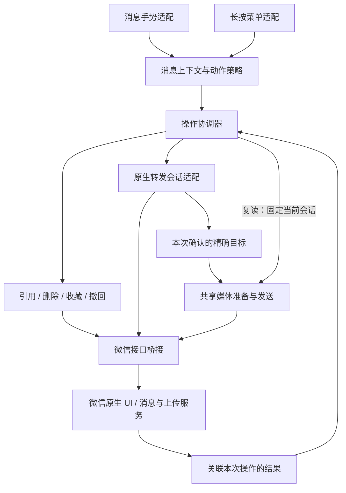

# 消息手势、语音转发、复读统筹重构方案

日期：2026-10-17。状态：供评审的完整设计提案，未实施、未部署。

源码基线：本轮工作区 `2aa7bcb8`，包元数据为 `1.7-17`；不代表手机当前安装版本。实施前再次记录文件哈希、手机实际微信构建与插件版本。本文依据当前源码、[消息手势审查](../../audits/message-gestures-2026-10-17/review.md)及已读取的 Codex 对话“评估语音转发与复读设计”（01a149f7-3f52-7af3-b6cc-d046ffb5570a）。

本文是三模块统筹设计的主文档，完整覆盖前一份[语音转发与复读提案](2026-10-17-message-actions-refactor-design.md)的发送、媒体和兼容要求，并补齐全部消息手势动作、交互状态及跨模块生命周期。前文保留为设计来源；发生冲突以本文的显式决定为准，不应各自实施成两套共享引擎。

## 1. 核心决定

产品上保留“消息手势”“语音转发”“复读功能”三个设置入口及既有操作方式；工程上合并为一个消息操作子系统，内部按交互适配、动作策略、执行协调、媒体与发送、微信桥接分层。

合并的是消息上下文、动作能力、配置契约、复读发送、语音媒体准备及结果管理。手势识别、长按菜单、原生选人与确认仍有各自的交互适配器。引用、删除、收藏、撤回走轻量原生动作分支；它们不创建发送队列、音频任务或逐目标发送状态。

| 方案 | 结果 | 决定 |
| --- | --- | --- |
| 一个消息操作子系统，保留三种交互边界 | 共用业务规则和发送实现，交互独立，可测试、逐项迁移 | 推荐 |
| 三个独立业务模块，只抽工具函数 | 手势复读、长按复读、语音转发仍各自维护状态、错误与兼容逻辑 | 不作为最终结构 |
| 合成一个大 Hook 或统一改为底层直接发送 | 交互、媒体、原生 UI 与数据副作用继续耦合，版本升级影响面扩大 | 不采用 |

目标是现有可用功能不减少、错误边界明确、性能可测、迁移可回退。微信私有接口随版本变化，因此“完善方案”必须包含证据与验收条件，不能承诺未知版本永久兼容。

## 2. 不变的产品契约

### 2.1 入口与配置

| 入口/配置 | 保留内容 | 依赖关系 |
| --- | --- | --- |
| 消息手势总开关 | 原键、原默认值、设置入口 | 关闭后不接管消息滑动 |
| 左滑己方/对方、右滑己方/对方 | 四个配置独立，动作枚举兼容 | 只受手势总开关和该方向动作控制 |
| 长按复读 | “复读”菜单、图标和当前支持范围 | 只受复读功能开关控制 |
| 长按语音转发 | “语音转发”菜单，原生选人、确认、取消 | 只受语音转发开关控制 |
| 手势复读 | 在触发会话发送同内容新消息 | 不依赖长按复读或语音转发开关 |
| 手势转发 | 进入原生转发流程；普通类型维持原生行为 | 不依赖长按复读；语音增强沿用语音转发开关，不擅自扩大其作用 |
| 配置备份/恢复 | 沿用现有保存位置和键 | 无数据迁移，不把全局配置改为按账号配置 |

手势动作枚举固定为：0 禁用、1 引用、2 删除、3 转发、4 收藏、5 撤回、6 复读。四个键继续使用 `com.wechat.enhance.left_swipe_other.action`、`left_swipe_self.action`、`right_swipe_other.action`、`right_swipe_self.action`，后面三个同属 `com.wechat.enhance.` 前缀。三个总开关仍为 `message_gesture.enabled`、`voice_forward.enabled`、`repeat.enabled`。

不新增总控制开关，不合并设置页，不要求用户重新设置。未知配置枚举按禁用解释且保留原始值，不重写用户偏好。撤回仍只在己方设置项提供，并受微信实时能力判断限制。

手势转发语音但语音增强关闭时，原生 onForward 能力仍按该微信版本原有行为处理；不能为了共享引擎而偷偷打开语音增强，也不拦截本来可用的原生行为。这一组合单独列入基线。

### 2.2 动作功能矩阵

| 动作 | 用户可见行为 | 执行边界 | 必须保留或修复的规则 |
| --- | --- | --- | --- |
| 引用 | 原消息进入当前聊天输入区的引用状态 | 经核验的原生引用接口及输入框逻辑 | 保留引用对象、焦点行为与必要兼容入口；仅在原聊天仍有效时操作 |
| 删除 | 先确认，再删除指定消息 | 微信删除节点接口 | 保留确认；确认时重新核对消息身份；不直接改数据库 |
| 转发 | 打开原生选人/确认，原生附言等能力继续可用 | 当前原生转发会话 | 在同一个 operationID 中衔接打开、确认、取消、发送；不重新创建第二次发送 |
| 收藏 | 使用微信原生收藏行为和反馈 | 原生收藏入口 | 采用真实可用性；不能把“调用完成”统一显示为“收藏成功” |
| 撤回 | 先确认，再按微信规则撤回己方消息 | 原生撤回能力与动作接口 | 不硬编码两分钟；确认时复核权限和时效；不影响防撤回模块职责 |
| 复读 | 当前会话收到一条新的同内容消息 | 共享媒体/发送能力 | 保留类型和兼容能力，源消息只读；用户主动两次操作产生两次发送 |
| 禁用 | 该方向不产生插件滑动、震动或动作 | 识别之前拒绝 | 禁用方向不先抢占再在松手时静默退出 |

不保留取消误触发、转发目标串台、无开关校验的菜单补入等缺陷。交互修正限于使手势与配置意图一致；不新增双阶段动作、速度档位或二级菜单。

### 2.3 消息范围不能缩水

| 消息类型 | 现有能力基线 | 新实现的要求 |
| --- | --- | --- |
| 文本 1 | 长按/手势复读；逻辑控制器发送、手势聊天控制器回退 | 多行、Unicode、群前缀、@ 等按现有真实行为对照，不擅改语义 |
| 图片 3 | 重发/队列兼容 | 保留媒体与缩略图关联，接收端可打开 |
| 语音 34 | 两种复读、长按语音转发、手势转发中的语音增强 | 己方/对方、群聊/私聊、单目标/多目标，可播放、时长与格式正确 |
| 视频 43 | 专用/通用转发构造、CaptureVideoInfo、发送兼容路线 | 原有可用能力都迁移；不把原历史包装直接投入发送队列 |
| 表情 47 | MD5、内容解析、表情对象、逻辑控制器、AddEmoticonMsg/队列路径 | 保留己方/对方及游戏表情组合能力 |
| 名片 42 | 手势路径明确处理，长按允许列表没有 42 | 保留手势能力，不顺带扩展或收缩长按菜单 |
| 位置 48 | 长按支持及通用发送分支 | 保留内容和接收端打开能力 |
| 应用消息 49 | 文件、引用等子类型 | 按实际可用子类型迁移，禁止统一改为普通文本或空包装 |
| 其他类型 | 手势存在通用兼容分支 | 以旧版可完成场景逐项保留，不通过新增窄白名单删能力 |

维护三列证据：源码允许、旧版真机可用、新版对照通过。源码有分支不等于所有类型已经成功；旧版可用而新版未证明可用时，本次迁移未完成，不发布缩水替换。能力表同时表达入口差异、原生权限与版本支持，不用“共享”掩盖入口差异。

## 3. 结构与职责

图中普通转发依然由微信负责；只有已核验需要语音增强的本次操作进入共享语音准备/发送策略。不能为了统一追踪而自行发送所有普通转发。

| 组件 | 输入 → 输出 | 职责与依赖 |
| --- | --- | --- |
| CSMessageActionPreferences | 原键值/变更通知 → 不可变配置快照与版本 | 集中配置，不持有页面，不查询消息服务 |
| CSMessageActionContext / Policy | 消息描述、入口、配置、能力 → 可用动作与执行约束 | 稳定账号/会话/消息身份，纯策略可独立测试 |
| CSMessageGestureAdapter | Cell 生命周期/触摸 → 一次动作请求 | 独立 delegate，方向与命中判定，位移/反馈；不读媒体、不发消息 |
| CSMessageActionMenuAdapter | Cell 上下文/原生菜单 → 插件菜单项 | 独立开关、去重、图标复用、动作绑定；不准备媒体 |
| CSMessageActionCoordinator | 请求 → 原生交互或执行结果 | 操作身份、确认、取消、重入、账号失效、资源清理 |
| CSMessageNativeActionAdapter | 已校验动作/消息 → 原生动作结果 | 引用、删除、收藏、撤回及打开转发；不承担复读媒体算法 |
| CSVoiceForwardAdapter | 特定原生逻辑对象 → 本次确认目标/生命周期 | 关联 operationID、提交所有者、原生确认与收尾 |
| CSMessageMediaProvider | 源媒体描述 → 可复用的就绪资源 | 文件读取、下载订阅、取消与资源租约；不查询全局当前聊天 |
| CSMessageSendAdapter | 就绪媒体/单个目标/版本能力 → 提交状态 | 按类型构造新包装、选择已核验路线；不出现 UI 选择逻辑 |
| CSMessageSendObserver | 已核验的宿主事件 → 特定目标结果 | 关联账号、消息身份、操作；不扫描任意消息作为成功证据 |

小型值对象和结果类型可共用一个头文件。按类型策略先是发送适配器内的独立实现单元，只有语音/视频等复杂度需要时再拆文件。这里定义职责，不要求每个名词生成一个类；不建设通用插件注册、动态工作流或全局事件总线。

继续使用现有 CSServiceCenter、CSChatNativeBridge、WCPLMessagePersistenceAdapter；后者仍只负责本地插入，插入成功不表示发送成功。所有新的 Controllers 实现与 Hooks 文件保持 Makefile 现有可自动编译的目录结构；若未来建子目录，须显式修改构建清单，不能让新文件漏编。

## 4. 消息身份与操作上下文

所有入口使用同一个只读消息解析器：优先当前 Cell 消息；若接口存在但返回 nil，继续受支持的模型解析；长文本分段按已核验的 parentModel 解析源消息。统一发送方判断，不再在每个动作复制不同的 fallback。

一次请求至少包含：operationID、entry、action、accountID/accountEpoch、sourceConversationID、stableMessageIdentity、消息类型/子类型、配置版本、触发时间、来源视图绑定代次、原生会话关联、固定的目标集合、路由版本。

消息身份优先使用账号＋会话＋服务端/本地 ID，并识别同一消息从临时 ID 到正式 ID 的演进。没有持久 ID 的原生消息只能使用有界的进程内对象身份及绑定代次；不能退化为正文/时间戳比较，也不跨换绑或重启使用这种临时身份。

Cell 和页面引用弱持有；必要的源包装只读、有界持有，禁止后台线程直接访问原生可变对象。后台使用在允许线程取得的不可变描述。目标必须来自触发聊天或本次确认，禁止用完成时的全局当前聊天替代。

手势 Began 锁定消息、动作与方向，Ended 时校验绑定仍相同。菜单项也携带创建时绑定上下文，点击时重新核验；不依赖菜单 target Cell 仍然展示原消息。若必须调用 Cell 上原生动作，则在原聊天内解析仍绑定原消息的对象，不能改用已复用 Cell 或新会话。

删除/撤回确认后再次验证账号、原消息、权限和有效执行上下文。确实无法恢复上下文时明确提示未执行，不猜测目标。引用依赖原聊天输入上下文；已离开该聊天时不将引用写入另一个输入框。

## 5. 手势识别与视觉设计

### 5.1 独立代理与准入

每个可交互 Cell 最多一个插件 pan，关联一个适配对象；Cell 强持有适配器，适配器弱持有 Cell，适配器提供 delegate 与 target 行为。反馈生成器按活跃手势延迟准备，复用不重复安装。

明确移除 MessageGestureHooks 和 MessageTimeHooks 在 CommonMessageCellView 上重复 `%new` 的同名代理。消息时间 tap 使用自己的 delegate，仅迁移其代理归属，不改时间显示功能；宿主原生识别器 delegate 保持原所有者。

准入顺序：

1. 配置已开启，当前消息这一侧至少有一个可用动作，消息上下文有效。
2. 触摸命中经桥接确认的消息操作区域。普通气泡、语音、图片/视频、卡片、引用与分段消息均有角色规则；不把头像、空白、按钮或嵌套横向控件当作消息手势。
3. 使用起手速度/位移判断横向意图，采用现有 1.5 倍横纵比例；方向不明确或纵向直接失败，交给原生滚动。
4. 当前发送方和当前方向的动作不为禁用，并通过轻量能力判断。多选/编辑等原生禁止操作状态不启动。
5. 边缘返回按实际导航控制器的返回识别器及经验证的宿主等价接口建立优先关系，不能仅按类名包含 Edge 判断。

动作能力在消息绑定/配置变化时计算轻量快照，真正提交时再核验实时条件。ShouldBegin/Changed 不构建菜单、不遍历服务、不读磁盘，也不反复做 KVC 异常探测。不能为提前判定而使首触成本比现在更高。

对本次确实参与竞争的识别器建立关系，不全局要求所有 tap/long-press 等待。横向手势认定后取消该次内容点击；未开始时保留原生点击、长按、语音播放、气泡外点时间和纵向滚动。真实 UIKit 仲裁必须在真机验证，独立 delegate 只解决所有权，不自动证明仲裁正确。

### 5.2 状态与触发

状态为 Idle → Tracking → Armed → Committed，或 Tracking/Armed → Cancelled → Idle；Armed 可在回拖时退回 Tracking，Committed 是单次不可重复的交接点。

- 距离保留 `max(Cell 可视宽度 × 0.2, 60pt)`，速度基础阈值保留 600pt/s；不修改已保存配置，不增加新的灵敏度设置。
- Began 锁定方向。同一触摸回到原点并穿过另一侧不会突然改成另一动作；须抬手后重新操作。
- 距离达到阈值可提交；快速滑动须速度与锁定方向同号，且位移至少 12pt（首轮设备验收起点），避免零位移或回拖高速触发。12pt 是待设备确认的设计参数，不能宣称已验证。
- 震动只在进入按当前条件可提交的 Armed 状态时发生，同一次手势最多一次；Ended 根据最终方向、距离/速度重新判定。反馈表示当时已就绪，不保证之后回拖仍提交。
- 只有 Ended 能提交；Cancelled/Failed、账号失效、消息换绑、手势开关关闭都只恢复，不创建业务动作。
- Changed 只更新可见位移和就绪反馈。Ended 冻结请求并立即启动回弹；重业务工作由协调器接手，不先同步读取音频再回弹。
- UI 动作在恢复模型几何后调用；不强制等待整段 0.25s 动画才处理。复用/失效时立即恢复，减弱动态效果时缩短或取消回弹动画。

### 5.3 属性所有权和布局顺序

不再无条件写 Identity，也不使用 removeAllAnimations 清理宿主动画。记录本次合法基底、插件位移及最后一次应用值；只撤销可证明仍由插件持有的变换。宿主发生不兼容变换或其他动画接管时，取消当前手势并保留宿主状态，不能恢复过期快照覆盖它。

为了避免与消息合并“非 Identity 时跳过紧密布局”的保护相互干扰，对手势、合并、时间共同涉及的 Cell 生命周期设置一个明确调度边界：撤销本次插件位移 → 合并恢复 → 原生布局 → 时间内容准备/合并渲染及最终时间定位 → 重新建立基底并叠加本次位移。原有时间测量与合并布局的先后细节须由现有回归固定，不能仅按此概述重排函数。

实施时抽出这三个功能在 CommonMessageCellView 上的 layoutSubviews、setViewModel、prepareForReuse 分散调用，接入一个轻量 CSMessageCellLifecycle 调度器及单一 Hook 所有者。已有 BubbleStyle 等独立功能保留自身职责，并做组合验证。必要的语音子类入口若不调用 super 则保留兼容接入，使用重入深度/绑定代次避免 super 链重复处理。

适配器在 setViewModel、复用、离窗或页面退出时取消未提交手势，清除自己的反馈和动画，移除自己的瞬时变换。已经交给协调器的复读/转发不再依赖 Cell 存活。不得新增临时复制整条 Cell 的截图视图或改造微信视图父子关系来绕开布局问题。

## 6. 统一动作执行，但不把一切当成发送

| 执行类别 | 状态/结果 | 关键约束 |
| --- | --- | --- |
| 引用、收藏 | Created → Invoking → Applied / NativeHandled / Failed / Unknown | 无确证时不伪称成功；原生 UI 反馈优先 |
| 删除、撤回 | AwaitingConfirmation → Revalidating → Invoking → 结果；可取消 | 确认与副作用最多一次，实时重查权限/目标 |
| 打开转发 | AwaitingSelection → Confirmed / Cancelled → 原生或插件发送 | Presented 只表示打开页面，不能解释为已发送 |
| 复读 | Created → Preparing → Ready → 逐目标提交状态 | 目标为触发时原会话，一次动作一次请求 |

引用保留当前三类兼容能力：聊天控制器引用、输入 presenter 引用、Cell 原生引用。具体路线在调用前按已核验能力选择；调用异常可能已改动输入框，不能自动把异常当作未执行，连续尝试多个入口。

删除保留现有确认及微信原生删除语义。撤回能力通过准确 BOOL ABI 调用，确认前后都核验；`revokeMsgByNodeView:` 的参数究竟是视图还是包装必须先验证，不能依名字推断。收藏/转发同样保留真实消息类型的原生行为，不把 `respondsToSelector:` 当作权限通过。

成功执行删除/撤回后，沿用宿主消息变化通知，使现有消息合并、防撤回和导航处理原生更新；不新增不必要的整表刷新，也不直接伪造原生结果。

## 7. 共享发送状态与防重复提交

每个明确的用户操作有新的 operationID；同一操作、同一目标有唯一提交所有者。原生重复回调按 operationID＋目标＋提交代次合并，不按源消息内容去重。用户连续复读两次是两个 operationID。

逐目标状态：Preparing / WaitingForMedia → Ready → Submitting → Accepted → Succeeded；失败分为 FailedBeforeAcceptance、FailedAfterAcceptance、Unknown。只有尚未开始副作用的目标可以 Cancelled。

| 观察 | 可得结论 | 允许后续 |
| --- | --- | --- |
| 接口能力缺失且未调用 | 本路线未提交 | 选择事先验证的兼容路线 |
| 明确无副作用拒绝 | FailedBeforeAcceptance | 安全切换路线或用户重试 |
| void 方法正常返回 | 只能先确认调用返回 | 按该版本契约确认 Accepted，否则等待或 Unknown |
| 本地 ID 暂时为 0、异常、超时 | 不证明未提交 | Unknown，不自动换服务再次发送 |
| 匹配账号/目标/消息的受理证据 | Accepted | 微信负责上传和后续重试 |
| 匹配的最终结果 | Succeeded 或 FailedAfterAcceptance | 使用原生成功/失败及重试流程 |

不能在 `Unknown` 后重跑整套 legacy 实现；也不能先 AddLocalMsg 落库，再发现没有可用上传能力。必须提前核验整条路线的前置条件，但核验不假装形成数据库事务；落库后发生失败交给已验证的原生恢复流程。

每个目标使用独立的新消息包装和发送身份，源包装及共享扩展对象只读。视频/表情的兼容路线保留能力，不保留直接发送原历史对象的危险方式。

多目标保留完整结果集合：所有成功、部分失败、全部失败、部分未知均有准确反馈。已受理目标不重发，明确失败目标才能独立重试，未知目标不自动重试。不能因为“一人成功”就清掉整批未完成状态。

插件只承诺控制自身重复提交，不宣称服务端 exactly-once。进程重启后不自动重放内存中的发送意图，继续使用微信已有队列和失败消息；本次不新增自己的持久化发送数据库。

## 8. 语音转发与原生会话绑定

长按语音转发、手势转发语音都通过同一转发适配器衔接，但保留入口策略差异。手势 Forward 的 operationID 在打开原生选人、创建原生 logic、确认目标、语音增强到结束期间保持同一个；原生入口首次进入时才创建操作。

优先保留原生提交所有权，只在经核验的本次消息构造/媒体边界补齐语音。如果特定版本必须由插件提交，在确证的发送前边界接管该消息，并验证原生不会再提交。每个操作只选一个所有者，不在通知回调末尾补发整批。

操作上下文绑定具体 ForwardMessageLogicController 实例及代次，不能只挂在单例管理器的一份 pending 属性上。目标仅取当前确认对象的 `getToContacts` 或经验证等价接口，按用户名稳定去重。不能遍历整个 forwardMessageLogics、泛化 contacts 字段或任意字符串收集收件人。

`OnForwardMessageSend:` 的真实时序、参数、清理责任在切换前取得版本证据；不能凭 Send 名字认定发送前。原生取消、附言、目标修改、关闭界面和清理回调继续按契约执行。原生附言若独立发送，由原生处理，插件不重复代发。

ForwardMsgUtil 的全局构造 Hook 必须先匹配本次活跃操作、源消息、目标和消息类型；未匹配时只调用原实现。不能因总开关开启就改写所有语音生成对象，也不能让语音复读误进入语音转发的二次发送路径。

清理不依赖功能开关：关闭后到来的取消、完成、晚到回调仍清理自己的上下文。页面弱引用；一个原生逻辑不能覆盖另一个未结束操作。特殊确认操作的重新创建用显式父子关系迁移绑定，不全局猜“最新任务”。

## 9. 媒体、线程与资源

媒体准备统一处理：已有完整文件直接准备；缺失或未完成则启动/加入下载，收到有效完成事件后继续本次已确认操作。打开选人之前可以预取但不得提交；取消选人取消本操作订阅。

下载完成自动续发是明确的体验修复：避免用户第一次操作仅下载、第二次才发送。续发前核验账号、目标、原操作意图和取消状态，不能在意图已经取消后发送。

同一批次源音频只读和解析一次，各目标复用不可变资源，各自构造发送包装。并发操作可按账号、源消息、媒体类型和文件代次共享准备；一个订阅者取消不取消其他订阅者，也不擅停微信的共享下载。

就绪判断包括下载状态、完成事件、有效文件和属性；不只检查文件存在。覆盖部分文件、零长度、读取失败和文件变化。没有可靠通知的兼容版本才用有期限、可取消、次数受限的检查，禁止空闲轮询。

文件读取与纯解析放专用后台队列，初始准备并发为 1；任务元数据和 UIKit 状态在主线程串行管理。原生服务、消息对象和发送调用按核验后的线程契约执行；不把整个发送流程随意移到后台。

内存限制通过媒体租约、共享源资源、排队和原生路径接口实现，不统一增加会减少旧能力的 20 MB 上限。不为每个目标完整复制音频，不一次构造全部大媒体包装；原生上传消费能力允许时分批交接。元数据队列也要有明确容量和可见的背压，禁止静默丢弃或提前宣称已接受超容量操作；容量在设备基线测量后固定为内部参数，不能缩小原生单次多选范围。

语音内部使用明确的时长单位，按原生接口转换，保留精度；不再用“大于 300 则视为毫秒”猜测。格式和各类状态字段按版本命名和集中管理，不散落魔数。

源文件不修改、不删除。临时资源的释放遵守微信上传服务真实持有期，不能因发送方法返回就删除文件。观察超时可移除插件监听，但仍在被使用的资源租约按独立所有权释放；不能用超时强行清理上传输入。

## 10. 取消、页面与账号生命周期

| 事件 | 未提交 | 已进入提交/已受理 |
| --- | --- | --- |
| 手势 Cancelled/Failed 或 Cell 换绑 | 只撤销交互，无动作请求 | 不适用；已经交接的请求不再归 Cell |
| 用户取消确认或媒体等待 | 停止本操作并释放订阅 | 明确提示已交给微信，不能声称已撤销 |
| 关闭对应入口开关 | 拒绝新请求；取消该入口未提交任务 | 保留清理/结果处理，已受理由微信继续 |
| 手势动作配置改变 | 取消仍在追踪的手势；已提交请求保留其快照动作 | 不把已经触发的复读改成另一动作 |
| 离开聊天/Cell 复用 | 未提交手势取消；已触发复读与已确认转发固定原目标继续，前提是有独立合法执行上下文 | 不改为当前新会话 |
| 原生选人导致聊天暂离 | 属于本次 Forward 的正常 UI 流程，不误取消 | 保持原生所有权 |
| 账号切换 | 所有旧账号未提交任务取消，能力/服务重新解析 | 不访问新账号服务处理旧任务，不自动重发；旧回调只按旧身份做必要清理 |
| 进程终止 | 不持久化并自动重放意图 | 后续归微信已有发送机制 |

对源消息被删除/替换的情况：交互尚未提交时失效；已经确认且完整取得独立发送载荷的复读/转发，按其合法快照和宿主契约继续，不能突然读取同位置的新消息。引用/删除/撤回仍需存在且匹配的原目标。

## 11. 配置与菜单统一

配置键、枚举、默认值只在一个模块定义，设置页与执行层共用。启动读取一次相关键，使用不可变快照。兼容现有 Darwin 通知，同时接入经过核验的 NSUserDefaults 变更及备份恢复/页面激活刷新；每次只比较相关键，重复通知合并到主线程，快照相同不增加版本。

不把 NSNotificationCenter 和 Darwin 的同名字串误当同一个通知通道。通知回调不直接操作 UIKit，统一调度到主线程。可见 Cell 弱注册、仅更新实际变化；离屏 Cell 下次绑定按版本更新，不全窗口遍历或全表重载。

菜单构建、canPerformAction 和点击执行使用同一个 Policy；复读菜单不能因为语音转发菜单存在而越过复读开关。只按插件自己的 selector/action 标识去重，不凭“转发”文字删除原生项，不改变其他插件项的相对顺序。

普通无关菜单原样返回，不复制数组或读取调试字符串。只有需要增删本插件项时才复制；图标按主题参数复用。全局 MMMenuController Hook 如目标微信确实需要则缩成有明确作用域的补救入口，并再次执行同一 Policy；不保留独立规则。

现有 selector 如 `cs_handleRepeatMenuItem:`、`cs_handleVoiceForwardMenuItem:` 在迁移阶段作为薄兼容入口调用新适配器，避免仍存活的菜单找不到 target/action。插件声明移出 HeadersFile，删除与实现不一致的带冒号旧声明；不批量改写 dump。

## 12. 原生接口契约与错误处理

私有接口集中在适配层专用声明中，既有类用 category/共享声明扩展，避免重复定义。每条路线必须记录类/实例方法、参数/返回 ABI、对象角色、线程、所有权、可能副作用、受理证据、适用微信构建及替代路径。

重点核验包括：BOOL 返回的 isMsgCanRevoke、撤回/删除参数对象、引用输入框变更、initWithMsgType 的整数宽度、转发回调顺序、getToContacts 的含义、发送队列本地 ID 写入时机、语音重发前置条件、下载与发送结果事件、包装 copy 的深浅关系。

类和方法能力可按宿主构建缓存；账号服务不永久跨账号缓存。存在方法、签名匹配、业务支持是三个不同条件。正常路径不通过未知键异常探测字段。

错误至少区分：目标失效、账号变化、当前不允许、媒体等待/失败、接口缺失、受理前失败、受理后失败、结果未知。短动作沿用原生反馈；长媒体等待提供轻量取消提示；多目标部分失败按目标反馈。未执行要说明原因，不能只 NSLog 后静默结束。

默认诊断记录操作 ID、入口、动作、阶段、路由、计时和错误码，不记录正文、音频路径或明文收件人；使用有界缓冲。Changed 路径不格式化日志或堆栈。界面不暴露类名、selector 和内部状态枚举。

## 13. 文件改造边界

| 当前文件 | 最终职责 |
| --- | --- |
| MessageGestureHooks.xm | 转发 Cell/页面生命周期到手势与动作适配器，删除内嵌复读和业务发送算法 |
| RepeatHooks.xm | 可改名为 MessageActionMenuHooks.xm；保留必要菜单 Hook 与兼容 selector，删除重复发送实现 |
| VoiceForwardHooks.xm | 仅关联本次原生转发、受作用域限制的语音构造桥接和结果/清理回调 |
| 三个设置控制器 | UI 和原配置不变，共用 Preferences 契约 |
| MessageTimeHooks.xm | 迁移冲突代理到独立对象，提供必要生命周期调用；不重做时间功能 |
| MessageMergeHooks.xm | 将与手势/时间重叠的 Cell 生命周期转交共同调度；模型/表格算法不重写 |
| HeadersFile/CommonMessageCellView.h | 去掉混入的插件过期声明，插件声明归本项目头文件 |
| 新 Controllers 文件 | 按第 3 节职责提供可测试实现；不新增微信数据库或安装目录 |

这是三模块统筹重构所需的最小邻接调整；不趁机重写聊天分组、红包、收款、后台模糊等功能。其他任务若也修改消息时间/合并 Hook，实施前先确定唯一改动负责人并合并设计，避免同时改同一生命周期。

## 14. 实施与回退顺序

| 阶段 | 交付 | 放行条件 |
| --- | --- | --- |
| 0 基线冻结 | 源码/安装环境/配置、旧版实际可用矩阵、接口清单 | 功能完整性可核对；确认实际手机和包方案，不把本地版本当设备版本 |
| 1 原生契约验证 | 当前微信的动作对象、转发顺序、发送受理/下载事件/资源期限证据 | 将要切换的每条路线有依据；用明确授权的测试会话验证副作用 |
| 2 配置、上下文、策略 | 单一配置、消息身份、动作矩阵、菜单策略与准确头文件 | 不改实际发送所有者；修开关与身份歧义，基线策略通过 |
| 3 手势与轻量动作 | 独立代理、仲裁、状态机、视觉所有权、引用/删除/收藏/撤回 | Cancelled 零动作、禁用方向零接管、复用不串消息、所有动作对照通过 |
| 4 共享复读 | 按类型迁移长按和手势到相同媒体/发送能力 | 对应类型的双入口、方向、群/私聊、接收内容与异常路径通过 |
| 5 原生语音转发 | 精确目标与原生会话绑定、共享语音准备、逐目标结果 | 单选/多选、附言、取消、部分失败、并发上下文、不重复提交通过 |
| 6 删除遗留与验收 | 删除重复算法和临时迁移分支，性能与组合回归 | 全部旧版可用场景有新版证据，无功能缩水，安装环境验收完成 |

阶段 1 可以与不产生副作用的基础工作交错，但未经验证的路线不切换。迁移按入口×动作×类型×宿主版本绑定具体执行器；同一操作创建时冻结执行器，后续不会因开关或能力刷新中途换引擎。

旧分支仅作为尚未迁移场景的显式执行器保留；不能让引用和新协调器都调用它，也不能在 Unknown 后执行旧实现补发。只允许纯描述/策略比较做影子验证，禁止双重原生生成、下载启动、落库或发送。

某条旧能力尚未完成等价替代时，该能力的替换不发布，不以静默禁用代替交付；高风险旧路径不能被新协调器当作通用安全 fallback。回退作用于新的尚未提交操作，已提交任务保持原所有者。

本次不迁移数据库、不改历史记录或媒体、不重置账号/偏好。打包沿用用户实际 Rootless/Rootful 等方案，保留旧包，不执行删除所有 packages 的 make clean。设备安装/重启和真实发送验收须在用户明确指定的原环境与测试会话内进行；其他活跃任务不得并行切换同一环境。

## 15. 验证与完成标准

### 15.1 核心不变量

1. Cancelled/Failed 的手势产生 0 次动作提交。
2. 关闭功能或禁用方向不接管本来属于微信的触摸。
3. 同一个 operationID、同一个目标最多一个插件提交所有者；用户两个操作不能被吞成一个。
4. 收件人只来自触发会话或本次确认的目标集合，目标调整后以最终确认快照为准。
5. 源消息及原媒体不因新发送包装构造被改写；不同目标不共享可变身份。
6. Unknown 不自动换路由重发；Accepted 不冒充 Succeeded。
7. Cell 复用、页面变化和账号切换不会把旧动作重定向到新对象。
8. 所有原生 UI 收尾和资源清理按所有权完成，不被功能开关阻断。

### 15.2 回归矩阵

| 维度 | 必测场景 |
| --- | --- |
| 配置 | 三总开关组合、四方向×全部动作、未知枚举、备份恢复、重复通知；复读关闭但手势复读开启、语音转发关闭但语音复读可用 |
| 手势 | 纵/横/斜拖、慢拖/快甩、阈值上下、反向回拖、触摸取消、边缘返回取消、一次手势最多一次动作、零距离高速不误发 |
| 原生交互 | 点击播放、长按、消息链接与按钮、气泡外时间、多选、嵌套滚动、头像、原生菜单、分段长文本 |
| 六种动作 | 引用焦点、删除取消/确认、收藏原生限制、撤回权限/时效变化、原生转发取消/附言、复读完整内容 |
| 生命周期 | Cell 换绑、原消息删除/更新、紧密合并、宿主动画、离窗、开关变化、账号切换、晚到/重复/乱序回调 |
| 媒体与类型 | 第 2.3 节全部可用类型/子类型；己方/对方×群/私聊；缺失/部分/零长度/损坏/慢下载/大媒体 |
| 转发 | 1/2/10 及宿主允许的更多目标；候选不等于已选；多个原生逻辑并存；全部失败、部分失败、未知；附言不重发 |
| 发送 | 受理延迟、本地 ID 延迟、方法抛异常前后有无副作用、受理后失败、取消竞态、连续两次复读、发送与账户切换同刻 |

测试分层：纯策略/状态测试；提取真实方法的调用录制与失败注入；现有消息时间/合并/气泡/撤回等回归；Logos 转换和目标架构构建；微信真机的仲裁、原生时序、接收端内容与性能验证。状态测试覆盖每条合法迁移、重复事件和终态后事件；不能只编写与实现同义的断言。

### 15.3 性能指标

- Changed 路径：0 次 NSUserDefaults 查询、0 次文件 IO、0 次服务发现、0 次未知键异常；除必要 UIKit/运行时行为外，不创建新的任务或集合。
- 已装配 Cell 的重复无变化布局：不新增识别器/反馈对象、不重复设置同值 enabled、不全表刷新。空闲没有新增轮询、显示帧回调或保活。
- 同批语音只准备一次，源数据不随目标数复制；后台准备并发有界，上传持有期独立测量。
- 初始目标：插件 Changed 自有处理 P95 ≤0.5ms、P99 ≤1ms；动作入口轻量处理 P95 ≤4ms。为设计验收目标，非当前实测结论；若设备基线不支持，明确记录原因与调整，不能悄悄排除慢样本。
- 同时记录端到端拖动/回弹帧耗时、菜单延迟、确认到首次提交 P50/P95、最长主线程连续占用、峰值内存与文件读取次数。微信原生调用耗时单列并计入端到端体验，不能仅凭插件自有耗时宣称不卡。
- 对照采用同一设备、微信构建、媒体集合、相同操作和冷热缓存条件；覆盖 60Hz/120Hz。100 次结束并完成宿主消费后的任务，插件活跃请求、订阅、资源租约和强持有页面回到基线；RSS 不要求逐字节归零。

### 15.4 发布完成定义

三模块所有旧版已确认可用场景均有新版对应证据；目标、消息内容、条数、原生确认/取消及开关语义一致；确定缺陷消失；跨模块组合、实际安装包与用户环境流程验证完成。

只通过主机测试或只缩短代码不能宣称完成。无法取得原生契约证据的路线标为未完成迁移，不以一个更大的“通用 fallback”掩盖它。交付列明已验证的设备/微信/iOS/包版本、未覆盖组合、性能实测和旧包回退方式。

## 16. 本轮交付与下一步

本轮只交付统筹方案，未改变源码、配置、发送行为或安装环境。审查依据是已读取的两份分析、引用对话的方案及本轮源码核对，设计里的新性能目标和原生契约都尚未验证。

进入实施时以本文为唯一统筹规格，先建立场景清单和原生契约证据，再按阶段逐项替换；不让三个模块分别重构出三个“统一服务”。
