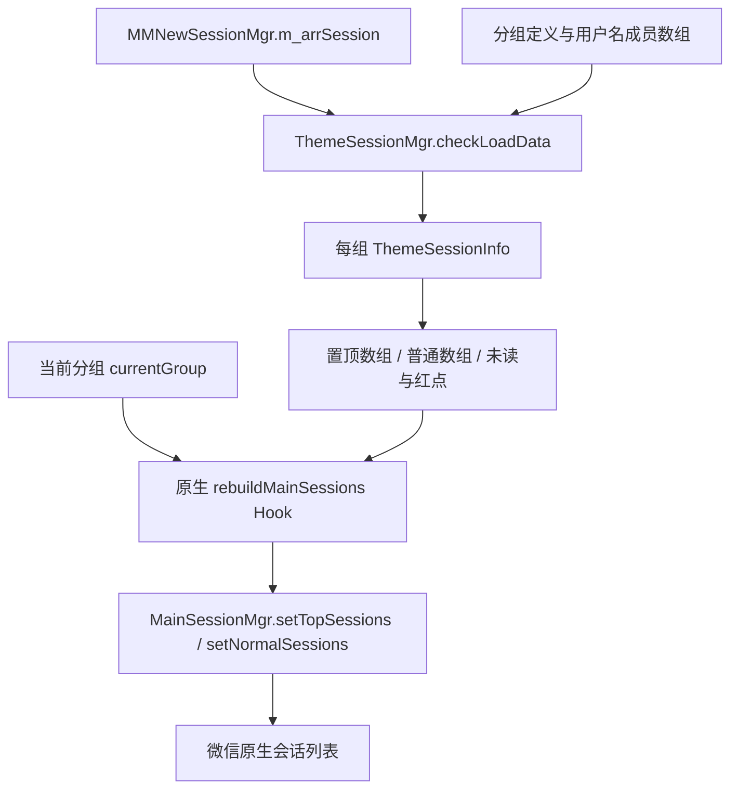
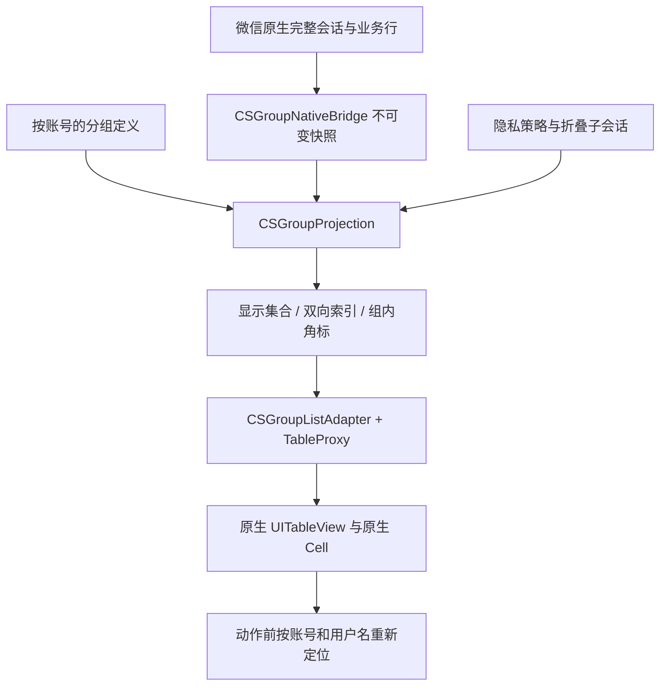

# ThemeBox 与 WeChatImprove 聊天分组实现对比

日期：2026-11-02，Asia/Shanghai。结论来自指定二进制的静态检查和当前项目源码检查。

**主要结论：ThemeBox 在原生会话管理器重建后，将当前分组的会话集合写回原生列表缓存；WeChatImprove 保留原生集合，通过不可变投影及双向索引映射改变列表展示。建议保留项目现有架构，优先收敛刷新调度、缩小消息变化后的取数与发布范围，再扩展分组功能。**

## 范围、来源与结论边界

- 插件：`/Users/zhangshichao/Downloads/Telegram Desktop/ThemeBox.dylib`，Mach-O arm64 动态库，SHA-256 `29d69aa8f608fee5317370275b8b029d4eb0428373f754a817dd55740aa8f3d9`。
- 项目：`/Users/zhangshichao/Documents/Workspace/WeChatImprove`，HEAD `189054633f7fb813ac3b03f7110f482ecaad9ffe`。检查时核心 `CSGroup*`、`WESessionTab*` 与 `SessionGroupHooks.xm` 相对 HEAD 无改动；其他正在进行的工作没有改写。
- 使用 reverse-engineer-anything 技能。REA Objective-C 元数据证据：`ev_53c9987d7697f5de00238e681579c34ffc3ed2b4ac2691d461a807f4f1617516`。其 Objective-C 类、方法、ivar 元数据覆盖完整；Swift 部分能力不在本次结论范围内。最初较小记录 `ev_3c599f7a997b02159cf655bead3876829330dafc4d0696f394a4985537860ea5` 因记录上限只有部分覆盖，不作为“全部类”证据。
- 对混淆字符串进行了静态常量折叠，结合 ARM64 调用参数、selector 与 Objective-C method list 核对关键链路。地址均为该二进制静态 VM 地址，镜像基址为 0；运行时地址还需加 ASLR slide。
- Ghidra 默认分析和伪代码请求均超过 600 秒超时，没有得到可用的完整伪代码。下文的语义整理不是原作者源码；未完整恢复的控制流和统计公式明确保留未知。
- 没有加载、执行或注入该 dylib，没有启动/重启微信或项目服务，没有读写真实聊天数据库、账号配置。没有进行真机 FPS、CPU 或耗电对照；不能据此判断哪一个实际更省电。
- 本次新增分析报告和静态证据，未修改产品代码；没有运行项目测试，因此不报告新的测试通过数量。

## ThemeBox 的实现链路



### 1. 分组模型与预设

元数据确认三个主要对象：

| 对象 | 已确认字段或方法 | 作用 |
| --- | --- | --- |
| `ThemeSessionGroup` | `name: NSString`、`type: NSString`、`value: NSMutableArray`、`sessionInfo: ThemeSessionInfo` | 定义分组及其运行时结果 |
| `ThemeSessionInfo` | `topSessions`、`normalSessions`、`unReadCount`、`redDotCount`、`showRedDot` | 保存组内会话和角标 |
| `ThemeSessionMgr` | `sessionGroups`、`lastCheckLoadDataTime`、`checkLoadData`、`currentGroup` | 加载定义、重建缓存及选择当前组 |

`+[ThemeBoxUtil defaultGroups]`（`0xbcedd0`）的静态常量及字典构造参数还原出：

| 名称 | type |
| --- | --- |
| 全部 | `all` |
| 私信 | `chat` |
| 群聊 | `room` |
| 企业号 | `openim` |
| 服务号 | `brand` |

自定义成员判定在 `-[ThemeSessionMgr isSession:belongToCustomGroup:]`（`0xc275cc`）中直接读取 `group.value`、`session.m_nsUserName` 并调用 `containsObject:`。其核心语义为：

```objc
// 根据机器码整理的核心判断，不是原始源码。
return [group.value containsObject:session.m_nsUserName];
```

因此自定义组核心是显式用户名名单。`NSMutableArray` 的 `containsObject:` 需要搜索成员；不能仅凭该函数断言整个插件没有其他辅助缓存。

配置读写也已追到：`ThemeBoxConfig.sessionGroups` 使用固定 `MAIN_SESSION_GROUPS` 键，defaults 由 `ThemeBoxMgr` 以固定 suite `com.tencent.themebox` 初始化。这条链没有显式按微信账号构造键或存储域。它与项目明确的 accountID profile 设计不同；尚未动态切换账号，不能排除其他未追踪代码替换 defaults 的可能。

### 2. 从原生完整会话源生成分组缓存

`checkLoadData`（`0xc18e38`）中已核对的调用包括：

- `getServiceWithClassName:` 的参数静态恢复为 `MMNewSessionMgr`，随后 `valueForKey:` 的参数为 `m_arrSession`，再经 `arrayWithArray:` 复制容器（调用点 `0xc212ac`、`0xc212cc`、`0xc212f8`）。这给出了真实输入源，超出了“看到某个类名字符串”的证据强度。
- 重置/设置每组 `sessionInfo`，遍历源会话，读取 `isHidden`，调用 `isChatRoomSession:`、`isChatSession:`、`isOpenImSession:` 等分类方法。
- 按 `m_bIsTop` 分流到 `topSessions` 与 `normalSessions`；自定义组调用上述成员判断。
- 读取 `m_uUnReadCount`、`m_bShowUnReadAsRedDot`，维护 `unReadCount` 与 `redDotCount`；也读取 `m_uAtAllCount`、`m_uAtMeCount`、转账、AA 等额外提醒字段。
- 有 `filterRepeat` 分支；其所有预设/自定义组之间的排除范围尚未完整恢复，不与项目“筛重”语义画等号。
- 在结果发布阶段读取原生 `GetTotalUnreadCount`，并通过 `ThemeBoxSegmentedViewUpdateBadgeNotification` 发送角标更新，userInfo 中出现 `index`、`number`、`red`。

`lastCheckLoadDataTime` 附近存在以 **0.3 秒**为阈值的时间差比较：`0xc18ed0` 加载 double 0.3，`0xc20194` 读上次时间，`0xc2021c` 相减，`0xc20220` 比较。由于混淆控制流未完整恢复，只能确认“有 300ms 时间门控”，不能据此声称它必然保留末次事件、永不丢刷新，或比项目的 80ms 合并更优。

额外提醒字段的精确合并公式、普通免打扰与强提醒的优先级、红点清零边界尚未完全还原。不将“读取字段”直接描述为完整支持某项产品行为。

### 3. 将当前组接入原生列表缓存

`rebuildMainSessions` 的替换实现位于 `0x4d124`。关键链路为：

1. 通过原 IMP 执行原生重建。
2. 检查分组开关、当前组类型及宿主页面条件。
3. 从 `currentGroup.sessionInfo` 获取分组结果。
4. 在 `0x4e5d8` 对原接收者发送 `setTopSessions:`，参数来自当前组置顶数组的 `mutableCopy`。
5. 在 `0x4ec50` 发送 `setNormalSessions:`。
6. 在 `0x4eebc` 发送 `setTotalTopSessionCount:`。

“全部”组绕过集合覆盖，保留原生重建结果；会话选择页面有额外保护。另有 `MMNewSessionMgr.foldSessionCount` Hook，在分组启用且当前组非 all 时返回该组 topSessions.count，配合列表边界。这里的函数名不能单独证明它具备项目对 ChatBoxMgr 折叠子会话的过滤、摘要和隐私语义。

Hook 注册、类名与分支细节见 `themebox-chat-groups-comparison-2026-11-02-evidence/hook-analysis.md`。这些调用说明它在原生模型/列表缓存层替换集合，影响当前原生列表看见的数据。它不等同于修改微信聊天数据库中的历史记录。

`updateMainSessionList`、`resortSessions`、`recountUnReadCount` 的 Hook 也接入 `checkLoadData`。对内部重建、排序和计数入口的依赖，是这一方案的主要兼容性边界。

## 项目的实现链路



### 1. 数据定义和账号隔离

`WESessionTabItem` 的默认预设是“全部、群聊、私聊、服务”，自定义组使用 UUID 和 username 数组。没有独立“企业号”预设，不代表企业会话一定不可显示。

`CSGroupPreferences.m:81` 起读取 `com.wechat.enhance.chat_group.account_profiles[accountID]`；定义、顺序、隐藏、成员和筛重按账号存储。`135` 起的 selection key 单独存储当前组，点击标签不重写整个配置。`155` 起有 schema 校验、原始旧配置保留、账号 original/previous 备份、写后读回和失败恢复；`208` 起阻止过期编辑页覆盖新配置。这些属于配置保护，不能表述为数据库级崩溃事务保证。

分组 enabled、角标隐藏及外观等部分选项仍使用全局 Option key（`CSGroupListAdapter.m:42`），不是所有设置都按账号隔离。

### 2. 不可变快照和统一投影

`CSGroupNativeBridge.m:499` 起逐行读取原生会话，将用户名、类别、置顶、未读等复制成 Foundation 值，并复查 section/row 数量，拒绝不稳定快照。

`CSGroupProjection.m:210` 起构建并复用 `username → tabID set` 反向成员索引，避免每个会话逐个线性搜索所有自定义成员数组。`274` 起按原生顺序生成显示集合，同时生成未读统计和显示/原生路径映射。

例如原生列表为 A/B/C/D，当前组包含 B/D，则显示第 0/1 行对应原生第 1/3 行。回调通过代理转换；原生查 Cell、滚动、获取可见路径时反向转换。相关入口：`CSGroupInvocationMapper.m:31`、`CSGroupIndexScope.m:3`、`SessionGroupHooks.xm:253`。

编辑/异步确认使用账号、epoch、用户名和行类型再次解析当前位置，避免新消息重排后错开/错删会话（`CSGroupListAdapter.m:1259`、`1300`）。未知回调采取保守降级；当前会停用分组模式的原生预取，部分菜单/移动/预览不提供完整原生能力（`1426`、`1448`；Hook `99`）。

### 3. 未读、折叠、筛重与位置

- 数字和红点来自同一套归属规则；红点须同时有正未读，聚合行不盲目重复累计（`CSGroupProjection.m:68`）。非隐私时 All 数字优先原生总数（Adapter `972`），不能把各组角标相加当总数。
- 折叠群有按当前组过滤的子投影，并从组内可见候选选择摘要（Adapter `1032`）。隐私策略统一作用于列表、摘要和相关角标，账号/策略不稳定时安全收敛。
- “过滤重复会话”仅将已在自定义组的群聊/私聊从对应预设排除；All、服务与不同自定义组仍可重叠（Projection `307`）。
- 普通数据刷新已有 username/kind/相对偏移锚点。当前切组及聊天返回有意回顶部（Adapter `1523`、`1545`；Hook `78`），有测试明确要求。记住各组位置应作为可选行为。

### 4. 已有优化及其边界

已有账号/epoch/modelRevision 快照缓存、成员反向索引、不可变对象与映射复用、可见行更新、80ms 通知合并、离屏暂停、交互延后、有限恢复、独立角标源以及布局隐私准入证明缓存。不能把这些重复列为尚未实现。

但原生 modelRevision 失效后仍全量读取 native rows（Bridge `518`）；折叠群在每次 projectionForSections 中重新读取并以 previousProjection:nil 构造（Adapter `1040`）。对象/映射复用减少分配，不会自动消除全量私有 getter 调用。

## 两种实现各自的优缺点

| 维度 | ThemeBox | 当前项目 |
| --- | --- | --- |
| 过滤发生的位置 | 原生管理器列表缓存层，写入当前组数组 | 展示投影层，保留原生完整集合 |
| 原生坐标 | 原生列表直接消费筛选后的集合，减少双坐标边界需求 | 维护 display/native 两套坐标，适配代码更多 |
| 与宿主的耦合 | 依赖重建/排序/计数入口及数组、总数的一致性 | 依赖 UITableView 回调、反向查询、生命周期和私有 accessor |
| 自定义成员 | 已确认 value 数组 containsObject 用户名判断 | 静态用户名名单，加反向索引及结构复用 |
| 预设划分 | 独立 openim 企业号组，5 个预设 | 全部/群聊/私聊/服务共 4 个预设；无独立 openim 规则，企业会话按现有原生标记归类 |
| 运行时结果 | 可变组内 top/normal 数组与统计缓存 | 不可变行、投影、双向映射与统计 |
| 操作安全证据 | 所查路径未建立与项目相当的账号/epoch/异步动作验证证据；不能推断整个插件都没有 | 明确按稳定身份重解析，保护重排/删除/账号切换 |
| 配置保护 | 所追链路使用固定 suite + MAIN_SESSION_GROUPS 键，未见显式账号隔离；未证实与项目同等的版本/备份/冲突保护 | 有按账号 profile、稳定 ID、显式旧配置导入、备份及保存校验 |
| 交互兼容代价 | 集合替换可能使其他消费者读到当前组数据，需核验宿主内部不变量 | 不改完整原生集合，但部分未知回调、预取和预览需降级 |
| 性能结论 | 有组缓存及时间门控；没有真机对照数据 | 已有多层缓存，但刷新调度、全量取数和整表回退仍可优化 |

ThemeBox 的优势是路径直接、原生列表可直接复用分组后的数据，以及企业号等分类更细。其主要风险是将“当前显示组”写入宿主原生集合后，重建、未读、置顶、导航、编辑等消费者需要保持一致；微信私有实现变化时需要重新验证。数组成员匹配在大成员名单下也有可优化空间。上述是结构性取舍，不能直接推导它实际更快、更慢或存在某个已复现错误。

项目的优势是分层、稳定身份与账号隔离比较完整，列表、折叠、角标和隐私可使用统一规则，已有可复用的纯数据测试边界。其成本是坐标适配面大，Adapter 职责多，保守兼容回退较多，以及模型失效后仍存在主线程全量工作。

## 建议的优化顺序

### P0：先保证调度能收敛，再扩大缓存

当前 `requestCoalescedRefresh` 只在调用栈里临时设置 coalescingNotification（Adapter `1159`）；若 publishing 中 scheduleRefresh 先返回（`1115`），finally 会清掉该标记，随后发布收尾 `1006` 的调度可失去原本 80ms 语义。`scheduleRefresh` 自身还会无条件置 dirty（`1112`）；`endNativeChangeCoalesced` 在未配对的零深度 end 时也可能调度（`1178`）。

建议把 pending 原因、首次事件截止时间、即时优先级和发布 generation 保存为持久状态；调度只安排已有工作，不创造新的数据变化；只在事务深度真实从 1 降到 0 时唤醒。普通消息在重入后继续合并，账号/锁定/可见前隐私变化保持即时安全处理。

这与仓库已有 `chat-groups-close-friends-performance-2026-11-02.md` 的有界回放证据一致。本次没有重跑该实验，也没有将其历史设备数据当成新测量。

### P0：把“谁变了”传下去，收窄发布范围

Hook 已收到 contact/session，但 `NativeNotification` 只传 kind（Hook `48`、`104`、`211`）。应增加 pendingChangedUserNames，并区分内容、未读、顺序、成员及未知结构变化。

先做结构稳定情况下的局部更新：重读/校验受影响会话，更新对应不可变行，按成员反向索引修正组角标，只更新相关可见 Cell。新消息可能改变排序，不能一律当成“只改文字”；无法证明结构稳定时继续全量回退。

当前只要投影任意位置出现匿名、业务或聚合行，就禁用增量（Adapter `1015`）；即使聚合行不在屏幕内，也会放大无关消息的更新成本。应追踪特殊行自身的身份、内容和几何变化，使稳定特殊行不阻止普通行局部更新。Content/Structure 当前还会更新全部可见行（`1025`），且每次发布强制 layoutIfNeeded（`1029`）；普通角标/文字变化可减少同步布局。

### P1：拆分失效版本，缓存折叠源与各组结果

建议分离 native model、分组定义、隐私策略、外观及纯选中状态：改名/配色不应重采原生会话，切组复用同版本的分组路径与角标，纯未读不重算类别归属。

折叠源按可靠的数据版本缓存，不能只用 NSArray 指针或数量证明内容未变。缓存键保留 account/epoch/model/folded/definition/privacy 版本；账号或隐私边界必须废止旧安全证明。先测量，再决定是否把快照之后的纯 Foundation 计算搬到后台；不把微信私有模型读取直接移到后台线程。

### P2：扩展分组能力并说清现有语义

- 可参考 ThemeBox 增加独立企业号组，或提供可配置的预设类别。需先核验当前微信 openim 分类入口，避免仅按名称或用户名猜测。
- 在保留 UUID 和静态名单的基础上增加 rule + include/exclude：如未读、置顶、免打扰、企业联系人、动态联系人标签。当前“按标签选成员”是选人入口，不等同于标签后续自动同步。
- 增加“未分组”比悄悄将所有自定义组改为互斥更清晰；说明筛重仅影响群聊/私聊预设。重叠组的未读不能相加。
- 可选“切组/返回保持位置”，复用现有身份锚点并保留当前默认回顶行为。
- 加微信版本/selector ABI 能力诊断，逐步以稳定身份支持必要的预取和异步菜单回调；不要为追求表面兼容而转发捕获旧 indexPath 的未知闭包。
- 修复 `CSGroupPreferences.m:238` 的 setFilterDuplicates 忽略保存结果、设置页 `CSChatGroupSettingsViewController.m:336` 缺失败反馈的问题。

## 后续实施的验证口径

先在隔离数据中比较全量和增量结果等价，覆盖重排、置顶、删除、折叠成员变化、重复用户名、组间重叠、账号切换、保存失败、锁定/解锁及菜单延迟确认。调度测试覆盖 publishing 中重入，不能只测普通 80ms 通知。

真机再记录静置、消息突发、切组、进入聊天/返回、搜索、侧滑菜单、小程序返回和隐私切换；对 snapshot、projection、publish 分段记录耗时、P95/P99、每秒刷新/重载/强制布局次数及操作停止后的回落时间。CPU 与自然放电耗电分别验证，不把 CPU 百分比直接换算为续航。

本轮已回答主要架构、数据模型、接入方式、项目差异及优化方向；ThemeBox 的完整提醒公式、全部筛重分支、时间门控最终控制流以及两者实际设备性能仍为未完成验证项。
